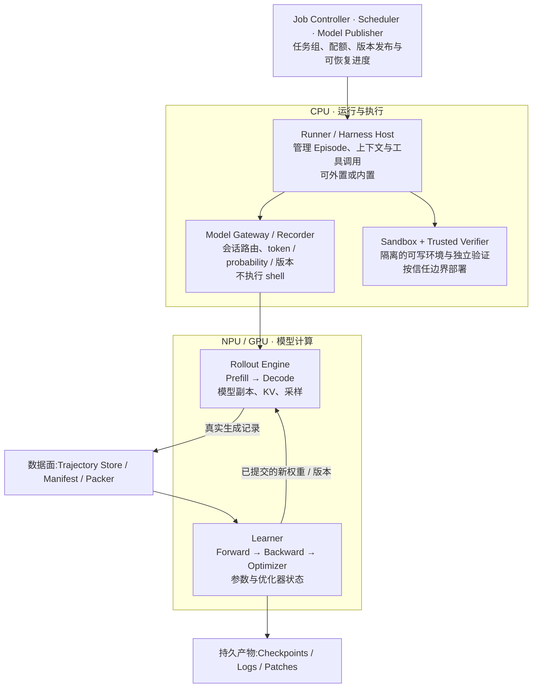
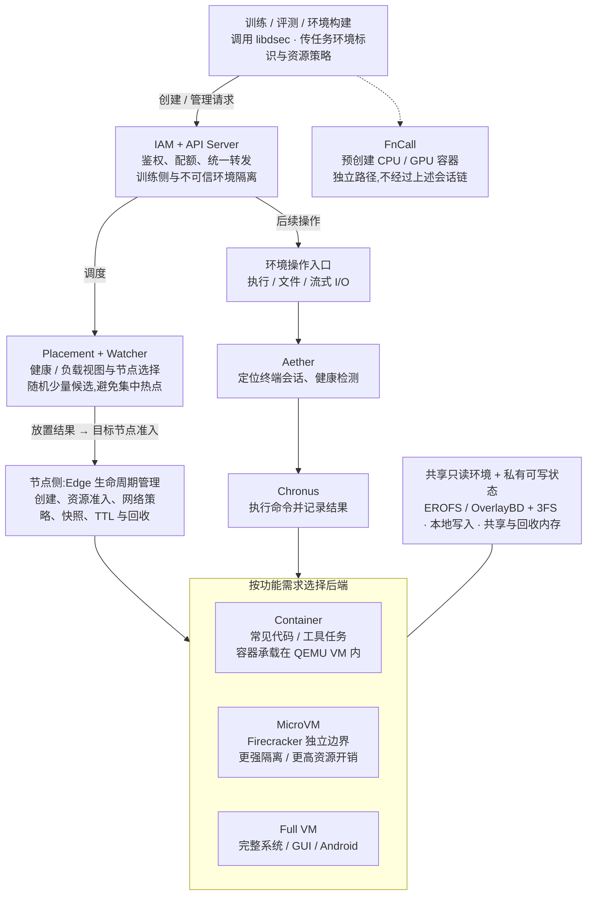
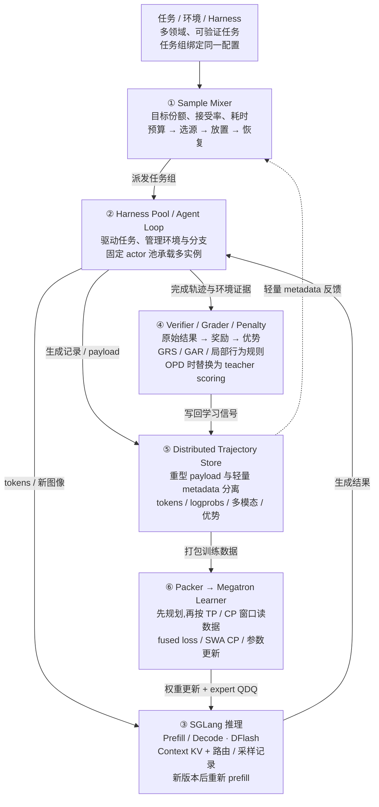
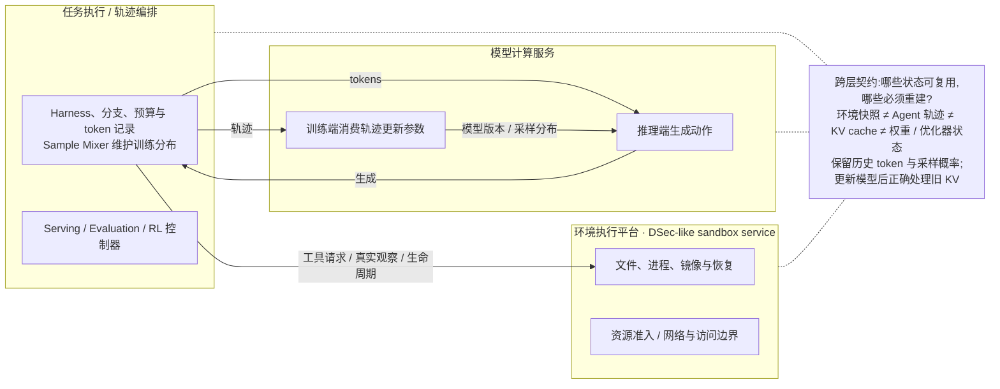

# Dispatch 46 · DSec 与 MiMo-V2.6:Agentic RL 系统原理与工程实施

*2026-10-22 · NPU Frontier Dispatch · agentic-RL / RL-infra / sandbox / training–inference consistency / RL-on-NPU*

> **TL;DR** — 两篇 2026 年 9 月的一手报告分别守住了 agentic RL 的两端:**DeepSeek 的 DSec**(arXiv:2609.22978,DeepSeek-AI 与清华)解决**环境执行成本**——有状态沙箱长期存活、CPU 却只间歇忙碌(约 90% 的沙箱平均 CPU 用量不超过申请额度的 5%),单个作业可突发申请 32K 个沙箱,一个 scale unit 每天服务约 300 万个沙箱、峰值并发约 38 万、创建速率超过每秒 5,000;**小米的 MiMo-V2.6 RL 技术报告**解决**经验的可用性**——每步 1,568 个 prompt × 16 次采样、27–37 亿训练 token,Pro 一轮 RL 花费 260 万美元,靠 Harness Pool、Payload Porter、Sample Mixer 和"权重量化 / 路由 / 采样候选集"三层训推对齐把这些经验正确地送进梯度。本篇的主线是**把两篇论文的机制翻译成一套可分阶段落地的工程方案**:先闭合"任务—动作—验证—更新—发布"一次学习循环,再扩并发;把环境、轨迹、KV、训练四类状态的所有权分开——**参数更新后旧 KV 必须重建,旧的行为 logprob 必须保留**;把"执行完成 / 任务通过 / 轨迹可训练"分成三个判断;按 t·B/r 而不是按派单数调度混合数据源;Actor:Rollout 分卡用供需测量而不是固定比例;并给出 18 项契约与故障测试。对本站主线:**两篇论文都没有在昇腾上验证过**——DSec 的实验平台是 AMD CPU 与虚拟化、GPU FnCall 用 NVIDIA MIG,MiMo 用 SGLang、Megatron、CUDA streams 与 MXFP4 kernel——迁移只能按能力逐项验收,不能按项目名打勾。

本篇性质:**工程精读篇,底稿为站长提供的《DSec 与 MiMo-V2.6|Agentic RL 系统原理与工程实施》工程版(2026-10-22)**。本站保留了底稿的全部 56 个章节、表格、公式与原文章节页码引用(〔…〕内),只做了三件事:

1. **逐条核验**。底稿内嵌了两篇论文的原始 PDF(哈希与其声明值一致),本站据此对照原文核对了 66 处承重数字,**全部吻合**;底稿自己标出的 MiMo-V2.6 Table 1 中 Pro 激活参数写作"42T"(引言为 42B)的笔误,在原文中确认存在。详见文末「本站核验」。
2. **格式转换**。底稿的四个交互计算器与一段交互时序改为按其默认参数计算的静态算例与表格;三幅"架构简图"与一幅部署组件图改为本站 Mermaid 图(图 1–4)。
3. **图与原文的处理**。底稿内嵌的两篇论文完整 PDF 与 30 幅论文原图,**本站未转载**:两篇论文在本环境都查不到可核实的再发布许可,这与本站 D44、D45 弃用许可不明原图的规则一致。每处原图位置保留了底稿对该图的解读与适用范围,并注明原文图号与页码。

承接 D29(DeepSeek Harness 与 DSec 初见)、D33(verl)、D36(沙箱执行层)、D43 / D44(自进化与把关)、D27(低比特训练)。

---

## 概述 · Agentic RL 的执行层与学习层

*Agentic RL 的扩展同时受环境执行成本和训练数据质量约束。DSec 侧重前者，MiMo-V2.6 则将轨迹、调度、奖励和模型更新组织为统一的训练流水线。*

Coding Agent 在仓库中读取代码、调用工具、修改文件并运行测试，根据执行反馈继续决策。一条轨迹因此同时依赖模型计算与持续存在的执行环境。轨迹完成后，verifier 或 grader 评价结果，训练器再利用一批经验更新策略。**多轮环境交互与模型参数更新是两个不同的循环。**〔DSec · §1 · pp.2–3〕〔MiMo-V2.6 · §4.1 · pp.8–9〕

| 层次 | DSec 的重心 | MiMo-V2.6 的重心 |
|---|---|---|
| 任务执行 | 沙箱后端、会话、环境状态、权限和回收 | Agent Loop、多 Harness、任务与上下文组织 |
| 数据与存储 | 基础镜像、workspace、可写磁盘和运行快照 | token、logprob、路由、多模态 payload、reward 与 advantage |
| 调度目标 | 节点容量、创建突发、CPU / 内存效率、隔离 | 训练目标份额、有效组供给、长尾与 KV 容量 |
| 学习 | 不实现 GRPO loss 或 learner | GRPO、GRS / GAR、行为正则、训推一致性、OPD |

**两项工作的差异来自主要约束的不同。**DSec 面对的是大量长期存活、资源需求间歇变化的环境，重点降低状态保留与执行成本；MiMo 面对的是大量异质轨迹及其学习信号，重点稳定样本供给、概率记录和参数更新。环境执行效率影响可获得的经验量，而经验的有效性又取决于训练系统如何记录、过滤和使用这些结果。

> **分析**:两项工作的共同问题是如何在长程交互中同时维持状态正确性与资源效率。DSec 降低有状态环境的驻留与恢复成本，MiMo 保证这些环境产生的经验能够按预定分布、真实采样记录和可信奖励进入训练。两者具有互补性，但并不是可以直接互换的软件层。

## 一 · 工程实施(E01–E18):接口、状态与验证

### E01 · 目标系统：先闭合一次学习循环，再扩大规模

*把“类似 MiMo 的 RL infra”定义为一条可验证的流水线：**同一任务产生多次隔离尝试，保留实际采样记录，经可信验证组成训练组，交给 Learner 更新，再把新版本发布给生成服务。** 大规模并发、混合数据源与 partial rollout 是这条流水线的扩展，不是最初的前置条件。*

#### 最小闭环与生产级扩展

| 层次 | 第一版必须具备 | 暂不作为第一版目标 |
|---|---|---|
| 环境 | 一个可复现 Linux 环境；每次尝试独立可写状态；停止和超时清理 | 32K 创建突发、四种后端、跨云扩容 |
| Agent | 一个可控 Harness；有限回合、命令超时、任务结束判定 | 多 Harness、子 Agent、复杂压缩 |
| 推理 | 一种已验证后端；实际 token IDs、概率口径、固定模型版本 | MXFP4、R3、候选集重放、跨版本 KV 优化 |
| 数据 | 任务组、episode、上下文和生成记录可追踪；完整组验收 | 分布式 CP/TP 按窗口读取 |
| 学习 | 一种训练配方；固定任务集；小批次同步更新 | 全异步、复杂组级 grader、MOPD2 |
| 发布 | 更新完成后才能接纳新版本请求；记录实际执行版本 | 无停顿热切换、训练卡动态转推理 |

**建议起点：外置的最小 Coding Harness + 一个容器后端 + verl 原生 AgentLoop + 已可运行的 NPU 推理服务。** 这是一种集成方案，不是 MiMo 内部生产拓扑的复刻。采用现成黑盒 Harness 时，再考虑 Uni-Agent Gateway 这条接入路径；两条路线应在轨迹契约层汇合，而不必先叠加两套 Agent Loop。

> **第一阶段完成标准**:能回答：这条训练记录来自哪次任务尝试？模型实际看到了什么？为什么得到这个奖励？谁更新了参数？下一次请求是否确实使用了新权重？任一问题没有可核查记录，都还不适合扩大并发。

MiMo §6 把轨迹组织、运行承载、数据搬运和模型计算分开设计；DSec 则提供可持续执行的环境。两者的交集是执行状态与学习数据，而不是必须使用相同的容器、同一套 Actor 或相同的存储实现。〔MiMo-V2.6 · §6 · pp.26–33〕〔DSec · §9–10 · p.25〕

> **设计要点**:实现目标是一条可追溯、可恢复的学习流水线。先闭合“任务—动作—验证—更新—发布”，再扩大并发和引入异步。

### E02 · 先确定对象：Task、Prompt、Episode 与训练记录

*这些名词要分成两类：**数据对象有包含关系；系统组件有调用和部署关系。** 把它们混成一棵树，会直接影响并发估算和 GRPO 分组。*

#### 数据对象的关系

```text
TaskSpec：一道任务的稳定身份
  ├─ task_prompt：任务说明
  ├─ environment_ref：仓库与依赖快照
  └─ verifier_ref：独立验证规则

Group：本次针对同一 Task 的 G 次尝试
  ├─ Episode 0 / 一次 rollout
  │    ├─ Context main
  │    │    └─ Segments：输入 → 模型生成 → 工具观察 → …
  │    └─ Context child（需要时）
  ├─ Episode 1
  └─ Episode G−1

一次 Episode 的执行记录 → 一条逻辑 trajectory
导出给训练器时 → 可能成为一个或多个 context/chain 记录
```

这里用 **Episode** 指“一次独立任务尝试”，以避免与不同框架中 `Sequence`、`trajectory` 的实现命名冲突。MiMo 的原始层级是 **Sample → Sequence → Context → Segment**：Sequence 对应一次 Agent Loop 执行，Context 是分支、KV 复用和训练导出的单位。〔MiMo-V2.6 · §6.1 · p.27〕

#### 两种 Prompt 不要混淆

**Task Prompt** 是“修复这个 issue”。**模型请求的 prompt** 是当前这一轮的实际输入，可能包含系统消息、任务说明、先前动作和工具结果。一个 Task Prompt 能产生 G 个 Episode，每个 Episode 又可能产生几十次不同的模型输入。推理请求数不能拿来当训练组数。

| 身份字段（建议） | 区分什么 | 重试／重启时的规则 |
|---|---|---|
| `task_id` | 数据集里哪一道任务 | 不随采样变化；配合 task_version |
| `group_id` | 同题的哪一组采样 | 同题下一次重新采样使用新组 ID |
| `episode_id` | 这一组中的哪一次尝试 | 独立奖励与可写环境；禁止用 context 数替代 |
| `attempt_id` | 发生基础设施失败后的执行尝试 | 重试生成新 attempt；最终只提交一个选定结果 |
| `context_id` / `segment_id` | 哪个对话分支、哪次输入或输出 | 保留亲缘关系及有效训练区间 |
| `generation_id` / `command_id` | 哪次模型生成、哪条工具命令 | 用于去重、故障查询与概率对齐 |
| `sandbox_id` / `session_id` | 运行在哪个环境、通过哪个模型会话 | 是资源句柄，不替代 episode 身份 |

**重要：一组四个 Episode，不应因为其中一个 Episode 导出三个 Context，就变成六个独立 GRPO 候选。** 组级奖励先按 Episode 计算；每个 Context 如何继承学习信号、重叠前缀如何避免重复计权，由训练适配器明确处理。MiMo 的层次定义与“Context 是导出单位”支持这一建模方向，但论文没有给出一个可直接照抄的通用多分支权重公式。〔MiMo-V2.6 · Trajectory Hierarchy · p.27〕

#### 数量关系算例

所有输入都是说明性工作负载。它只计算任务数，不推算模型显存和吞吐。（原稿此处为交互计算器，本站改为按其默认参数计算的静态算例。）

| 输入 | 取值 |
|---|---|
| 不同任务／Prompt 数 B | 8 |
| 每题尝试数 G | 4 |
| 同时活跃 Episode 上限 C | 16 |
| 每次尝试平均模型请求数 | 5 |

| 输出 | 结果 | 说明 |
|---|---|---|
| 逻辑 Episode / Rollout 数 | 32 | 8 组 × 每组 4 次尝试 |
| 模型请求数（按输入均值） | 160 | 不是新的训练组，也不是卡数 |
| 活跃环境上限（简化场景） | ≤ 16 | 每 Episode 一环境、无重试与子环境时 |

最终训练记录条数仍取决于 Context/chain 导出规则；NPU 卡数、Ray Host 数及真实并发需要单独规划。

> **设计要点**:Prompt、Episode、Context 和训练记录是不同计数单位。GRPO 分组依赖逻辑尝试身份，不能由导出记录行数反推。

### E03 · 谁运行在哪里：进程部署与状态归属

***Harness 管决策循环，Sandbox 管执行环境，模型引擎管生成，Learner 管参数更新。** 但“负责什么”不自动决定“位于哪台机器、哪个进程”。一个 Harness 可以在 Sandbox 内运行，也可以通过远程执行 API 控制它。*



*图 1 · 本站图(据原稿 E03「建议部署」组件图重绘)。控制、执行、计算分开,逻辑状态通过 ID 关联。物理资源布局可选:同步共卡建立基线,分池异步在后续阶段启用。*

| 组件 | 典型部署位置 | 拥有的状态 | 不应承担的职责 |
|---|---|---|---|
| Job Controller / Scheduler | 稳定 CPU 服务 | 组目标、待执行队列、配额、版本发布记录 | 汇聚全批轨迹张量 |
| Harness / Episode Runner | CPU 进程，或 Agent Sandbox 内 | 决策进度、工具协议、结束条件 | 模型反向传播 |
| Model Gateway / Token Recorder | 可信 CPU 服务 | 会话路由、真实 token、版本与概率记录 | 编译仓库、直接执行 Agent shell |
| Sandbox backend | 隔离 CPU 执行池 | 文件、依赖、进程、命令执行状态 | 决定策略优势或持有训练集群密钥 |
| Rollout Engine | NPU/GPU 推理池 | 权重副本、KV、采样器状态 | 保存仓库全部文件 |
| Verifier | 独立受信服务／环境 | 测试规则、结果与证据 | 暴露隐藏测试或参考答案给 Agent |
| Trajectory Store / Packer | CPU/存储与训练消费侧 | 不可变 payload、manifest、分片计划 | 用记录数量替代逻辑 episode 数量 |
| Learner / Model Publisher | NPU/GPU 训练池与控制服务 | 参数、优化器、训练进度、发布状态 | 在未完成发布时宣告新版本可用 |

这是面向实现的职责划分。DSec 原文确认 worker container 与 agent sandbox 在可抢占 GPU 池外共同保留 rollout 状态；MiMo 则描述模型侧 Agent Loop 与环境侧 Harness 的独立池化。**两篇论文不能简单合并成一张已经存在的联合部署图。**〔DSec · §6.2 · p.18〕〔MiMo-V2.6 · §6.2 · p.28〕

Kubernetes/Ray 可以承载这些组件，但不会自动解决业务一致性。进程重启并不等于恢复了上一条命令结果，也不等于一次模型更新已经提交。第一版可先用少量稳定进程完成正确性闭环，再把进程迁移到集群编排层。

> **设计要点**:职责与位置分开描述：Harness 可以在环境内外，模型权重与计算缓存归引擎，运行副作用归 Sandbox，学习进度归 Learner。

### E04 · Sandbox 与 Harness：两种部署、三条通路

*这是最需要分清的接口边界：**“Harness 调用工具”是一种逻辑行为；工具究竟是本地子进程，还是经远程 Sandbox API 执行，要看 Harness 的部署方式。***

#### DSec 确认了什么

DSec §3.3 描述外部访问 Container/VM 的运行接口：请求经 API Server、Edge、Aether 到达 Chronus；Aether 管理终端会话对应的 Chronus 实例，Chronus 提供命令、文件、HTTP 与流式 I/O。FnCall 走独立路径，不使用这套 Aether/Chronus 会话链。〔DSec · §3.1 · p.7〕〔DSec · §3.3 · p.8〕

§6.2 又描述 V4.1 的状态解耦：**worker container 控制 rollout，agent sandbox 内运行 scaffold（例如 DSH）与工具**。因此不能进一步推断“DSH 每一次本地文件编辑都必须绕一圈 DSec ingress 和 Chronus”。原文没有披露 DSH 内部所有工具的具体传输协议，也没有给出其模型 Gateway 的完整认证和恢复协议。〔DSec · §6.2 · p.18〕

#### 交互时序：两种部署方案

**方案 A · Harness 在沙箱外。** 外置 Harness：Agent 循环在可信 CPU Runner 中，工具经 Sandbox Adapter 远程执行。模型调用走独立 Gateway，不通过 shell 执行通道。

| 步骤 | 发送方 → 接收方 | 操作 | 说明 | 示例字段 |
|---|---|---|---|---|
| 1 | Controller → Runner | 派发 Episode 与版本 | 锁定 task、环境和 Harness 版本；创建组内独立 episode。 | `{"group_id": "g07", "episode_id": "ep07-2", "task_id": "task-parser", "policy_version": "v42"}` |
| 2 | Runner → Sandbox service | 申请隔离环境 | 按任务 snapshot 创建独立可写状态，等待 ready；不上传整个环境给模型。 | `{"operation": "create", "environment_ref": "env-parser-v3", "lease_seconds": 1800}` |
| 3 | Harness → Model Gateway | 发送本轮上下文 | 绑定模型会话；Gateway 编码并保留真实 token。 | `{"session_id": "s07-2", "context_id": "main", "messages_ref": "observations/turn0", "required_policy_version": "v42"}` |
| 4 | Gateway → Rollout Engine | 生成下一步动作 | 推理引擎返回原始生成 IDs、logprob 与实际策略版本；Gateway 再解码工具调用。 | `{"generation_id": "gen01", "actual_policy_version": "v42", "output_ids_ref": "payload/gen01/tokens", "behavior_logprobs_ref": "payload/gen01/probs"}` |
| 5 | Harness → Sandbox exec API | 执行工具命令 | DSec 外部接口的逻辑路径是 ingress → Edge → Aether → Chronus。自建 backend 可用等价接口；不要在 Gateway 本机执行 Agent 命令。 | `{"command_id": "cmd01", "argv": ["python", "-m", "pytest", "-q"], "cwd": "/workspace/repo", "timeout_seconds": 120}` |
| 6 | Sandbox → Harness | 返回观察与执行状态 | stdout 与退出码保留为事实；模型看到的截断结果也要记录。测试失败不等于基础设施失败。 | `{"command_id": "cmd01", "state": "completed", "exit_code": 1, "stdout_ref": "artifact/cmd01/stdout", "observation_kind": "tool", "loss_mask": 0}` |
| 7 | Verifier / Recorder → Trajectory Store | 验证并最终化 | 奖励证据与 payload 都完成后，才发布可交接的 episode manifest。 | `{"episode_id": "ep07-2", "reward_finalized": true, "payload_status": "ready", "manifest_revision": 1}` |
| 8 | Group assembler → Learner | 收齐组后训练 | 按 episode 计算组信号，按 context 组织训练数据；保存 checkpoint 和发布记录，完成闭环。 | `{"group_id": "g07", "expected_episodes": 4, "ready_episodes": 4, "next": "learner_update_then_publish"}` |

**方案 B · Harness 在沙箱内。** 内置 Harness：Worker 负责外部 rollout 控制，Harness 与工具运行在 Agent Sandbox。模型请求仍然连向共享推理服务；本地工具不必反复穿过外部 Sandbox ingress。

| 步骤 | 发送方 → 接收方 | 操作 | 说明 | 示例字段 |
|---|---|---|---|---|
| 1 | RL Controller → Worker Container | 派发 Rollout | DSec 论文中，Worker 与 Agent Sandbox 都位于可抢占 GPU 作业之外。这里以独立 CPU 控制层表示。 | `{"group_id": "g07", "episode_id": "ep07-2", "task_ref": "task-parser"}` |
| 2 | Worker → DSec / Sandbox | 创建并启动 Harness | 通过管理/执行接口准备环境并启动 Agent 程序。Toolkit 是软件分发层，启动后才成为 Harness 进程。 | `{"environment_ref": "env-parser-v3", "toolkit_ref": "harness-v2", "operation": "create_then_launch"}` |
| 3 | Worker → Harness 配置 | 注入会话级模型端点 | 这是建议的接线方式，原文未披露 DSH 的完整模型 Gateway 协议。会话凭据只允许本 Episode 的模型使用。 | `{"session_id": "s07-2", "model_endpoint": "<session-scoped-gateway>", "credential_scope": "episode-only"}` |
| 4 | Harness（沙箱内） → Gateway → Rollout Engine | 请求模型生成 | 输入是任务与可见观察，不是环境镜像。模型服务仍在 NPU/GPU 侧。 | `{"context_id": "main", "generation_id": "gen01", "required_policy_version": "v42"}` |
| 5 | Harness（沙箱内） → 本地 Tool / 子进程 | 执行文件操作或测试 | 局部工具可直接访问 Sandbox 内文件系统。是否调用 Chronus 取决于工具实现，DSec 论文未规定所有内部动作走 Chronus。 | `{"command_id": "cmd01", "execution_target": "sandbox-local", "argv": ["python", "-m", "pytest", "-q"]}` |
| 6 | 本地 Tool → Harness → Gateway | 读取结果、继续模型请求 | Harness 保留下一步控制状态；可信记录侧保存实际看到的观察与生成记录。 | `{"command_id": "cmd01", "exit_code": 1, "observation_ref": "artifact/cmd01/visible-output"}` |
| 7 | Worker / Verifier → 结果与轨迹存储 | 结束、验证与导出 | Worker 管理完整 lifecycle；正式奖励不能仅来自不可信 Agent 的口头汇报。 | `{"episode_id": "ep07-2", "artifact_ref": "patch/ep07-2", "verifier_ref": "verify-v3"}` |
| 8 | 故障分支：Trainer 恢复 → Worker / Sandbox | 可选：抢占后重连 | 该分支可发生在 RUNNING 阶段，不是完成验证后的必经步骤。对应原文 GPU 作业抢占的恢复动机；不意味着 CPU 节点故障下无条件恢复。模型新版本仍需要 KV 处理。 | `{"action": "reconnect", "preserve": ["agent_progress", "environment_state"], "rebuild_if_version_changed": ["model_kv"]}` |

交互时序是实施方案；组件位置与 DSec 原文对应，具体 JSON 字段和模型 Gateway 接线不属于 DSec 公布的 API。“示例字段”是接口语义示例，不是论文或上游框架的真实请求 Schema。（原稿此处为可逐步点击的交互时序，本站改为两张静态表。）

#### 三条通路必须分别设计

| 通路 | 谁调用谁 | 主要信息 | 必须解决的问题 |
|---|---|---|---|
| 生命周期控制 | Controller → Sandbox service | create、lease、status、stop；可选 pause/resume | 配额、准入、身份、超时、孤儿清理 |
| 模型调用 | Harness → scoped Gateway → Rollout Engine | messages 或 token IDs、采样配置；返回 token/工具动作 | 会话路由、版本、原始采样记录 |
| 工具执行 | 外置 Harness → exec API；内置 Harness → 本地工具或指定远端工具 | argv/script、工作目录、输入；返回 stdout/stderr/exit | 权限、命令幂等性、输出限额、执行状态 |

外置方式便于把可信记录器与不可信工具代码分开，是自研最小 Harness 的低复杂度起点。内置方式适合直接运行依赖本地文件系统的现成 Coding CLI，但要处理**会话凭据暴露、进程恢复与日志持久化**。两种方式都可以实现稳定 Agent 状态；物理位置本身不保证故障恢复。

**推荐选择规则：**可修改 Agent Loop 时先用方案 A；现成 Harness 难以改造、天然依赖本地工具时用方案 B。把两者隐藏在统一 Runner 接口后面，后续才有必要扩展 Multi-Harness。

> **设计要点**:外部 Sandbox 控制接口与内部 Harness 工具调用不是同一条通路。模型 API 是第三条独立通路；位置、身份和恢复协议必须明确。

### E05 · 从一道修复任务追踪到一次模型更新

*下面是一条**建议实现的执行时序**：任务是修复仓库中的空输入异常，组大小 G=4。所有 ID、预算和状态名都是接口示例，不是论文提供的配置。*

| 顺序 | 发起方 → 接收方 | 请求或产物 | 应写入的证据 |
|---|---|---|---|
| 1 | Scheduler → Runner | 同题四个 episode；冻结任务、环境和 Harness 版本 | group_id、expected_episodes=4、发布版本 |
| 2 | Runner → Sandbox | 为每次尝试申请独立工作区 | sandbox_id、环境 digest、资源限制 |
| 3 | Runner → Gateway | 创建模型会话，绑定 episode 和允许使用的模型 | session_id；短时且受限的凭据 |
| 4 | Harness → Gateway | 系统规则、任务说明、工具定义、可见环境信息 | 模型实际输入 token；不能只保存最终 messages |
| 5 | Gateway → 推理引擎 | token 输入和采样参数 | generation_id、实际 policy_version |
| 6 | 推理引擎 → Harness | 生成“读取 parser.py”的动作 | 原始输出 IDs、行为 logprob、finish reason |
| 7 | Harness → 工具执行侧 | 带 command_id 的 read/edit/test 操作 | stdout/stderr/退出码；执行是否已完成 |
| 8 | 工具侧 → Harness → Gateway | 结构化观察；按明确规则截断或引用长输出 | 模型实际看到的观察，mask=0 |
| 9 | Verifier → 结果存储 | 独立检查最终 patch 与测试 | reward、verdict、verifier_version、失败类别 |
| 10 | Recorder → 数据面 | 完成后的 episode manifest 与 payload 引用 | 校验和、长度、上下文关系、提交状态 |
| 11 | Group assembler → Learner | 四次尝试组成完整训练组 | episode 级奖励；mask 与 advantage |
| 12 | Learner → Publisher → Rollout | 参数更新与新策略发布 | checkpoint、发布 ACK、缓存失效记录 |

这个流程复用了 MiMo 中 Agent Loop 管理环境与轨迹、Payload Porter 分离轻重数据的思路，但没有假设 MiMo 使用上述具体服务或 REST 路径。〔MiMo-V2.6 · §6.1–6.2 · p.27〕〔MiMo-V2.6 · §6.2 · p.29〕

#### 沙箱建立后，究竟发什么给 NPU？

第一次发送任务和工具上下文；随后发送模型实际需要的工具观察与续接上下文。**不发送整个 Docker 镜像、完整仓库或沙箱内存。** 服务入口可能接收 JSON messages，真正的推理执行通常使用 token 与引擎元数据；这两层接口不能混写成“直接向 NPU 发 shell”。

```json
{
  "episode_id": "ep-07-2",
  "context_id": "ctx-main",
  "generation_id": "gen-0003",
  "required_policy_version": "policy-0042",
  "input_ids_ref": "payload://ep-07-2/context/main/input-0003",
  "sampling": {"temperature": 0.7, "top_p": 1.0},
  "max_new_tokens": 1024
}
```

上例是内部协议设计。推理引擎应回复**实际**使用的版本；不能让请求方写的 `required_policy_version` 直接冒充执行事实。第一版使用完整 token 前缀即可；前缀命中与增量传输是后续优化，不能靠省略历史来假装存在 KV。

#### 哪些信息不要进入 Agent 上下文

隐藏 verifier、参考 patch、全局管理凭据、其他 episode 的文件或轨迹都不应暴露给 Agent。环境供给和评测材料需要不同权限范围；即便模型最后通过测试，也要保留它是否访问了禁止信息的审计结果。DSec 与 MiMo 都将环境残留和非预期答案渠道作为任务完整性问题。〔DSec · §6.1 · p.17〕〔DSec · §6.4–6.5 · p.19〕〔MiMo-V2.6 · §4.2.6 · pp.15–16〕

> **设计要点**:从一次工具动作到训练数据，每一跳都要带身份和完成状态。模型只接收所需上下文，正式奖励依赖受信验证证据。

### E06 · 接口契约：先定义对象，再连接框架

*接口的目标不是创造更多 API，而是把**身份、结果是否完成、数据版本、错误归因**放在明确的位置。以下是建议的内部契约；可映射到原生 AgentLoop，也可映射到 Gateway Session。*

| 接口 | 输入 | 输出 | 最小不变量 |
|---|---|---|---|
| `Environment.create` | task/env digest、隔离策略、lease | SandboxHandle | ready 前不能执行；写层与其他 episode 隔离 |
| `Environment.exec` | command_id、argv/script、cwd、timeout | ExecHandle / ExecResult | 命令未确认完成不得标记成功；重试必须先查状态 |
| `Model.generate` | context、token、sampling、版本约束 | GenerationRecord | 输出 token、logprob 与版本逐 token 对齐 |
| `Runner.run` | TaskSpec、EpisodeSpec、adapter | EpisodeResult | 正常失败与 infra_error 分开 |
| `Verifier.grade` | task、最终环境/patch、verifier_ref | RewardResult | 无证据时不伪造 reward=0 或 reward=1 |
| `Trajectory.finalize` | immutable payload refs、reward refs | Manifest | 未写完所有依赖不能进入可消费状态 |
| `Group.assemble` | group_id、expected G、终止结果 | GroupManifest | 不因一个 episode 有多个 context 而改变 G |
| `Publisher.publish` | checkpoint、codec/precision信息 | PublicationRecord | 所有被接纳请求的 replica 必须已确认版本 |

#### 最少要锁定的版本

```yaml
# 内部设计清单，不是 verl / Uni-Agent 可直接执行的配置文件
run_identity:
  dataset_digest: REQUIRED
  task_version: REQUIRED
  environment_digest: REQUIRED
  harness_commit: REQUIRED
  harness_config_digest: REQUIRED
  verifier_digest: REQUIRED
model_identity:
  checkpoint_digest: REQUIRED
  tokenizer_digest: REQUIRED
  chat_template_digest: REQUIRED
  tool_parser_version: REQUIRED
  precision_recipe: REQUIRED
runtime_identity:
  training_framework_commit: REQUIRED
  inference_engine_commit: REQUIRED
  sandbox_backend_version: REQUIRED
  driver_cann_torch_npu_versions: REQUIRED
```

这些字段不是要求全部写进 Prompt，而是保存在可追踪的运行记录中。版本锁定后，性能比较、错误复现和回滚才有共同基础。

#### 失败不是一个统一的 failed

建议至少区分 `task_failed`、`budget_exhausted`、`infra_error`、`cancelled`、`invalid_trajectory`。前两者在预先定义的训练预算下可能是有效学习结果；后三者需要单独策略。**不能仅通过退出码判断奖励是否可信**：例如 pytest 的失败退出与节点死亡后的执行失败不是同一回事。

随附的 `contracts.py` 与单元测试只验证字段对齐、组身份、提交与版本约束，不启动容器或训练模型；它们可作为实际适配器的测试输入，不能替代真实集成测试。（本站注:原稿提到的随附文件未随本篇发布。）

现成 Sandbox Adapter 可以参考 Uni-Agent 的生命周期与窄执行接口，再将其错误分类映射到本系统的结果类型。〔实现参考 · R3〕

> **设计要点**:优先固定接口不变量，再映射上游框架。配置中保存版本和身份，响应中验证实际执行事实，失败中区分模型行为与基础设施。

### E07 · 训练轨迹：保存真实生成，而不是重放最终聊天文本

***一条轨迹的核心不只是“说过什么”，而是“在什么实际输入和采样条件下，生成了哪些动作 token”。** 工具解析、字符串整理、上下文压缩都可能改变文本表现，不能据此覆盖真实采样记录。*

MiMo 在每个 Context 同时保留字符串前缀与 token 序列，用前缀匹配定位续接的对话；只有模型生成的 Segment 进入策略损失。〔MiMo-V2.6 · §6.1 · p.27〕 verl 的 AgentLoop 文档也明确提醒，最终 messages 重新套模板得到的 token 可能不等于逐轮实际输入输出拼接。〔实现参考 · R1〕

#### 同一段上下文的两种用途

| 片段 | 是否进入策略损失 |
|---|---|
| 任务说明 | mask 0(仅作上下文) |
| 模型：读取文件 | mask 1(策略动作) |
| 工具：代码内容 | mask 0(仅作上下文) |
| 模型：修复代码 | mask 1(策略动作) |
| 工具：测试结果 | mask 0(仅作上下文) |
| 模型：提交结果 | mask 1(策略动作) |

所有这些内容都可能影响后续生成；只有属于策略动作、且未被规则剔除的 token 参与相应策略梯度。**loss mask=0 不意味着从 attention context 删除。**

#### 生成记录建议保留的字段

| 字段 | 记录原因 | 常见错误 |
|---|---|---|
| `input_ids` / `output_ids` | 保留实际模型序列 | 完成后从整理后的 messages 重新编码 |
| `behavior_logprobs` | 实际行为策略的概率 | 用新模型重算并覆盖旧分母 |
| `policy_version` | 标识生成时权重 | 只在整条长 episode 上记一个可能已过时的版本 |
| `sampling_config` | 温度、Top-p、Top-k 等 | 将原始模型概率与截断后采样概率混用 |
| `codec/precision digest` | 模板、tokenizer、量化配置 | 同名模型实际使用不同模板或数值表示 |
| `context lineage` | 子 Agent／压缩后的上下文关系 | 将不同分支简单连接成一条假的历史 |
| `origin generation + offset` | 标记生成 token 的来源 | 同一个共享前缀在多个导出记录中重复参与 loss |

**基础方案：先选择兼容的模型和接口，保留每轮完整 token 输入，禁用复杂上下文改写。** 确认多轮记录与梯度路径正确后，再做增量分词、子 Agent、compaction。禁用 Top-p 截断只能减少一种差异，不能消除精度、模板、EOS 或温度处理的差异。

#### 冻结权重的一致性测试

在同一版本、相同输入和相同采样口径下，比较 rollout 记录与训练端计算的生成 token logprob；报告差异分位数、最大值和 IS ratio 分布。误差阈值要先根据精度与引擎校准，不能凭一个统一常数宣布正确。随后逐项启用量化、路由重放和候选集归一化，确定差异来自哪里。MiMo 的 QDQ、R3 和 candidate replay 分别处理不同来源的不一致，不能互相替代。〔MiMo-V2.6 · §6.4 · p.32〕

> **设计要点**:真实采样 token 和行为概率是历史事实。工具观察参与上下文但不参与策略动作损失；多上下文导出必须防止重复计权。

### E08 · Harness Pool：池化的是控制执行，不是共享任务世界

*MiMo 将许多 Harness 实例和 Agent Loop 作为 tenant 放进固定大小的持久 Host Actor 池。每个 tenant 保留独立轨迹；模型侧共享 endpoint、proxy、tokenizer，环境侧共享导入的 Harness codebase。其直接动机是避免 Actor 数与 rollout 数同比增长，压垮控制面。〔MiMo-V2.6 · §6.2 · p.28〕*

> **Actor 一词的两个含义**:Ray Actor 是持久进程／远程对象；RL Actor 是被训练的策略模型。Harness Host Actor 的数量不是训练卡数，也不是策略副本数。

#### 一个 Host 进程可以承载什么

```text
model-host-0（一个 Ray Actor / 进程）
  ├─ session ep-01：等待模型响应
  ├─ session ep-02：整理上一轮观察
  ├─ session ep-03：等待工具结果
  └─ shared endpoint / proxy / tokenizer

environment-host-pool（按 Harness codebase 划分）
  ├─ Harness instance ep-01 → sandbox-01
  ├─ Harness instance ep-02 → sandbox-02
  └─ Harness instance ep-03 → sandbox-03
```

这不是把三个仓库放进同一可写目录，也不是给每个 tenant 分一张 NPU。“模型侧 Host”管理请求与记录，不等于执行模型矩阵乘法的推理进程。

#### 四道并发上限要分别设置

| 上限 | 防什么问题 | 观察指标 |
|---|---|---|
| 创建速率 / 并发 create | 镜像准备突发拖垮节点 | ready time、失败率、磁盘与网络 |
| Host 活跃 session 数 | event loop、FD、RAM 被耗尽 | event-loop lag、FD、RSS |
| 同时模型请求数 | KV 与推理排队过量 | TTFT、队列长度、KV 使用率 |
| 同时工具执行数 | 所有 pytest 同时占满 CPU | exec queue、CPU、RAM、工具 P99 |

阻塞的 SDK 调用和分词应移出主事件循环，但线程池必须有界；把编译请求放到线程中不意味着编译开销在模型侧消失，实际程序仍应在 Sandbox 执行。Ray 官方文档说明 async Actor 通过单个事件循环复用协程，阻塞调用会拖住该循环。〔实现参考 · R5〕

**第一版可用一个 Host 验证 4→16→64 个 episode 的承载曲线，再决定增加 Host。** 这些数值是压力测试阶梯，不是生产推荐密度。必须验证一个 tenant 异常不会取消其他 tenant，并在 episode 结束后清除会话引用、超时任务与临时文件。

> **设计要点**:池化减少等待态管理开销，不消除工具计算成本。Host、Sandbox 创建、模型请求与工具执行要有各自的并发与背压。

### E09 · 环境工程：可复现、隔离、再谈按需加载

*DSec 的环境层和读取路径解决规模成本；第一版更先需要的是**同一个任务能否从相同初始状态重复启动，且并发尝试互不污染**。*

| 层 | 保存什么 | 改动时怎么办 |
|---|---|---|
| Base | OS、语言运行时、基础工具 | 生成新不可变版本；做兼容性测试 |
| Workspace | 仓库固定 commit、任务相关依赖 | 不含参考修复残留；准备可重置的基线 |
| Toolkit | Harness 与工具软件 | 独立发布；不热改运行中的 episode |
| Writable | 本次尝试的代码修改、日志、临时状态 | episode 独占；需要保留的产物显式导出 |

DSec 用 OverlayFS 合并层，用 EROFS 存储只读层，以 3FS 供给共享数据；运行时写入留在本地。MicroVM 的可写磁盘还存在 OverlayBD/ublk 路径，不应把全部后端都画成同一个 EROFS 容器栈。〔DSec · §5.1 · pp.14–15〕〔DSec · §5.3 · pp.16–17〕

#### 对自建系统的分阶段选择

**开始：**普通容器镜像 + 固定仓库快照 + 独立写层即可验证任务语义。**出现真实瓶颈后：**测量冷启动、实际读比例、重复解压和镜像缓存命中，再决定是否接入 EROFS、共享镜像存储或预热池。不能用 DSec 的整套存储设计替代本地测量，也不能把“更新一个 Toolkit 层”理解为所有依赖自动兼容。

#### 安全与可信奖励是同一个设计问题

不向 Agent 挂载宿主 Docker socket、训练 checkpoint 写目录或 verifier 私有目录。Runner/Gateway 使用最小权限身份，模型会话凭据限定 episode、有效期、模型与预算。网络策略依据任务语义设置；允许依赖镜像服务时，也应防止通过新包版本或历史残留获得参考答案。测试日志必须限制大小、支持落盘引用，避免输出无限增长。〔DSec · §6.4–6.5 · p.19〕〔MiMo-V2.6 · §4.2.6 · pp.15–16〕

DSec 论文观察到单个作业可短时间请求多达 32K 实例，这是**突发创建需求**，不是每次训练必须同时运行 32K 沙箱，也不是模型卡数。容量规划至少分别统计 submitted、creating、ready、executing、waiting-model、paused。〔DSec · §4.1 · p.9〕

> **设计要点**:先保证环境可复现和写入隔离，再按冷启动与 I/O 测量引入 EROFS 等优化。环境安全直接影响奖励可信度。

### E10 · Payload Porter：提交、消费与回收都要去中心化

*MiMo 的关键不是“加一个消息队列”，而是**调度器始终主要看 metadata，数据消费端按需要取 payload**。如果 Driver 最终仍将所有轨迹 `get` 回来并 padding，瓶颈只被推迟了。〔MiMo-V2.6 · §6.2 · pp.28–29〕*

#### 建议采用两个存储角色

| 存储角色 | 内容 | 是否要求持久 |
|---|---|---|
| 热轨迹数据面 | token、logprob、路由、图像、逐 token advantage | 可依部署选择内存/高速存储，但必须明确故障语义 |
| 持久控制与产物存储 | manifest、版本、checkpoint、任务结果、复核产物 | 需要与恢复目标一致的持久化与校验 |

论文举 Ray object store 或 TransferQueue 作为数据面例子；**使用这些名字本身不等于 payload 已经持久落盘，更不等于节点故障后一定可恢复**。具体持久、复制、spill 和 checkpoint 需要以选定版本测试。〔MiMo-V2.6 · Disaggregated Data Plane · p.29〕

#### 一条轨迹的安全交接协议（实施设计）

```text
WRITING
  → 写入 immutable chunks
  → 校验 token 数 / checksum / 字段长度
  → 发布完整 manifest
PAYLOAD_READY
  → grader / verifier 完成并写入 reward revision
REWARD_READY
  → 同题完整组 + 学习信号处理 + staleness 检查
GROUP_READY
  → claim：绑定 batch_id 与消费租约
IN_TRAINING
  → 提交训练 step / checkpoint 的消费记录
COMMITTED
  → 引用数归零且超过保留窗口后 GC
```

**写一半的轨迹不能进入训练队列。** 元数据应包含最终化标记、依赖引用和奖励版本；GC 不能仅按“文件足够旧”删除，因为 grader、packer 或 learner 可能还持有引用。一次未提交的训练失败究竟重放哪些数据，也必须与 checkpoint 中的训练进度对齐。

#### 分布式 Packing 分两层

MiMo 的 batch-yield hook 根据长度等元数据规划 micro-batch 与 rank，不读大型 tensor；pack-time 再由每个训练 TP group 的 packer 按 CP 所需窗口读取未 padding 数据，并在组内共享只读副本。〔MiMo-V2.6 · Packing · p.29〕

第一版先对**单一 Context、单一训练记录**实现 packing 等价测试。启用 CP 后，不仅检查 token 是否全覆盖，还要检查 next-token label 的跨分片位移、position IDs、mask、loss 归一化和梯度是否与未切分基线一致。跨节点“共享一份内存”不能按字面实现为普通 Python 共享内存，必须依实际 TP 拓扑选择传输方式。

**数据量为何不只是 Token IDs**

说明性估算：若每 token 记录 60 个 MoE 层、每层 8 个专家索引，每索引 2 字节，单路由字段就有 60×8×2=960 B/token；10 万 token 约 96 MB（十进制）。这不是 MiMo 的实测格式，实际受层数、压缩与字段保存范围影响。它说明仅按 4 B/token 估算数据面会遗漏主要载荷。

> **设计要点**:数据面拆分要贯穿提交、消费和回收。READY 是依赖完整且可验证的状态，不是写入函数刚被调用。

### E11 · 奖励与组提交：不能把执行完成等同于答对

***Episode 能正常跑完、任务通过测试、轨迹适合训练，是三个不同判断。** 一个 reward=0 的真实失败可以很有价值；一次基础设施故障得到的“未通过”则不应不加区分地训练模型。*

| 结果 | 记录方式（建议） | 训练处理 |
|---|---|---|
| 代码真实未通过测试 | completed + task_failed + reward=0 | 保留为正常失败候选 |
| 代码通过可信验证 | completed + task_passed + reward=1/质量奖励 | 按组计算学习信号 |
| 正确执行但用尽预设预算 | budget_exhausted + 预算证据 | 按预先固定的配方处理；不事后删掉困难题 |
| 环境未就绪、节点死亡、服务故障 | infra_error + 原因 + reward unknown | 重试或显式剔除策略，不能默认为任务失败 |
| token/logprob 不对齐 | invalid_trajectory | 拒绝进入 learner，并定位数据采集问题 |
| grader 超时或输出无效 | grade_unavailable | 采用预先约定的回退；记录是否回退 |

MiMo 的 Penalty Module 将检测规则与 mask/advantage shaping/monitor 等策略解耦，并强调不要将基础设施故障作为模型错误；GAR 对不可用 grader 结果可退回原始优势。具体预算终止和失败样本处理需要与所选实现核对。〔MiMo-V2.6 · Penalty Module · p.27〕〔MiMo-V2.6 · GAR · p.18〕

#### GRS 与组过滤需要显式定义先后

原文 §4.1 概括过滤 all-pass/all-fail，§4.3.1 又允许测试全通过但质量分数不同的组产生信号，§6.2 描述 grader/hook 与 acceptance。报告保留这组表述，不将其改写成已经验证的唯一代码执行顺序。〔MiMo-V2.6 · §4.1 · p.9〕〔MiMo-V2.6 · GRS · p.18〕〔MiMo-V2.6 · §6.2 · p.29〕

**建议实现规则：**先确定这一任务使用 binary、GRS 还是 GAR 配方，再完成该配方要求的奖励修正和优势计算，最后按“最终学习信号是否有效”决定消费资格。二元全过/全败过滤只能用于已证明适用的分支，不是全平台硬编码。每次改变规则都保存 `reward_recipe_version`。

#### Verifier 与 Agent 的权限要分开

Agent 自己运行的可见测试是工具观察；正式 verifier 可以应用隐藏测试、干净环境验证或其他任务规则，其结果才进入受信奖励路径。Agent 说“测试通过”不是最终证据。生产端要保存 verifier 日志、补丁 digest 与环境版本，以识别测试漂移、flaky tests 和奖励作弊。

> **设计要点**:执行完成、任务成功、训练有效必须分开。真实失败与成功共同提供信号，基础设施错误不能冒充有效奖励。

### E12 · 权重发布与 Partial Rollout：四种状态不能一起刷新

*一次训练更新改变模型参数，但不应抹掉环境副作用或生成记录。**环境可以继续、Agent 可以继续，旧 KV 通常必须失效，旧 behavior logprob 必须保留。** MiMo 明确在策略更新后为续接序列重新 prefill，且不重新计算并覆盖 partial rollout 的历史推理概率。〔MiMo-V2.6 · §4.1 · p.9〕〔MiMo-V2.6 · §5.1 · p.21〕〔MiMo-V2.6 · Context Caching · p.32〕*

| 状态 | 所有者 | 更新后处理 |
|---|---|---|
| 文件、数据库与工具进程 | Sandbox | 保留或明确暂停；不能无条件重做副作用 |
| 对话、已返回结果、下一动作位置 | Harness / Runner | 继续执行；不重置成新题 |
| KV / 图像编码等计算缓存 | Rollout Engine | 按模型、模板、精度和上下文键验证；版本改变时重建 |
| 原始 token / behavior logprob / 生成版本 | Recorder / Trajectory Store | 不可变历史；训练读取而非“刷新” |

#### 第一版：同步发布，避免引入跨版本 Episode

```text
收齐固定版本下的完整训练组
  → 停止新模型请求准入
  → 完成/排空当前生成请求
  → Learner 更新并产生 checkpoint
  → Rollout replica 加载完整新权重
  → 处理缓存失效
  → smoke test + replica ACK
  → 原子更新可用版本指针
  → 恢复新一批采样
```

这是保守实施方案。不能在权重只传了一部分时接受请求；任一 replica 失败时，将它移出可调度集合，或回滚到一致的可用版本。权重传输 API 只是发布协议的一部分，不能代替业务侧版本提交。

#### 第二阶段：Partial Rollout

长 Episode 允许在回合或生成片段边界暂停，之后用新策略继续。此时 `policy_version` 至少要细到**每段生成**；一次请求如果被中断后跨版本续接，应拆成多个生成记录或提供逐 token 版本范围。staleness 的度量粒度、过期策略和哪些完整组可用，必须在实现中明文定义。

MiMo 给出 staleness=4，但未完整披露所有版本门槛和同步细节；不能直接从这个数推导固定硬件分池或任意跨版本混用规则。〔MiMo-V2.6 · §5.1 · pp.20–21〕

> **发布验收**:所有生成响应能追踪实际模型版本；新版本不存在混合半更新参数；旧 KV 不会被误标为新版本缓存；旧行为概率始终可追溯；恢复后相同 command_id 不会盲目重执行。

推理引擎的权重传输协议可作为发布适配器的底层实现，但仍需要上层完成准入、版本提交、ACK 与缓存管理。〔实现参考 · R8〕

> **设计要点**:参数更新不应覆盖历史概率，也不应保留无效 KV。先实现同步发布与 ACK，再处理跨版本 Episode 和陈旧度。

### E13 · 恢复语义：进程重启不是 Rollout 恢复

*DSec 将 worker 与 agent sandbox 移出可抢占 GPU 作业，是为了避免“环境还在、控制进度丢失”。这一设计支持其描述的抢占恢复，并不自动覆盖任意 CPU 节点断电、网络分区或外部数据库副作用。〔DSec · §6.2 · pp.17–18〕*

#### Episode 状态机与数据状态机分开

```text
Episode：NEW → ENV_READY → RUNNING ↔ WAIT_MODEL / WAIT_TOOL
                           ├→ PAUSED → RUNNING
                           └→ VERIFYING → COMPLETED → RELEASED
异常分支：INFRA_ERROR / CANCELLED / BUDGET_EXHAUSTED

Training data：WRITING → PAYLOAD_READY → REWARD_READY
              → GROUP_READY → CLAIMED → STEP_COMMITTED → GC
```

**Episode 完成不代表数据已经可训练；数据已训练也不代表所有审计产物都可以删除。** 两个状态机通过 ID、版本和引用关联，不共用一个含糊的 `done`。

| 故障点 | 立即动作 | 恢复时必须检查 |
|---|---|---|
| 工具请求超时但进程可能还活着 | 标记结果未知，查询执行句柄 | 命令是否已应用副作用；不能直接再执行 |
| Harness 进程死亡，Sandbox 尚在 | 暂停相关调度，读取运行日志/检查点 | 下一动作位置、最后观察、正在运行的命令 |
| Sandbox 节点死亡 | 分类 infra_error，保存证据 | 是否有可用快照；否则从初态新 attempt，不能伪造续跑 |
| Rollout replica 故障 | 重路由时保持生成身份与已提交前缀 | 重试是否导致重复输出，实际策略是否改变 |
| Payload 写入中断 | 不发布 READY manifest | 缺失 chunks、校验失败、重传与孤儿回收 |
| Learner 中断 | 恢复最近提交 checkpoint | 同批数据是否已更新，避免二次提交或悄悄跳过 |
| 权重发布中断 | 保持旧可用版本或隔离失败副本 | 权重完整性、ACK、cache epoch |

#### command_id 是必要条件，不是 exactly-once 魔法

维护执行日志可以去重已完成请求，但如果进程在“执行副作用”和“记录完成”之间崩溃，仍会出现不确定状态。需要针对可重试操作使用事务、幂等目标、结果探测或明确人工/任务级恢复策略。不能因为有 Redis 去重表，就宣称所有 Shell 命令严格只执行一次。

第一版不追求任意故障下透明续跑：**能可靠分类、停止污染、保存证据并从初态重跑，比带着错误状态继续训练更重要。** 随后再验证 GPU 抢占恢复、容器暂停回收和 microVM 快照等高级能力。

> **设计要点**:恢复要求控制进度与环境副作用一致。记录命令 ID 有助于查询和去重，但无法单独保证任意外部副作用 exactly-once。

### E14 · 调度目标：Learner 真正消费的组分布

*多任务异步 RL 不是“谁先完成就训练谁”。快速任务和容易通过过滤的任务会更快进入数据队列；若不校正，最终消费分布会偏离目标。MiMo 的 Sample Mixer 分别处理并发预算、源选择、rank 准入与启动/恢复补样。〔MiMo-V2.6 · §6.3 · pp.29–31〕*

#### 先读懂三个量

| 量 | 含义 | 不是什么 |
|---|---|---|
| Bᵢ | 每个训练批次目标保留的 prompt groups | 不是发出去的组数 |
| rᵢ | 完整组通过当前规则的接受率 | 不是单条轨迹解题成功率 |
| tᵢ | 原文估计的活跃 rollout 时长，含生成与环境交互 | 不是只统计 NPU kernel 时间 |

期望派发量是 **mᵢ=Bᵢ/rᵢ**；固定目标吞吐下，并发需求与 **tᵢ×mᵢ** 成正比。MiMo 再以有上下界的 oversampling 分配和 target/deficit 混合调度实现这一思想。〔MiMo-V2.6 · 式（6）–（7） · p.30〕

**接受率与解题成功率是不同的**

两类任务都希望每批贡献 8 个有效组。源 A 接受率 100%、平均 2 分钟；源 B 接受率 50%、平均 20 分钟。预计需要派发 8 与 16 组；稳态承载需求与 16 与 320 组·分钟成正比，B 约为 A 的 20 倍。该比例是并发压力，不是卡数比例，也不保证两类任务使用相同 KV 或 CPU。

#### 四种调度决策不要混成一个权重

1. **选哪个源**：按训练目标与当前缺口补齐。
2. **能开多少 episode**：受创建、Host、工具、payload、KV 各层容量约束。
3. **放在哪个 replica**：预测剩余 KV 和实际模型请求并发，保留安全裕量。
4. **哪些组可被学习**：完整组、奖励最终化、版本陈旧度和配方过滤。

实际实现要额外监控“只从已完成任务估计耗时”带来的偏差：启动时短任务先返回，易低估长任务的 KV 与存活时间。MiMo 在故障分析中报告过这种估计偏差导致 HBM 与 host KV 同时耗尽。〔MiMo-V2.6 · §5.5 · p.24〕

第一版先记录静态配额下的源分布，建立对照；再启用接受率与耗时校正。验收指标是 **learner 消费组份额、完整组吞吐、陈旧度、队列年龄和任务质量**，不是只看派单比例或设备利用率。

> **设计要点**:调度目标是 Learner 消费的有效组分布；源选择、执行准入、replica 放置和数据接受是不同决策。

### E15 · Actor 与 Rollout 怎么分卡：用供需测量代替固定比例

***Actor:Rollout=4:1 是资源布局，不是算法要求。** 只有当这组资源下采集与学习的速度相匹配，且模型并行、HBM 和 CPU 环境都可承载时，这个比例才合适。*

#### 同一工作负载下比较两端

| 测量 | 定义 |
|---|---|
| T_collect | 生产 B 个符合配方的完整组所需时间；包含环境与验证瓶颈 |
| T_learn | Learner 消费同样 B 个组的实际时间；包含全部训练 micro-batch 与更新 |
| T_publish | 同步权重、校验、失效缓存等不能隐藏的时间 |
| Actor wait | 因训练数据不足而空等的比例 |
| Queue age / policy lag | 从生成到消费的时间与权重版本差 |

串行基线近似为 **T_collect + T_learn + T_publish**。能重叠的异步稳态更新间隔近似受 **max(T_collect, T_learn)** 约束，再加不能隐藏的开销；这不是单条任务延迟，也不适用于随意忽略 verifier 或 re-prefill 的估算。

| 32 Actor 卡 + 8 Rollout 卡的假设测量 | 诊断 | 先做什么 |
|---|---|---|
| 收集 40 分钟，训练 10 分钟；推理队列长 | 生成供给不足 | 测试更多推理副本／降低重复 prefill |
| 收集 40 分钟，训练 10 分钟；推理常空闲、工具排队 | CPU 环境或验证瓶颈 | 增加推理卡未必有效；先看 Sandbox/Verifier |
| 收集 10 分钟，训练 30 分钟；数据积压 | Learner 消费不足 | 限制派发、检查过期与训练容量 |
| 两侧均约 20 分钟且队列有界 | 可能接近平衡 | 再检查尾延迟、质量与故障恢复 |

以上是诊断算例，不是特定硬件的预测。调整卡数也必须满足 TP/PP/EP/CP 等组合约束；推理副本只有在无其他并行分割时，才可近似用 `rollout_cards / TP` 计算。

#### CPU、RAM 与数据面同样需要预算

环境平均并发可用 Little 定律 **N≈λ×W** 初估；λ 是新 episode 到达率，W 是同一条件下存活时长。CPU 需求更接近 `N×工具活跃比例×活跃时平均核数`，而 RAM 要看驻留内存分位数、缓存与峰值相关性。工具输出、轨迹保留和 grader 未完成队列也需要容量上限。

**建议压测：**固定模型、task mix、G、预算、过滤与评测集，对多个可行分卡方案分别采集稳态数据，不用更短输出或删除困难题制造吞吐提升。原论文未提供能直接换算昇腾 4:1 最优性的实测。〔MiMo-V2.6 · §5.5 · p.24〕〔DSec · §8.1 · p.21〕

> **设计要点**:4:1 不是先验最优。固定任务与训练工作量，分别测采集、学习、发布与工具排队，才能判断该调整哪一侧。

### E16 · 可复用的软件层与需要自建的接口

*复用上游框架可以缩小工作量，但**接口存在、配方存在、目标硬件稳定运行，是三种不同证据**。下面按职责选择接入点，不把所有项目堆叠成必需依赖。*

| 接入选择 | 已有职责／文档入口 | 本系统仍需完成 |
|---|---|---|
| verl 原生 AgentLoop | 自定义多轮循环，返回 token 与 mask | Task/环境适配、概率记录、完整组语义、故障处理 |
| Uni-Agent Gateway | 现成 Harness 模型协议转接与训练轨迹输出 | 锁定兼容版本、任务和奖励定义、持久恢复与权限 |
| mimoagent | Agent、工具、环境、数据集和 grader 的可组合 rollout 层 | 与选定 learner/trajectory 协议对接并验收 |
| vLLM-Ascend / 其他已适配引擎 | NPU 生成执行 | 具体模型、长上下文、概率口径、更新和缓存测试 |
| 热轨迹存储与 packer | 可复用框架数据面或分布式存储 | 完成提交、引用回收、CP/TP 读取等价性 |
| DSec-like 环境服务 | 从单一容器 backend 开始 | 环境镜像、lease、exec 结果、隔离与可观测性 |

#### 两条可落地路线

**路线 A：控制 Agent Loop。** 选一个白盒 Harness，以 `AgentLoopBase.run` 为集成点；先把每轮生成与工具结果接回固定版本的输出结构。适合需要理解每个 token 如何进入训练的初始阶段。〔实现参考 · R1〕

**路线 B：接入现成 Harness。** Uni-Agent Gateway 提供会话级模型端点、轨迹组织与 TransferQueue 接口。一个 session 的多条 chain 可在最终化时导出多条记录；不能只数导出行来重建 GRPO 的 episode 组。文档描述的 session 暂存与故障处理也不等同于 DSec 的抢占恢复。〔实现参考 · R2〕

mimoagent 官方 README 将 Agent、Model、Environment、Dataset/Grader 分离，支持不同执行后端。这是可复用的 rollout 组织入口，不足以据此确认 MiMo 旗舰训练中的所有 Sample Mixer、Packer 或一致性 kernel 都已经同等开放。〔实现参考 · R6〕

#### 昇腾适配按能力验收，不按项目名打勾

Uni-Agent 的 NPU 示例使用 VeOmni、torch_npu 和 vllm_ascend，并给出 Qwen3-Coder-30B-A3B 的训练配方；其 Results 仍标为待补充。该示例不能证明所有模型、卡数和异步模式的组合都已经验证。〔实现参考 · R4〕

| NPU 验收项 | 最小测试 |
|---|---|
| 模型加载与工具格式 | 固定模板生成一段可正确解析的工具调用 |
| 多轮 token/probability | 冻结权重比较生成记录与 learner 侧计算 |
| 分布式训练 | 小 batch forward/backward/update；检查有限 loss 与梯度 |
| 发布路径 | checkpoint 重载作为基线；再接硬件支持的热更新 |
| HCCL／网络 | 实际通信拓扑、权限、带宽与错误回退 |
| 长上下文与 KV | 实测峰值 HBM、缓存失效与恢复，不外推 GPU 数字 |

verl 的 V1 文档区分 sync、colocate_async、separate_async；后两者涉及 partial rollout 与版本跨度。选择同一版本的完整配方，避免把不同年代的参数键和 NCCL 示例直接拼成 NPU 启动命令。〔实现参考 · R7〕

> **设计要点**:选一条接入主线并锁定版本；原生 AgentLoop 与 Gateway 是可选适配路径，不是必须层层堆叠的组件。

### E17 · 实施阶段与验收矩阵

*每个阶段增加一种复杂度。**先证明数据和状态正确，再证明吞吐更高。** 未通过当前阶段的故障注入和对齐测试，不进入下一阶段。*

| 阶段 | 可交付结果 | 完成门槛 | 暂不引入 |
|---|---|---|---|
| P0 · 单 Episode | 一题、一个环境、一个模型版本、完整日志与 patch | 命令执行、观察与生成可逐步回溯；退出后无孤儿资源 | 多源、异步更新 |
| P1 · 同题分组 | 同题 G 次隔离尝试、可信 reward、完整组导出 | 无工作区污染；正常失败保留；记录数不改变 G | 分支上下文、GRS |
| P2 · 同步 RL | 小训练批、一次更新、下一批用新权重 | token/mask/probability 通过；更新前后版本和 cache 正确 | partial rollout |
| P3 · 有界并发 | Host 池与 Sandbox/模型/工具背压 | 一个 tenant 异常不影响其他任务；RSS/FD 无持续泄漏 | 盲目放大并发 |
| P4 · 数据面 | 轻元数据 Driver、完整 manifest、消费侧 packing | 中心节点不持有全 batch；分片结果与基线等价 | 过早优化 kernel |
| P5 · 异步与混合 | 至少两个时长不同的数据源；版本边界与过期策略 | 消费分布、质量、陈旧度与恢复可解释 | 未验证的任意断点续跑 |
| P6 · 高阶优化 | 分层 KV、EROFS、路由/候选集、grader 中一种 | 有单项消融与成本分解；同时报告质量 | 多项一起开导致无法归因 |

#### 必须执行的契约和故障测试

| 编号 | 测试 | 预期结果 |
|---|---|---|
| T01 | 两个 episode 同时修改同一路径 | 互不污染；只读初态不变 |
| T02 | 模型输出工具调用、工具返回文本 | 工具观察不进入策略动作 loss |
| T03 | 同一文本经过 parser 重排 | 原始 token 记录不被覆盖 |
| T04 | output_ids 与 logprobs 数量不一致 | finalize 前拒绝 |
| T05 | 一个 episode 导出多个 Context | 不改变组大小；重叠动作不重复计权 |
| T06 | 一个组未收齐 | 不伪装为完整组进入 learner |
| T07 | 测试失败 vs 节点死亡 | 前者有可信结果；后者单独归因 |
| T08 | 工具已完成但响应丢失 | 通过 command_id 查询；不盲目重复副作用 |
| T09 | generation 重试 | 输出只提交一次；真实版本可追踪 |
| T10 | payload 写一半进程死亡 | manifest 不 READY；可清理孤儿数据 |
| T11 | grader 较晚返回 | 不消费未最终化的错误 reward revision |
| T12 | checkpoint / weight update 中断 | 新版本不被路由；保留一致可用版本 |
| T13 | partial rollout 跨版本 | 历史概率不变；KV 按版本重建 |
| T14 | CP/TP 切分与 packing | label、mask、归一化与梯度对齐基线 |
| T15 | 多源时长相差显著 | learner 消费份额符合明确目标与容差 |
| T16 | 模型队列满、CPU队列满或存储满 | 对应层触发背压，而不是无界申请新环境 |
| T17 | 进程／任务取消 | 关闭会话、释放租约、停止环境并记录终止 |
| T18 | 训练更新后恢复 | batch 消费记录与 checkpoint 一致，不丢不重复提交 |

#### 一次实验应该留下哪些指标

每条 episode 至少记录 **create/ready、model_queue、prefill/decode、tool_queue、tool_exec、verify、payload_commit、train_consume** 的时长或时间戳。汇总 source/harness 维度的完整组吞吐、质量、过滤原因、policy lag、重复前缀与 re-prefill token、CPU/NPU 时间、峰值 HBM/RAM、存储和网络量。

这些指标用于回答“慢在哪里”。只有一个总耗时或 NPU 利用率，无法区分模型忙、工具忙、数据堵塞和故障重试。

> **设计要点**:以阶段交付和故障测试控制复杂度。数据正确、状态可靠之后，才用完整组吞吐和任务质量评价优化。

### E18 · 工程拆分、接口负责人和首个里程碑

*建议将代码按**状态所有权与变更边界**拆分，而不是按每篇论文一个文件夹。以下目录是设计建议，不代表随附文件已实现完整系统。*

```text
agent_rl_infra/
  contracts/        # Task / Group / Episode / Context / Generation / Manifest
  env_service/      # create / exec / inspect / lease / stop；后端适配
  runners/          # 白盒循环、黑盒CLI启动、任务预算与终止
  model_gateway/    # 编码、会话、原始token记录、引擎客户端
  verifiers/        # 独立验证、结果证据、奖励配方
  trajectory/       # payload写入、manifest、claim/ack、回收
  scheduling/       # 组状态、源配额、背压、版本门槛
  learner_adapter/  # 框架数据转换、mask、packing、损失检查
  publisher/        # checkpoint发布、replica ACK、cache epoch
  observability/    # 统一事件、trace与指标
  tests/            # 契约、集成、故障、数值等价、压力测试
  deployment/       # 固定版本清单与部署配置
```

#### 首个里程碑的具体范围

选择一份小型训练任务集和独立 held-out 验收集；用已经能正常运行的模型，固定 Harness、环境、模板和测试版本。先完成 **4 个任务 × 每题 4 次尝试** 的同步闭环。16 条是调试规模，不是最佳训练 batch；不以这一次小样本结果宣称能力提升。

交付物应包含：可重现的启动配置、16 个 episode 的运行证据与隔离环境、组级 manifest、一次真实 learner update 的日志、新权重的推理校验、上述关键失败场景的结果，以及 CPU/NPU 资源测量。只有闭环可解释后，再提升上下文、任务难度或并发。

#### 优先解决的三个问题

**第一，真实训练语义。** 保存原始 token、行为概率、组关系和奖励证据，避免“Agent 能跑但训练记录不正确”。

**第二，状态与副作用。** 明确谁保存下一步进度、哪条命令已执行、模型更新后哪些缓存可继续用。

**第三，稳定供给。** 以完整训练组为单位做配额和背压，确保模型、环境、grader 与数据面可以共同扩展。

DSec 的存储与密度技术、MiMo 的池化与混合调度都服务于这些目标。自建系统不必从复制全部组件开始，而应先证明最小流水线具有同样清楚的状态和数据边界。〔DSec · §10 · p.25〕〔MiMo-V2.6 · §6 · pp.26–33〕

> **设计要点**:工程模块应围绕状态所有权划分。首个里程碑不追求生产规模，而要产生可核查的轨迹、一次真实更新和正确的新版本生成。

## 二 · DSec:有状态环境执行平台(原文精读)

### 1.1 · DSec 总体架构：有状态环境执行平台

*DSec 不是单个容器运行时，而是把访问控制、放置、会话、存储和资源回收组织成可横向扩展的服务。*



*图 2 · 本站图(据原稿「DSec 分层职责与数据通路」架构简图重绘,对应 DSec §2–3、§5–6)。概括逻辑职责,不表示物理节点或设备数量。论文自己的平台架构图见原文 Figure 1(p.6)。*

> **论文原图(本站未转载,见原文)**:DSec · Figure 1 — 平台架构 〔DSec · Figure 1 · p.6〕
>
> **图示解读：**创建路径经过鉴权、节点选择与 Edge 准入；已建立会话的操作路径为 API Server → Edge → Aether → Chronus。底部存储提供环境镜像。
>
> **适用范围：**FnCall 使用单独的预创建容器执行路径，不应硬套 Aether / Chronus。图中的框不是独立物理节点。

调用方通过 `libdsec` 申请一个环境，并继续在同一 sandbox 中发命令、读取文件或获取输出。平台统一了入口和生命周期，但四种后端的功能、隔离和成本仍有区别，调用方需要主动选择。〔DSec · §2.1–2.2 · pp.4–5〕

> **示例 · 一条命令经过什么**:任务已经有 sandbox_id：请求先到统一入口，再路由到拥有它的 Edge；Aether 找到对应终端会话，Chronus 执行命令并返回状态与输出。创建和使用是两条相关但不同的路径。

> **分析**:DSec 的系统边界覆盖环境生命周期，而不是模型参数更新。其平台价值在于把节点选择、会话管理、存储和资源回收统一起来，使环境的长期存在不再等同于计算资源的长期独占。

### 1.2 · 执行后端、接口与生命周期

*统一 SDK 降低接入成本，不代表 FnCall、容器、microVM 和完整 VM 可以无条件互换。*

> **工程连接**:后端选型之后，沿 E04 对照 Harness 位于环境内、外的调用路径。

| 后端 | 执行方式与场景 | 代价 / 约束 |
|---|---|---|
| FnCall | 预创建 CPU / GPU 容器池；短小、无状态代码、OJ、编译和算子执行 | 复用环境并做 best-effort 清理；不等于一条长程有状态会话 |
| Container | 软件工程与一般工具使用，启动快、打包密度高 | 共享所在 VM 的内核；DSec 的容器 / FnCall 承载在 QEMU / libvirt VM 内 |
| Firecracker microVM | 需要 VM 边界的 Linux 兼容任务、安全敏感场景 | 比容器增加启动和内存开销 |
| Full VM | Android、完整系统、GUI 和图形渲染等 | 系统功能完整，资源开销最高；不是所有任务都需要 |

〔DSec · §2.2 · pp.4–5〕〔DSec · §3.3 · p.8〕

#### 接口输入、输出与状态

| 阶段 | 输入 | 输出 / 状态 |
|---|---|---|
| 创建 | 后端类型、环境标识、CPU / RAM 限制、TTL、网络规则、初始用户 | 可访问的 sandbox 会话 |
| 交互 | 命令、文件操作、终端会话标识 | stdout / stderr、返回状态、文件变化 |
| 结束 | 显式 stop 或生命周期到期 | 清理节点本地资源；不是自动保存所有中间状态 |

〔DSec · Listing 1 / §2.1–2.3 · pp.4–5〕

> **示例 · 每题八次尝试**:八次尝试可复用相同只读环境层，但必须有独立的可写状态。模型 A 改了某个文件，不应让模型 B 直接看见这个修改。**共享初始环境 ≠ 共享解题过程。**

**补充讨论：为什么所有任务不都用 microVM？**

因为隔离强度、启动成本、系统兼容与内存开销不同。DSec 的贡献是按任务选合适后端，而不是宣称一个运行时对所有任务最优。

> **分析**:四种后端构成隔离强度、系统功能与资源成本之间的选择空间。统一 SDK 统一的是访问与管理方式，而不是底层执行语义；任务类型仍然决定是否需要容器、microVM 或完整操作系统。

### 1.3 · 工作负载特征与容量约束

*CPU 间歇忙、内存长期占，叠加批量创建与低复用镜像，是 DSec 设计的起点。*

> **论文原图(本站未转载,见原文)**:DSec · Figure 3 — 一次 sandbox 的 CPU / 内存时间线 〔DSec · Figure 3 · p.10〕
>
> **图示解读：**一次执行包含 setup、tool call 与 test 三个阶段。CPU 呈现短时峰值，内存和执行状态则跨阶段持续保留。
>
> **适用范围：**这是一条代表性轨迹，不是全体任务的平均曲线。

> **论文原图(本站未转载,见原文)**:DSec · Figure 5 — 平均使用与峰值使用 〔DSec · Figure 5 · p.11〕
>
> **图示解读：**横轴为使用量与申请量之比。约 90% 的环境平均 CPU 使用不超过申请额度的 5%，但平均值与峰值分布明显不同。
>
> **适用范围：**5% 不是可以无条件超配 20 倍的证明；并发测试和编译峰值可能相关。

| 生产现象 | 论文证据 | 系统后果 |
|---|---|---|
| 突发创建 | 单 job 最多约 32K sandbox | 调度、镜像和准入不能依赖单中心慢路径 |
| 长寿命 | container 中位 17.4 min，microVM 15.5 min；p99 均超过 3 h | 低 CPU 活跃度不意味着状态可以销毁 |
| 庞大环境集合 | 一周 container 11,266 base + 102,171 workspace；microVM 2 base + 53,590 workspace | 完整环境难以全部留在单节点缓存 |
| 低 fanout、低访问比例 | container fanout 中位 3、microVM 中位 1；样本访问镜像数据 4.2%–13.3% | 先完整拉镜像会搬运大量不需要的数据 |

〔DSec · §4.1–4.4 · pp.9–13〕

**补充原图：突发、存活密度与镜像工作集**

> **论文原图(本站未转载,见原文)**:DSec · Figure 2 — 每个作业创建的 sandbox 数 〔DSec · Figure 2 · p.9〕
>
> **图示解读：**分布具有明显长尾。这里的 task 是批量作业口径，数千个环境对应一个作业，而不是单道题的固定环境需求。

> **论文原图(本站未转载,见原文)**:DSec · Figure 6 — 一天内单节点存活实例数 〔DSec · Figure 6 · p.12〕
>
> **图示解读：**该采样日的单节点峰值为 1,048 个 container 和 524 个 microVM；更高的稳定运行点在正文另行报告。
>
> **适用范围：**不能把不同采样窗口的峰值混成同一台机器同一时刻的数量。

> **论文原图(本站未转载,见原文)**:DSec · Figure 7 — 环境生命周期 CDF 〔DSec · Figure 7 · p.12〕
>
> **图示解读：**生命周期采用对数横轴，中位数约 15–17 分钟，p99 超过三小时。长尾增加了状态驻留和恢复的重要性。

> **论文原图(本站未转载,见原文)**:DSec · Figure 8 — 任务内镜像 fanout 〔DSec · Figure 8 · p.13〕
>
> **图示解读：**多数镜像在单个任务内只服务少量实例，因此热点缓存难以覆盖整个环境工作集。

> **分析**:低平均 CPU 使用解释了超配的可行性，长寿命和持续内存占用则决定了超配的上限。两种现象必须同时成立于容量模型中：仅按平均 CPU 利用率增加实例数，会忽略内存驻留和相关性峰值。

### 1.4 · 控制面：分布式放置与节点准入

*集群调度可以使用略旧的视图，但不能绕过节点的最终资源检查。*

| 组件 | 关键输入 / 输出 | 为什么这样做 |
|---|---|---|
| IAM | 身份、project、权限与额度 → 管理操作授权 | 允许多层委派，但子级不能超出父级权限和额度 |
| API Server | 请求、sandbox_id → 所属 Edge | 无每 sandbox 的持久状态；ID 编码归属，任意入口实例可转发 |
| Watcher | 探测 Edge / host → 健康、运行数与负载视图 | 重启后可重新探测恢复视图 |
| Placement Engine | 能力过滤 + 少量随机候选 → 低负载节点 | power-of-k choices；用本地 in-flight 放置补偿周期快照滞后 |
| Edge | 创建 / 操作请求 → 节点资源分配或拒绝 | 保留最终准入权，防止过期估计导致资源越界 |
| Aether / Chronus | 会话 ID → 对应 shell 进程与操作结果 | 已有会话状态持续；结束时清理相应进程树 |

〔DSec · §3.2–3.3 · pp.7–8〕〔DSec · §7 · pp.19–20〕

训练与评测代码位于可信一侧，运行模型生成代码的 sandbox 是不可信一侧。API Server 是两侧受控通信入口。**“轻量控制面”不等于所有数据都绕过入口**：DSec 明确说命令执行和流式 I/O 也经过这个入口，镜像存储则是另一路径。〔DSec · API Server · p.7〕

> **示例 · 两台调度器同时派单**:A、B 可能都看到节点还有空位。每个调度器叠加自己刚派出的请求，但无需全局强同步；若目标节点实际已经太满，Edge 拒绝并选择替代节点。

> **分析**:调度器使用周期性负载视图降低协调成本，Edge 保留最终准入权以处理视图滞后。这种分层将“快速选出候选节点”与“保证本地资源不过载”分开，避免要求每次创建都依赖全局强一致状态。

### 1.5 · 环境分层与独立版本管理

*Base、Workspace 和 Toolkit 独立发布，运行时由 OverlayFS 组合；每个 sandbox 的修改保存在独立可写层中。*

> **工程连接**:E09 将分层机制转换为第一版环境构建、版本锁定与隔离检查。

> **论文原图(本站未转载,见原文)**:DSec · Figure 4 — 整体打包与组合层 〔DSec · Figure 4 · p.11〕
>
> **图示解读：**整体镜像方案需要重建所有包含 Toolkit T1 的组合；独立分层方案只更新 T1，再与已有 base 和 workspace 组合。
>
> **适用范围：**降低重建数量不等于免做依赖兼容性测试。

#### EROFS 与 OverlayFS 的职责

**EROFS** 是支持压缩与随机访问的只读文件系统，用于保存不可变环境层；读取压缩内容时仍要解压对应块。**OverlayFS** 把多个下层目录合成一棵目录树，重名文件按层优先级处理，运行时写入落到独立 upper。两者不是同一种东西，也不是“模型权重格式”。〔DSec · §5.1 · pp.14–15〕

```text
Agent 看到的目录 = 独立可写 upper ⊕ Toolkit ⊕ Workspace ⊕ Base
共享的是只读初始内容；每条轨迹的代码修改、日志和临时文件互相隔离。
```

> **示例 · 升级工具**:100 个仓库都使用同一个 Harness。把 Harness v1 换到 v2，只重建工具层，再组合相应仓库；这是环境发布的解耦，不是让这 100 个任务共享同一份可写仓库。

**论文描述的制品重建数量**

```text
更新 k 个 Toolkit：整体镜像方案 O(kN) → 独立层 O(k)
```

比 tar.gz 更合适之处是可以直接挂载、随机访问，无需每个实例启动时完整解包。比简单 bind mount 更合适之处是合并目录树而非直接遮住目标路径，并容纳 Python __pycache__ 一类写入。microVM 也用只读 EROFS 下层和 ext4 可写上层组合。〔DSec · §4.2 · p.11〕〔DSec · §5.1 · p.15〕

> **实现边界**:论文称在 dockerd 中动态插入下层的 hook 约 30 行 Go；它只是一个改动点，不是整套系统代码规模。只读层管理、存储、会话和编排仍是完整工程。

〔DSec · §7 · p.20〕

> **分析**:该设计降低的是环境更新的组合复杂度和启动时的重复展开成本。EROFS 提供不可变内容的压缩随机访问，OverlayFS 提供目录合并与写入隔离，两者共同支持环境内容复用，但不会取消依赖兼容性验证。

### 1.6 · 内存效率：共享映射与冷页回收

*virtio-pmem / DAX 减少重复文件缓存，DAMON 与 free-page reporting 回收闲置内存；两条路径针对不同的内存浪费。*

> **论文原图(本站未转载,见原文)**:DSec · Figure 9 — 核心系统机制总览 〔DSec · Figure 9 · p.14〕
>
> **图示解读：**中间为环境组合层；左侧为 container 的 CPU QoS 及镜像读取；右侧为 microVM 的共享映射、冷页回收与空闲页报告。
>
> **适用范围：**图里的 Host Disk Image / 3FS 与模型 KV cache 无关。

#### 第一条路径：virtio-pmem + DAX

普通虚拟块设备路径可能出现 host 一份 page cache、各 guest 再各存一份。pmem + DAX 让文件访问直接映射 host-backed pages，避免复制进 guest RAM，让同机 microVM 复用一份 host 文件页。共享的是文件内容，不是不同 Agent 的私有进程内存。〔DSec · §5.2 · p.15〕

#### 第二条路径：DAMON → Guest 回收 → free-page reporting → Host 释放

guest 认为页面空闲，并不意味着 host 已收回物理内存。DAMON 采样访问位、识别长期未访问的冷文件页，通过内核回收后进入 buddy allocator；合并出的空闲块再由 virtio-balloon free-page reporting 报告，host 用相应释放机制回收。默认 order-9 对应 4KiB 基页下的 2MiB 块，但可以配置。

> **示例 · 三台 VM 读同一套运行库**:第一种机制避免三台各缓存整份只读库；第二种机制处理某台 VM 已不再使用的冷页。前者偏“不要重复存”，后者偏“用完归还”。

| 收益 | 代价 / 条件 |
|---|---|
| DAX 缓解跨 guest/host 重复缓存 | 冷访问可能需要同步 fault 建映射；不是免费 |
| FPR 把 guest 空闲页真正归还 | 需要先形成可报告空闲页；内核与配置要配套 |
| 只读 base/toolkit 用 pmem，较大可写磁盘用 DAMON+FPR | pmem 地址空间的页元数据本身占 guest RAM；文中约 1/64，128GB 对应 2GB |

〔DSec · §5.2 · p.15〕

**补充讨论：内存降低 40.2% 和 21.2% 能相加吗？**

不能。一个是峰值下降，一个是内存随时间积分下降；优化作用还可能重叠。参见 DSec Figure 12（§8.4）。

> **分析**:内存优化需要区分两个阶段：首先避免多个 guest 重复保存相同文件页，其次把已经不再使用的页面归还 host。前者降低重复驻留，后者降低持续占用；它们的收益指标和运行代价不同，因此不能简单相加。

### 1.7 · CPU 超配与延迟敏感任务隔离

*低平均 CPU 使用支持超配，但并发峰值、SMT 共享与内存带宽仍会造成干扰。*

DSec 区分 latency-sensitive（LS）与 best-effort（BE）任务。BE 用 SCHED_IDLE，在有 LS 可运行时让出调度机会；但逻辑线程优先级不能阻止同一物理核的 SMT sibling 争抢执行资源，因此再使用 Linux core scheduling，使无关 BE 不与 LS 在同核兄弟线程上同时执行。〔DSec · §5.2 · p.15〕

| 机制 | 回答的问题 | 不解决什么 |
|---|---|---|
| SCHED_IDLE | 任务的 CPU 调度优先级 | 同核另一条硬件线程的资源竞争 |
| Core scheduling | 同一物理核心上的并发任务组合 | 跨核共享末级缓存、内存带宽和睿频变化 |
| 节点准入与配额 | 当前机器是否还能承接新环境？ | 不等于为每个存活 sandbox 独占一核 |

> **示例 · 测试任务与游戏 Agent 混部**:编译任务可以利用空闲核，但游戏 Agent 的每一步有严格时间预算。若后台负载使它无缘无故超时，模型评测可能被环境噪声污染。此例说明 QoS 为什么与任务结果可信性有关，不是论文额外证明的训练增益。

> **架构迁移边界**:SMT 层面的 core scheduling 收益依赖具体 CPU 架构与部署；不能将 AMD 测试数据直接承诺给 ARM 或昇腾宿主机。CPU 资源超配不是一核同时提供多份完整算力。

> **分析**:资源超配只有在不破坏任务时间预算时才有价值。SCHED_IDLE 处理调度优先级，core scheduling 进一步处理同核 SMT 竞争；残余的缓存、带宽和频率干扰表明，环境吞吐与单任务服务质量仍需共同衡量。

### 1.8 · 镜像分发与按需加载

*环境分层决定制品如何组织，按需加载决定制品数据何时以及通过哪条路径进入执行节点。*

样本只访问镜像 4.2%–13.3% 的数据，完整拉取会消耗本可服务正在运行任务的 CPU 与 I/O。3FS 的吞吐特性偏好大 I/O，不适合大量小随机访问，设计据此将读、写与元数据分流。〔DSec · Table 3 / §4.4 · p.13〕

| 数据 | Container 路径 | MicroVM 路径 |
|---|---|---|
| 只读层 | multi-device EROFS，元数据与内容分离 | base / toolkit 仍使用 EROFS |
| 读内容 | 元数据本地；内容从 3FS 按需读取，结合预读 | 可写 ext4 盘由 OverlayBD + ublk 支撑，按块懒加载 |
| 运行时写 | 本地 overlay upper，适应小而零碎的写入 | 本地写层，支持增量磁盘快照 |
| 小随机 I/O 缓解 | 路径和目录查询尽量不访问远端 | ext4 元数据仍在块镜像中；256KiB 获取与二级本地缓存缓解 |

〔DSec · §5.3 · pp.16–17〕

microVM 没有完全复制 container 路线：论文指出 Docker overlay2 数据根不能放在 overlayfs 支撑的目录上，其 Firecracker 后端又不支持所需 virtio-fs。因而采用独立 ext4 磁盘，给 Docker-in-microVM 提供合适文件系统语义。**兼容性决定存储路径，而不是单一格式包打天下。**

**层合并与挂载开销**

按需读取避免完整拉取，但挂载大量 EROFS 层仍有创建成本。DSec 在离线阶段按大小阈值（例如 3GB）合并连续层，保留 whiteout 删除语义及公共层 page-cache 复用；file-backed mount 进一步去掉 loop-device 映射开销。〔DSec · §5.3 · p.16〕

> **示例 · 6GB Python 环境**:Table 3 的 Python 示例为 6GB 镜像、访问比例 6%，按内容量粗算为 0.36GB；**这不是实际网络字节预测**，网络量还受压缩、读取粒度、缓存和复用影响。

> **分析**:按需加载的主要收益不是单纯提前下载，而是减少未使用内容的传输与物化。读、写和元数据路径按存储特性分离后，大块只读内容可以共享，零碎写入保持本地，文件系统兼容性仍由各后端分别处理。

### 1.9 · 环境构建、状态解耦与抢占恢复

*Agent 的控制进度与环境副作用都必须保存；单独保存一段聊天文本或一份代码 patch 不够。*

> **工程连接**:E04 区分内部工具与外部控制接口；E13 展开恢复状态机与故障处理。

#### 6.1：Agent 建环境，pack_diff 保存磁盘差异

Agent 在同一平台安装依赖、准备仓库并验证，然后通过 pack_diff 创建可恢复的增量磁盘环境。构建者与运行时 Agent 分开账号，打包前去除可写层中的答案残留，并经过内部质量检查。**磁盘差异快照不等于完整进程 / 内存快照。**〔DSec · §6.1 · p.17〕

#### 6.2：把长期 rollout 状态从可抢占 GPU 任务中移出去

旧方案：GPU pod 内的 Agent Loop 消失而 sandbox 尚在，恢复依靠命令日志对齐，已经执行过的非幂等操作复用记录，不能重执行。新方案：worker container 与运行 scaffold/tool 的 agent sandbox 都位于可抢占 GPU 池之外，共同作为完整 rollout 状态的权威来源；trainer 恢复后重新连接。〔DSec · §6.2 · pp.17–18〕

| 暂停方式 | 如何释放资源 | 恢复 |
|---|---|---|
| Container | docker pause 冻结进程树；开启 memory.swap.max 并用 memory.reclaim 主动回收 | MADV_WILLNEED 异步预取，然后 unpause |
| MicroVM | 保存内存与执行状态快照，终止 Firecracker 进程 | 新进程加载快照继续运行 |

〔DSec · §6.3 · p.18〕

> **示例 · pytest 已完成而训练被抢占**:若测试产生数据库变化，重放命令可能产生第二次副作用。正确恢复需要知道命令是否已经完成，并继续消费已有结果。DSec 的新组织方式减少从日志拼回全局进度的需求。

> **恢复保证与故障范围**:DSec 描述的恢复场景是 GPU 作业抢占以及 sandbox 暂停。任意 host 故障、外部连接恢复和跨云迁移的保证未在论文中完整说明。容器冻结还需要配合 swap 与主动回收才能降低内存占用；环境恢复也不决定新参数下 KV 的有效性。

> **分析**:可靠恢复要求 Agent 控制进度与环境副作用保持一致。将二者移出可抢占 GPU 作业，可以降低跨组件重建执行状态的复杂度；暂停回收则处理这一持久化选择带来的内存成本。其保证范围仍取决于故障类型。

### 1.10 · 访问控制、云端扩容与数据通路

*任务完整性、执行隔离与云端环境依赖共同约束平台可以安全承接的负载。*

作者观察到 Agent 读取平台日志、探测内部会话接口或外部镜像中的参考实现；普通操作也可能触发内核问题，无界 stdout 可累积数十 GB。AppArmor 控制文件与 socket，eBPF 按 sandbox 落实 IP / 端口 / 协议白名单。即使 sandbox 内是 root，也仍受平台策略约束。〔DSec · §6.4–6.5 · pp.18–19〕

> **任务完整性与安全限制**:访问控制减少了通过平台文件、内部接口和外部镜像获取答案的机会，但不能覆盖所有内核漏洞或破坏行为。测试通过与任务按预期完成仍是两个需要分别验证的问题。

#### 云端环境预分发与选择性扩容

常态负载在自建集群；本地使用超过 80% 时，部分符合条件的新建请求分流到云端。去重后 30TB EROFS 集合预同步到云端共享文件系统，覆盖约 70% container 任务访问的镜像文件；只有全部依赖包含其中才可上云。一个 scale unit 中 200 cloud VMs 承接约 30% peak overflow。〔DSec · §3.4 · p.9〕

| 通路 | 主要数据 | 设计提醒 |
|---|---|---|
| 控制调用 | 环境标识、命令、资源策略 | 大量小请求也可能造成排队与往返延迟 |
| 镜像供给 | base / workspace / toolkit 数据块 | 共享层提前同步，运行时按需读 |
| 观察与产物返回 | 测试日志、读取文件、图像、patch | 返回体可以很大；存储累计量不等于全部回传量 |
| 状态保存 | 磁盘差异、VM 内存快照 | 不是模型权重同步；不必然跨公有云 |

源码与运行时细节方面，论文还介绍 BGP / ECMP 入口高可用、CPU 编译后移交 GPU FnCall、MIG 隔离和 Python warm pool。它们减少非 GPU 工作占据宝贵 GPU，但不是昇腾设备隔离已验证方案。〔DSec · §7 · pp.20–21〕

> **分析**:跨云扩容不仅是算力调度，也是环境依赖的可用性判断。提前同步可共享的制品，将大数据搬运从单次创建的关键路径移走；任务控制、环境读取、输出回传与模型请求仍需要分别计量。

### 1.11 · 部署规模、性能实验与适用范围

*生产规模说明可运行到多大；独立测试集群的消融才说明某个机制带来什么收益。*

| 口径 | 原文报告 | 适用范围 |
|---|---|---|
| 生产 scale unit | 约160 CPU节点、30K核、250TB DRAM；日服务约3M、峰值约380K、创建>5000/s | 不能把创建率换算成端到端解题吞吐 |
| 单节点观察 | 至少3200容器或800 microVM 的稳定运行点 | 不是两者同时相加，也不是硬上限 |
| microVM 实验 | 独立10节点测试集群；每节点双路96核×2 SMT、1.5TB RAM、3.4TB本地盘 | 不是与容器同资源配置的运行时横评 |
| container 实验 | QEMU VM中：96核×2 SMT、512GB RAM、5.8TB本地盘 | 不直接映射到普通PC或NPU宿主机 |

〔DSec · §2.4 · pp.5–6〕〔DSec · §8.1 · p.21〕

> **论文原图(本站未转载,见原文)**:DSec · Figure 10 — 按需加载与冷拉 / 热缓存 〔DSec · Figure 10 · p.22〕
>
> **图示解读：**8,192 个容器在 10 节点上突发启动。按需加载约 35 分钟完成，接近全缓存对照，冷拉取超过 60 分钟；累计写入减少约 57%。右侧实线和虚线分别对应 IOPS 与累计写入。
>
> **适用范围：**1.71×是该环境负载的完成时间对照，不是完整RL或任意网络条件下固定加速。

**如何读这张图：坐标、曲线与结论边界**

横轴为经过时间。左图纵轴是每个 VM 上当时运行的容器数；下降可能是任务完成，不应单看曲线高低判断优劣。比较 cached / cold / EROFS 的启动爬升与整批结束时刻。

右图实线是瞬时写 IOPS，虚线是累计写入 GB，分别读取左右轴。冷拉取约 60+ 分钟、按需约 35 分钟；57% 是累计写入降低，不是完整 RL 训练成本降低。

> **论文原图(本站未转载,见原文)**:DSec · Figure 11 — EROFS 挂载与每环境 tar 解压 〔DSec · Figure 11 · p.22〕
>
> **图示解读：**固定预录制工具调用后，仅改变环境准备方式。完成时间由 tar 路径约 79 分钟降至 EROFS 路径约 45 分钟；tar 的总写入和峰值写吞吐分别约为 5.5 倍与 3.4 倍。
>
> **适用范围：**此实验隔离环境准备方式，不验证模型准确率；两个存储实验加速比不能相乘。

**如何读这张图：坐标、曲线与结论边界**

上下两图横轴都是时间。上图 CPU(%)；下图磁盘写吞吐 MB/s。EROFS 的 CPU 峰值较高，可来自更多任务更早进入真实工具执行阶段，并不直接代表环境准备更浪费。

该实验用预录工具序列固定任务行为。79→45 分钟对应此批环境工作负载；5.5× 是累计写入之比，3.4× 是峰值吞吐之比，二者不是同一指标。

> **论文原图(本站未转载,见原文)**:DSec · Figure 12 — 内存共享与主动回收 〔DSec · Figure 12 · p.23〕
>
> **图示解读：**pmem 使峰值内存下降 40.2%，DAMON + FPR 使内存时间积分下降 21.2%。CPU 图使用分段时间尺度，pmem 的短时峰值从 26.5% 升至 41.4%。
>
> **适用范围：**两个百分比口径不同不可相加；单看平均内存会漏掉OOM峰值。

**如何读这张图：坐标、曲线与结论边界**

左图是 Host 内存随时间变化：峰值看曲线最高处，累计驻留成本看曲线下的时间积分。pmem 针对重复缓存，DAMON+FPR 针对冷页驻留；组合效果不能由两个百分比相加得到。

右图是 CPU 使用率，时间轴前段放大、后段压缩，不能按视觉横向距离比较等长时间。40.2% 是 pmem 的峰值内存改善；21.2% 是 FPR 的时间积分改善；26.5→41.4% 提示 pmem 的瞬时 CPU 成本。

> **论文原图(本站未转载,见原文)**:DSec · Figure 13 — 高超配下的 CPU QoS 〔DSec · Figure 13 · p.24〕
>
> **图示解读：**在 50% BE 背景负载下，两级 QoS 将 LS 单步延迟膨胀从 45.2% 限制到 17.3%；仅使用 SCHED_IDLE 的改善有限。
>
> **适用范围：**尚有带宽、LLC和睿频干扰，未实现零干扰。

**如何读这张图：坐标、曲线与结论边界**

横轴不是时间，而是共置后台 CPU 负载 10%–50%；纵轴是延迟敏感 Agent 的单步秒数，越低越好。无后台负载是参考线，baseline / idle / idle+core 比较保护策略。

45.2% 与 17.3% 都是相对无后台负载的延迟增幅，不是两种方案直接相除的加速比。Core scheduling 缓解 SMT 争用，仍不能消除内存带宽、LLC 和频率变化。

> **实验未覆盖的系统能力**:RL 生命周期协同（§6）不在这些性能实验范围内。报告没有量化所有暂停恢复时间、恢复成功率和最终模型收益，也没有512卡DeepSWE单step实测。不能把“生产采用”写成“各组件已消融验证”。

〔DSec · §8 范围声明 · p.21〕

> **分析**:生产数据证明平台具有大规模承载经验，消融实验则限定具体机制的收益。环境准备加速、内存峰值下降和延迟膨胀受控分别对应不同瓶颈，不能合成为一个通用的 RL 加速倍数。

## 三 · MiMo-V2.6:混合任务 RL 基础设施(原文精读)

### 2.1 · MiMo-V2.6：混合任务 RL 与 OPD 总体架构

*MiMo-V2.6 将任务执行、轨迹管理、判分、数据传输与模型更新协同设计，核心约束是训练分布和采样语义在高并发下保持一致。*



*图 3 · 本站图(据原稿「MiMo:从任务到参数更新的职责图」重绘,对应 MiMo-V2.6 Figure 14 与 §6)。控制面负责派单、长度、奖励、引用与计划;数据面按需写入 / 读取大张量。每条工具调用 ≠ 每次模型参数更新。论文自己的 RL 基础设施总览见原文 Figure 14(p.28)。*

> **论文原图(本站未转载,见原文)**:MiMo-V2.6 · Figure 14 — RL infrastructure 总览 〔MiMo-V2.6 · Figure 14 · p.28〕
>
> **图示解读：**下半部通过 Harness Pool 与 Inference Engine 执行多轮交互；上半部以 metadata 管理调度，以 payload 保存训练数据。Packer 组织消费，Learner 更新权重并回流推理侧。
>
> **适用范围：**图没有披露精确设备共置、卡数及所有屏障。不能仅从图推导每步的物理时序或“无任何等待”。

| 闭环 | 输入 → 输出 | 主导组件 |
|---|---|---|
| 执行闭环 | 任务 / 环境观察 → 模型动作 → 新环境观察 | Agent Loop 与 Harness |
| 学习闭环 | 一组轨迹 / 验证证据 → advantage / loss → 新策略 | 判分、Penalty、Packer 与 Learner |
| 系统闭环 | 各源耗时 / 接受率 / KV占用 → 下一次派单 | Sample Mixer 与资源调度 |

〔MiMo-V2.6 · §6 · pp.26–33〕

> **系统设计的核心约束**:任务交互、组级判分与参数更新运行在不同粒度。执行服务必须保留真实上下文，数据路径必须在消费前完成学习信号准备，调度器则需要在资源容量允许的范围内维持目标训练分布。

> **分析**:MiMo 的系统优化直接参与学习过程：组过滤决定哪些经验进入训练，Sample Mixer 决定各任务的实际贡献，数据与概率记录决定梯度是否对应真实采样。因此，资源效率和训练正确性不能分开评估。

### 2.2 · 模型架构与 Agent-centric Mid-training

*先建立足够强的探索基础，再扩大环境交互；架构、长上下文和低精度适应是基础条件。*

> **论文原图(本站未转载,见原文)**:MiMo-V2.6 · Figure 2 — 模型架构，而不是 RL 系统架构 〔MiMo-V2.6 · Figure 2 · p.5〕
>
> **图示解读：**视觉、音频和文本映射为共享 token 序列，主干交替使用局部 SWA、全局注意力与稀疏 MoE，右侧为 MTP 辅助结构。
>
> **适用范围：**模型结构与 Figure 14 的服务及数据流结构是不同层次；主干预训练MTP配置与RL默认DFlash block配置也不同。

| 项 | Flash | Pro |
|---|---|---|
| 总参数 | 310B | 1.02T |
| 激活参数 | 15B | §1写42B；Table1原文写42T（冲突） |
| 总层 / SWA / GA | 48 / 39 / 9 | 70 / 60 / 10 |
| 专家总数 / 每token激活 | 256 / 8 | 384 / 8 |
| 主干SWA窗口 | 128 | 128 |

〔MiMo-V2.6 · §1 · p.3〕〔MiMo-V2.6 · Table 1 · p.6〕

> **参数口径差异**:Pro 的激活参数在引言中为 42B，Table 1 则标为 42T，两处不一致。规模讨论采用引言的 42B；原表中的 42T 保留为待澄清的标注差异。

#### 训练路线

```text
文本预训练 → 加入视觉/音频联合训练 → Agent-centric Mid-training
→ 短阶段 SFT → 多任务/多Harness混合RL → MOPD2能力整合
```

预训练从32K扩到256K；Flash为48T tokens（文本26T、omni22T），Pro为30T（文本27T、omni3T）。Mid-training混合Agent轨迹、代码与多模态材料，主要在256K训练，再扩到1M。隐藏矩阵切换到Muown（Muon加row-norm control），embedding、LM head和router仍用AdamW；同时引入MXFP4 QAT。〔MiMo-V2.6 · §3.1–3.2 · p.7〕

**视觉、音频和 draft 的功能定位**

MiMo-ViT以行/列序列化的局部SWA与周期性GA降低高分辨率处理成本；音频先转为25Hz帧表征，再将4帧编码成一个patch，得到6.25Hz主干输入。§2.4的draft为5层dense网络，依据锚点预测后续7个token。**这些是架构描述，不能当作§6.4默认RL block-6的同一配置。**〔MiMo-V2.6 · §2.2–2.4 · pp.4–6〕

> **示例 · 为什么先做SFT基础**:如果模型很少产生合法工具调用，或不能利用测试反馈，大规模 RL 将主要收集难以提供有效学习信号的尝试。强初始化因而有助于探索形成可学习经验；这一机制解释与正文的设计动机一致，但不代表各 mid-training 组件均已完成独立消融。

> **分析**:架构、长上下文和低精度适应为后续 RL 提供计算基础，Agent-centric 数据则扩大可探索的行为范围。最终能力是多个训练阶段的累积结果，不能仅根据混合 RL 的更新步数解释全部增益。

### 2.3 · RL 扩展维度与训练配置

*训练计算、环境与 Harness 覆盖、grader 计算构成三条扩展轴；大批次更新同时增加经验量、存储压力和采样调度复杂度。*

> **论文原图(本站未转载,见原文)**:MiMo-V2.6 · Figure 1 — RL全过程的多领域进展 〔MiMo-V2.6 · Figure 1 · p.1〕
>
> **图示解读：**六类基准在 RL 更新过程中总体改善，各 checkpoint 之间存在波动；横轴为训练更新步，而非工具交互轮数。
>
> **适用范围：**这是整体recipe的结果，不能将所有变化归因于其中一个组件。

**由论文配置计算**

```text
1,568 prompts × 16 rollouts = 25,088 个名义轨迹位置 / step
```

每步2.7–3.7B training tokens，原文折算为每sequence约110K–150K；最长上下文1M。名义轨迹位置不等于唯一题数，也不等于实际发出的总尝试数：过滤、partial rollout和启动恢复replay会改变这些计数。**Training tokens不是全部新增输出token。**〔MiMo-V2.6 · §4.1 · pp.8–9〕

| 配置 | 原文值 / 语义 |
|---|---|
| 任务混合 | 代码68%、通用工具12%、美学设计13%、上下文遵循3%、网络安全4% |
| 采样 | 每批1568 prompts，每题16次；异步partial rollout，staleness=4 |
| Muown | 学习率3×10⁻⁶，无weight decay / warmup，grad clip=1.0；Muon矩阵动量0.95、Nesterov、10次Newton–Schulz、更新缩放0.5 |
| Adam部分 | β₁=β₂=0.95、ε=10⁻⁸；从SFT继承FP32 master weights与Muown row state；RL冻结router |

〔MiMo-V2.6 · §5.1 · pp.20–21〕

> **论文原图(本站未转载,见原文)**:MiMo-V2.6 · Figure 3 — 成本—能力曲线与成本分解 〔MiMo-V2.6 · Figure 3 · p.8〕
>
> **图示解读：**Pro 与 Flash 的本轮 RL 成本约为 260 万和 90 万美元。训练／rollout／grader 占比分别为 Pro 43.5%／43.8%／12.7%、Flash 40.9%／44.9%／14.2%。左图采用 DeepSWE v1.1 average@3。
>
> **适用范围：**不是从预训练开始的总成本；不能用美元直接精确反推卡型和卡数；average@3不是三次任一成功就算成功的pass@3。

> **DeepSWE 的指代范围**:MiMo-V2.6 中的 DeepSWE v1.1 指向 §5.2 及参考文献中的代码基准。其评测成绩与同名训练项目的 recipe、数据规模或硬件配置应分别讨论。

〔MiMo-V2.6 · §5.2 · p.21〕〔MiMo-V2.6 · References · p.38〕

> **分析**:每步约 25K 条名义轨迹和数十亿 training tokens 表明，更新次数并不能独立描述 RL 规模。Rollout、grader 与 learner 都消耗显著计算预算，对效率的比较需要覆盖三者，而不是只统计生成速度或训练步数。

### 2.4 · 任务构造、环境复现与监督质量

*训练数据的核心不是题目数量，而是任务说明、执行环境和验收标准的一致性。*

> **论文原图(本站未转载,见原文)**:MiMo-V2.6 · Figure 4 — 代码任务合成与监督审查 〔MiMo-V2.6 · Figure 4 · p.10〕
>
> **图示解读：**多来源任务合成后分别检查监督准确性与执行稳定性：前者关注规格—测试一致，后者关注重复执行结果。
>
> **适用范围：**正确参考patch通过，不等于测试不会奖励错误实现或拒绝其他正确方案。

代码任务来自GitHub Issue/PR、内部日常开发需求、复杂规格实现、现有代码功能反推、逐步加长的工程任务，再补充公共/授权数据。每题先由Coding Agent尝试4次，Auditor联查题意、测试、参考patch和四条轨迹；发现“错解却通过”的假阳性及“合理解却失败”的假阴性。对有参考patch的任务，要求F2P/P2P修复前后的预期结果稳定重复8次。〔MiMo-V2.6 · §4.2.1 · pp.9–11〕

> **论文原图(本站未转载,见原文)**:MiMo-V2.6 · Figure 5 — 通用工作流环境与任务构造 〔MiMo-V2.6 · Figure 5 · p.12〕
>
> **图示解读：**真实文件和本地软件 mock 组成可重置环境；Agent 探索后合成任务与 rubric，多模型 rollout 用于修订判分标准。
>
> **适用范围：**重复判分一致仅说明稳定，不足以说明判断正确；mock覆盖范围仍限定所测能力。

| 任务域 | 验证方式 | 关键边界 |
|---|---|---|
| 通用知识工作 | 确定性内容用代码检查，开放内容用LLM原子rubric；自部署SFT模型判分 | 本地状态与mocks减少真实外网波动，但不是完整替代真实业务服务 |
| 视觉开放设计 | pointwise基础标准 + groupwise渲染结果比较 | 质量偏好需与运行正确、指令遵循分别检查 |
| 视觉复现 | 参考图相似度为主，辅以整体视觉判断 | 像素相近不自动保证交互功能正确 |
| 网络安全任务 | 匹配预期漏洞类型与项目级首个crash位置 | 匹配目标bug，不是任何crash都算成功；这是任务奖励设计，不是一般漏洞防御证明 |

〔MiMo-V2.6 · §4.2.2–4.2.4 · pp.11–14〕

> **示例 · 空输入修复**:只测试“程序不崩溃”，Agent可能用吞掉所有异常的方式得分。更好的测试应同时检查空输入行为、正常输入行为和原接口契约；grader还可检查超范围修改。例子用于解释测试覆盖与实现质量的区别。

> **分析**:监督质量包含正确性和稳定性两个独立维度。重复运行一致只能排除部分环境噪声，不能证明测试覆盖了任务要求；跨轨迹审查和规格—测试对齐用于识别错误通过与错误拒绝。

### 2.5 · 多 Harness 训练与奖励作弊防范

*通过可组合的 mini-harness 增加交互多样性，同时维持组内配置一致，并约束任务外信息获取。*

作者没有把完整生产Codex等外壳直接当作训练中唯一对象：生产Harness模块耦合、提示和工程约束复杂，有些要求不在task-completion reward内。于是从最小Agent Loop出发，将system prompt、tools、context management拆成可控组合，形成适应不同任务的mini-harness。〔MiMo-V2.6 · §4.2.5 · p.14〕

> **示例 · 同一道题换工具接口**:一种mini-harness给单一shell工具，另一种把read/edit/test分开。目标是让策略学到“定位—修改—验证”，而非仅记住一种接口习惯。**同一 GRPO 组使用统一配置**，组内预算和工具应保持可比。

〔MiMo-V2.6 · Heterogeneous Agent Harnesses · p.28〕

> **论文原图(本站未转载,见原文)**:MiMo-V2.6 · Figure 6 — 训练前与训练中的反作弊 〔MiMo-V2.6 · Figure 6 · p.16〕
>
> **图示解读：**训练前进行制品、缓存、Git 历史和网络清理，再由 hack agent 迭代探测；训练期间通过离线轨迹审计发现新的利用路径。
>
> **适用范围：**日志中确证作弊低于2%不等于真实作弊率已知或全部漏洞被消除。

Mid-training纳入模型自我反思、修正错误行为的数据。环境清理保留任务需要的依赖及base commit之前历史，移除参考解残留、后续提交和可能携带答案的缓存。在线groupwise grader对确证作弊先将有效reward清零，再重算组统计。〔MiMo-V2.6 · §4.2.6 · pp.14–16〕

> **与DSec的互补**:DSec提供文件、socket、网络等执行边界；MiMo还要判断任务是否被真正完成、rubric是否恰当。平台访问限制与奖励审查互补，不能互相替代。

> **分析**:Harness 多样性扩展的是交互方式，任务多样性扩展的是目标与环境，两者并不等价。组内固定配置维持相对比较基础；持续反作弊审查则防止模型把环境漏洞学习成稳定策略。

### 2.6 · 层次化轨迹与局部学习信号

*Sample、Sequence、Context 与 Segment 分别表示任务组、尝试、对话分支和交互片段，训练记录保留模型实际经历的上下文。*

> **工程连接**:E02 区分逻辑 Episode 与导出 Context；E07 给出 token 对齐和重复计权检查。

| 层级 | 原文语义 | 训练相关作用 |
|---|---|---|
| Sample | Sample Mixer派出的prompt；GRPO中产生一组Sequence | 以组接受/拒绝，保持相对奖励语义 |
| Sequence | 一次Agent Loop执行 | 包含一次尝试的多个上下文分支 |
| Context | 一条对话分支 | 前缀匹配、KV复用和训练导出单位 |
| Segment | 系统/用户消息、模型生成、工具结果等一个turn | 只有模型生成turn贡献loss |

〔MiMo-V2.6 · §6.1 · p.27〕

Agent Loop拥有setup、interaction、reward evaluation、cleanup生命周期，通过request endpoint接入外部Harness。每条对话同时保存文本前缀和token序列，前缀匹配确认新请求延续哪条Context，只分词新增后缀，推理引擎保持token-in/token-out。

> **示例 · 一次压缩与子Agent**:主Agent将历史压缩后继续，或派生一个分析子Agent，未必形成一条简单线性上下文。训练导出要保留每次真实可见历史，不能事后把完整旧日志拼回来让模型“学它没见过的输入”。

#### Penalty：把“检测规则”和“训练动作”拆开

Rule 可以用手写逻辑或模型judge，在segment/context/sequence上识别重复、乱码、工具错误或基础设施故障；Strategy决定mask、设置/缩放/扣减advantage，或仅monitor。复合early-stop可停止rollout、清零outcome、分别处理触发turn和此前turn、mask sibling contexts；失效内容再逐层向上归并。〔MiMo-V2.6 · Penalty Module · p.27〕

> **接口一致性约束**:token、logprob、模型版本、segment来源和mask按同一位置对齐。工具观察不作为策略输出训练，但仍是后续动作输入。模型合法失败可以贡献训练信号；平台断线、错位轨迹和丢失上下文不应伪装成有效负样本。

**补充讨论：为什么不能只保存最终messages？**

因为解析工具调用、重新套模板、上下文压缩及重编码可能改变实际采样的token序列或上下文。论文的结构就是为保留真实过程服务。

> **分析**:轨迹结构首先是一项正确性约束，其次才是存储组织。Context 明确分支和压缩后的实际输入，Segment 区分动作与观察，Penalty 再将检测结果映射到训练作用；缺少这些边界容易把平台故障或错误上下文写入梯度。

### 2.7 · Harness Pool：长期多租户执行池

*固定大小长期host actor池承载多个tenant，摊薄Ray控制面、分词器和服务开销。*

> **工程连接**:E08 给出 Host、模型请求、工具与环境创建的四类并发上限。

每个Harness实例和Agent Loop都占独立Ray actor，会在线程、进程和GCS文件描述符上放大成本。MiMo让一个host process里的多个tenant共享event loop；模型侧共享endpoint、inference proxy与tokenizer，环境侧共享导入的Harness codebase。每个tenant保留独立轨迹状态，按in-flight实例数平衡分配。〔MiMo-V2.6 · Multi-tenant Rollout Execution · p.28〕

阻塞的环境操作和分词放到后台线程，否则一次同步调用会卡住整个event loop。不同Harness codebase分开池，host actor预算份额在启动时确定；数据源训练混合比例则每步由调度器控制。

| 容易混淆的量 | 区别 |
|---|---|
| host actor数 / tenant数 | 一个进程可以承载多条等待或交互状态，不代表并行CPU计算免费 |
| pool容量份额 / 训练数据份额 | 前者是承载预算，后者是learner最终消费分布 |
| Harness实例 / sandbox隔离 | 池化控制逻辑不意味着取消环境隔离或共享可写仓库 |
| “一个进程一种codebase” | 是文中实现组织方式，不能外推为Python的一般限制 |

〔MiMo-V2.6 · Heterogeneous Agent Harnesses · p.28〕

> **示例 · 100个Agent都在等模型**:共享一个事件循环可以高效维护许多等待状态；若100个Agent同时编译大项目，CPU需求仍要由环境资源池承担。

> **分析**:池化摊薄了等待态实例的进程与服务开销，但不会减少实际工具计算需求。Host actor 配额控制运行承载能力，Sample Mixer 控制训练数据份额；二者分别配置，才能避免把池容量比例误作学习目标比例。

### 2.8 · Payload Porter 与分布式 Packer

*driver负责轻量计划，大payload在需要它的地方读取；用了分布式存储不代表自动消除了中心瓶颈。*

> **工程连接**:E10 补充 payload 最终化、manifest、消费租约与回收协议。

一次长轨迹除token和logprob外，还携带MoE路由、Top-p集合与视觉数据；多次截图可能达到GB级。完成时payload写入分布式key-value store（文中举Ray object store或TransferQueue），driver只处理reward、Context长度和payload keys。〔MiMo-V2.6 · Data Plane / Control Plane · pp.28–29〕

| 阶段 | 读写什么 | 为什么 |
|---|---|---|
| rollout完成 | 一次写入重型payload；返回轻量metadata | 避免全batch汇聚到driver RAM |
| group完成 | 只读hook需要的字段；异步grader回写组reward；length/advantage shaping后写回逐token优势 | 数据和学习信号分别准备好 |
| batch yield | 依据metadata安排micro-batch与rank，不触碰tensor | 规划不必把大张量全搬来 |
| pack time | 每TP组一个packer，读取CP窗口触及的unpadded行和片段；组内共享只读内存 | 消除集中聚合和dense padded中间结果 |

〔MiMo-V2.6 · §6.2 · p.29〕

多模态编码也遵循相同原则：图像 pixels 留在存储，负载规划只读取 metadata；视觉 encoder 在 TP 组内复制，先按图像 item 做数据并行编码，再将 embedding 分配给持有相应 token 的 rank。正文未说明该 redistribution 采用哪一种具体 collective。

> **组过滤与质量奖励的衔接**:GRS允许“测试全过但质量reward不同”的组仍提供信号；§4.1又概括说过滤all-pass/all-fail，§6.2写按passrate和hook处理。不能自行拼成确定的hook顺序。源码复现应核查使用原始测试还是refined reward、filter和grader先后，避免提前丢掉GRS本要学习的组。

〔MiMo-V2.6 · §4.1 · p.9〕〔MiMo-V2.6 · §4.3.1 · p.18〕

> **示例 · 错误的数据面拆分**:将ObjectRef先写入Ray，随后driver再get全部数据并padding，仍然会撞到driver内存。真正的目标是driver始终只规划，消费端按需拿数据。

> **分析**:控制面与数据面的分离必须贯穿最终消费路径。若 driver 仍在后续阶段读取所有 payload 并生成完整 padded batch，分布式存储只改变了中间位置，并未解除中心节点的内存约束。

### 2.9 · Sample Mixer：混合任务的有效样本调度

*各数据源的耗时与组接受率不同，原始派单比例并不能保证 learner 消费比例符合训练目标。*

> **工程连接**:E14 将论文公式映射为源选择、准入、放置与训练接受四类决策。

> **论文原图(本站未转载,见原文)**:MiMo-V2.6 · Figure 15 — 25个数据源的异质性 〔MiMo-V2.6 · Figure 15 · p.30〕
>
> **图示解读：**两个坐标轴均为对数：横轴是平均生成 token 数，纵轴是活跃 rollout 时长。起止点展示不同源随训练变化的情况，长度与时长跨度约为 90 倍和 66 倍。
>
> **适用范围：**不能用一次固定平均值永久估计所有后续任务；active时长排除了训练阶段暂停。

**B：每步目标保留组数；r：组接受率；t：活跃rollout时长**

```text
m_i = B_i / r_i；稳态并发需求 ∝ t_i · B_i / r_i
```

“接受率”是整组通过当前过滤后能否保留，不是单条轨迹成功率。t包括模型生成和环境交互、排除训练步间暂停。慢源、低接受率源需要更大在途预算，才能贡献相同有效组数。〔MiMo-V2.6 · §6.3 · pp.29–31〕

> **示例 · 两个源都要保留10组**:A耗时2分钟、接受率100%；B耗时20分钟、接受率50%。并发需求比例：(20×10/0.5)/(2×10/1)=20。公平派单与公平训练贡献不相同。

#### 四个子机制，分别解决不同问题

| 子机制 | 论文方法 | 边界 |
|---|---|---|
| Adaptive Rollout Concurrency | 每源预算(1+pᵢ)mᵢ；pᵢ=clip(c·tᵢ−1,pmin,pmax)，使Σmᵢpᵢ/Σmᵢ=p̄ | c与上下界调总预算；r≈0、冷启动和过期统计仍需实现保护 |
| Adaptive Rollout Scheduling | wᵢ=αBᵢ/rᵢ+(1−α)max(Bᵢ−Aᵢ,0)/rᵢ；smooth weighted round-robin | 既维持长期需求，又补当前缺口；Aᵢ是已接受组数，不是advantage |
| Predictive Rollout Dispatch | 用总序列长度先验估KV；结合工具时间比例估实际推理并发；两者同时检查 | 存活rollout数≠并发decode请求数；还受graph capture配置约束 |
| Sample Replay | 启动/恢复后的首次collection，按当前过滤补慢源；必须满足策略与staleness条件 | 不是整段训练都无约束地反复用旧样本 |

〔MiMo-V2.6 · 式(6)–(7) · pp.30–31〕

> **论文原图(本站未转载,见原文)**:MiMo-V2.6 · Figure 16 — 调度策略仿真 〔MiMo-V2.6 · Figure 16 · p.31〕
>
> **图示解读：**上排为保留组数相对目标的收集进度，下排为 sequence slot 占用份额。依次比较缺口型、目标型、缺口校正与稳态启动配置，超额收集可跨步结转。
>
> **适用范围：**这是6源trace-driven simulation；明确排除training time、credit-assignment latency、staleness expiry和replay，不能当完整生产端到端加速实验。

#### 并发需求敏感性分析

以下计算比较 tB/r 决定的稳态相对需求，不包含完整调度器的动态行为。（原稿此处为交互计算器，本站按其默认参数给出静态算例。）

| 数据源 | 目标保留组数 B | 活跃时长 t（分钟） | 组接受率 r | 预计生成组数 m = B / r | t × B / r |
|---|---|---|---|---|---|
| 源 A | 10 | 2 | 100% | 10.0 | 20 |
| 源 B | 10 | 20 | 50% | 20.0 | 400 |

相对并发需求 B / A = **20.00 ×**（比较 t × B / r，不是 GPU 卡数）；A / B 需求占比约 4.8% / 95.2%，仅为稳态比例示意。

适用范围：稳态相对需求。计算未包含式（6）的有界预算、式（7）的动态缺口校正、KV 准入与策略陈旧度。

> **分析**:Sample Mixer 将资源调度与有效训练贡献联系起来。按耗时和接受率调整在途预算，能够补偿慢源和低接受率源；缺口校正进一步约束当前批次。评价重点应是最终保留组的分布和收集延迟，而非单独的设备利用率。

### 2.10 · Partial Rollout、Context Cache 与版本管理

*保留环境和历史记录，更新后重建KV；旧概率必须保留，旧KV却不能无条件沿用。*

> **工程连接**:E12 明确发布边界、真实生成版本、旧 KV 与历史概率的不同处理。

§4.1明确描述：收齐训练批次时，中断仍在进行的序列，下一rollout阶段继续。参数更新后continuation需要re-prefill重建KV，因此大batch用于摊薄这笔成本。§5.1给出staleness=4，但正文没有完整定义所有版本门槛、barrier或设备共置，不能据此声称训练和推理一直完全无同步。〔MiMo-V2.6 · §4.1 · p.9〕〔MiMo-V2.6 · §5.1 · p.20〕

| 状态 | 同一策略版本内 | 策略更新后 |
|---|---|---|
| 任务环境 / Agent历史 | 保留交互进度 | 按框架协议继续，不能丢真实副作用 |
| Context KV | 按持久context key命中，prefill新增后缀 | 重新prefill；不能将旧KV当作新参数计算结果 |
| 生成时logprob | 和生成token一起记录 | 不能“刷新”覆盖：它是实际采样分母 |
| 历史图像 | 缓存对应visual tokens，通常只送新增图像 | policy update或cache miss时需完整视觉输入 |

〔MiMo-V2.6 · Policy Optimization · p.21〕〔MiMo-V2.6 · Context Caching · p.32〕

分层缓存将状态的时间分割映射为空间分层：GPU生成时在HBM，工具执行等待时可卸载到pinned host pool，旁路CUDA streams执行传输。上下文还持有路由与候选集合，最终收集时再返回，避免逐轮碎片化处理。

> **缓存开销与容量约束**:使用side streams旨在减少阻塞，仍受链路带宽、host内存和调度影响。作者也报告过HBM与host KV池一起耗尽的失败；“offload了”不等于容量无限。

〔MiMo-V2.6 · §5.5 · p.24〕

**补充讨论：数据“旧”时，到底什么要重算？**

KV是模型内部计算状态，新参数通常需重建；rollout logprob是历史事实，重算覆盖会毁掉正确的采样记录。

> **分析**:KV 是特定参数下的计算结果，rollout logprob 是生成行为的历史记录，两者在更新后的处理恰好不同：前者需要重建，后者必须保留。Partial rollout 的吞吐收益依赖于这一区分及可接受的 re-prefill 与陈旧度成本。

### 2.11 · 训练—推理一致性：权重、路由与采样分布

*即使模型名字与参数版本相同，两个引擎也可能走不同路径、使用不同概率归一化。*

| 层次 | MiMo做法 | 解决什么差异 |
|---|---|---|
| 专家权重表示 | rollout专家为MXFP4；每次参数更新后按Humming GEMM约束QDQ | 让两端看到相同的量化后专家权重值 |
| 离散MoE选择 | 保存rollout专家索引，训练端R3回放 | 避免数值差异使Top-K专家发生翻转 |
| 采样候选集合 | 保存Top-k/Top-p候选集，训练logprob在相同集合内重新归一 | 避免用全词表概率对比截断后实际采样概率 |

〔MiMo-V2.6 · Training–Inference Consistency · p.32〕

> **示例 · 参数不变，为什么比值不等于1？**:某个token在全词表概率0.4，Top-p候选总质量0.8，则实际采样概率0.5。训练若仍用0.4，与rollout的0.5相除得到0.8；这是归一化口径制造的差异，不一定是策略真的改变。

**采样集合归一化的说明性例子**

```text
p_{candidate}(x) = p(x) / Σ_{v∈C} p(v)；0.4 / 0.8 = 0.5
```

Top-p记录在GPU→CPU阶段用固定全词表宽度bitmap，避免变长形状导致同步，也不截断极端大的集合；后续转稀疏形式。原文典型top-p=0.97时平均集合不足5个token，这是其负载观察，不是通用常数。

> **与IS的关系**:QDQ、R3、candidate replay减少实现引入的不一致；IS仍处理实际采样策略与训练策略的差异。R3不是消灭全部off-policy问题，也不是证明两个引擎逐位相同。

**一致性验证方案**

可在冻结权重后固定输入、精度、路由和候选集合，比较概率比值与梯度；再逐项移除一种对齐，区分各类误差来源。每个生成 token 的策略版本和概率口径应纳入记录。这些测试用于验证集成方案，不属于论文已报告的独立实验。

> **分析**:QDQ、R3 与候选集重放分别约束连续数值表示、离散执行路径和概率归一化范围。三个机制可减少实现层面的差异，但不能替代对真实策略陈旧度的处理，也不构成两个引擎逐位一致的保证。

### 2.12 · GRPO 目标、IS Mask 与 Prompt-mean 聚合

*论文采用停止梯度的token级IS比值和四个区间边界，不能直接写成标准PPO min-clipped surrogate。*

**式(1)的每prompt整理；外层再对prompt取平均**

```text
L_q = − [1 / Σ_i|o_i|] · Σ_{i,t} r_{i,t} M_{i,t} A_i log π_θ(o_{i,t}|h_{i,t})
r_{i,t} = sg[ π_θ(o_{i,t}|h_{i,t}) / μ_{生成时}(o_{i,t}|h_{i,t}) ]
```

〔MiMo-V2.6 · 式(1) · pp.8–9〕

| 量 | 作用 | 容易弄错的地方 |
|---|---|---|
| r | 记录生成时策略与当前训练概率的比值，sg停止梯度 | partial rollout的分母不在后面重新计算覆盖 |
| M | 按正/负优势分别判断ratio是否在区间内 | 区间外mask掉，不是钳到端点继续使用 |
| A | 组内奖励/质量/行为规则产生的学习权重 | 与reward不是同一个对象 |
| Prompt-mean | 先在prompt组内按token聚合，再平均prompt | 不是每条Sequence严格等权，也不是全batch token-mean |

〔MiMo-V2.6 · §5.1 · p.21〕

**原文clip mask；初始两组区间都为[0.2,5.0]**

```text
M = 1[(A ≥ 0 且 ε^l_+ ≤ r ≤ ε^h_+) 或 (A < 0 且 ε^l_− ≤ r ≤ ε^h_−)]
```

作者依据策略熵在运行时独立调整正负区间：熵偏低时放宽正区间、收窄负区间，偏高时反向调整，并监控两个方向的 token clipping rate。这是一项在所述训练中采用的经验控制策略，其泛化效果仍取决于模型、任务与更新设置。

> **运行时控制参数**:正文没有披露完整熵目标、调参时点和区间变化序列，四个初始边界不足以复原全部稳定性控制。片段级优势调整与各类 mask 的组合顺序也需要由具体实现确定。

> **分析**:概率比值、有效 token 范围和聚合方式共同决定更新权重。此处的 clip 通过区间 mask 去除部分更新，与标准 PPO 的截断 surrogate 不同；复现时需要同时核对目标函数、停止梯度位置和归一化单位。

### 2.13 · GRS 与 GAR：质量奖励与优势重分配

*GRS改变奖励的细分依据，GAR重分配成功轨迹的正优势；它们用于不同代码任务子集，不是每条轨迹必然顺序叠加。*

> **论文原图(本站未转载,见原文)**:MiMo-V2.6 · Figure 7 — 两条groupwise grading路线 〔MiMo-V2.6 · Figure 7 · p.17〕
>
> **图示解读：**GRS 离线比较多条轨迹提炼 rubric，在线逐条评分；GAR 在线联查同组轨迹，纠正确证作弊、排序通过解并重分配序列优势。
>
> **适用范围：**GAR是sequence-level，最终广播response tokens；不是learned critic + GAE。

#### GRS：测试门控下的质量奖励

对部分高通过率代码任务，离线Agent比较多种解法，提炼solution与behavior rubrics；标准以任务为依据，不把某个成功解的所有选择强加给其他解。在线grader进入执行环境，用代码、结果和轨迹作为证据。

**式(2)**

```text
R_i = R^test_i · S^sol_i · S^beh_i
```

〔MiMo-V2.6 · §4.3.1 · pp.17–18〕

> **示例 · 所有测试都过也能学习**:假设三条测试都通过，solution×behavior分别0.81、0.40、0.60，最终reward仍不同。测试失败则乘法门控保持0。GRS不是给“没修对但看起来努力”任意正奖励。

#### GAR：先纠正作弊，再排序成功解

其余代码任务的mixed-outcome组由SFT-trained agentic grader联查成功与失败，必要时读仓库、跑针对性测试；从方案适切性、实现准确性、必要改动最小性、无任务外副作用及代码规范等维度排序，可并列。确证答案泄漏的reward先清零，再计算Aᵢ=Rᵢ−R̄。〔MiMo-V2.6 · §4.3.2 · p.18〕

**式(3)：未截断版本，f∈(0,1]**

```text
P = {i : R_i = 1}
λ = [Σ_{j∈P}A_j] / [Σ_{j∈P}f_jA_j]
A′_i = λ f_iA_i（通过）；A′_i = A_i（失败）
```

未截断公式守恒正优势数值总量，失败轨迹不变；实际实现对λ加上限，再对成功/失败全组减均值，保证最终组均值为零，因此最终版本不能无条件说失败优势不变。grader不可用则回退原优势。**守恒优势总量并不代表参数梯度不变。**

#### GAR 参数算例：三条成功、一条失败

固定奖励 [1,1,1,0]，比较质量因子与缩放上限如何影响原优势、未截断 GAR 及截断后的组居中。质量因子和上限为假设参数。（原稿此处为交互计算器，本站取其默认参数：f = 1 / 0.5 / 0.25，λ 上限 = 1.2。）

| 轨迹 | 原始优势 | 质量因子 | 未截断 GAR | 截断 λ 并全组居中 |
|---|---|---|---|---|
| 成功 A | +0.250 | 1 | +0.429 | 0.356 |
| 成功 B | +0.250 | 0.5 | +0.214 | 0.206 |
| 成功 C | +0.250 | 0.25 | +0.107 | 0.131 |
| 失败 D | −0.750 | 不适用 | −0.750 | -0.694 |

未截断 λ = 1.714，成功优势总量仍为 0.750。给定上限下 λ = 1.200，居中前组均值 = -0.0563，最后一列从每项减去该均值。

质量因子与 λ 上限为假设参数。截断并全组居中后，失败轨迹优势可能变化；此计算未包含 grader 排名和不可用结果的回退流程。

> **论文原图(本站未转载,见原文)**:MiMo-V2.6 · Figure 8 — GAR消融：通过率、轮数、总token 〔MiMo-V2.6 · Figure 8 · p.19〕
>
> **图示解读：**Flash code-only 对照采用 batch 128 与 token-mean。加入 GAR 后交互轮数相对稳定，通过率持续改善到第 52 步，但总 token 长度仍增长。
>
> **适用范围：**有GAR的token长度仍增长；不是“绝对越来越短”。该消融也不是主实验1568 prompt、prompt-mean设置。

> **分析**:GRS 在测试通过的前提下引入质量差异，GAR 在混合结果组中重分配成功轨迹的强化力度。两者的作用点和适用任务子集不同；GAR 的优势总量约束维护更新平衡，但不会使最终参数梯度保持不变。

### 2.14 · 长度正则与片段级行为惩罚

*组相对长度惩罚限制冗余增长，片段级惩罚针对格式与工具错误；两者分别处理效率和局部行为质量。*

#### 组相对长度惩罚（式4）

只有成功率超过阈值的组才启用，以成功轨迹生成长度的指定分位数为参考ℓ★；只对超过参考一定幅度的成功轨迹扣分。容忍带δ、饱和阈值s、最大扣分X、增长指数γ共同控制强度。这里“最小组通过率A”是超参数，不是advantage。

**式(4)；仅满足组通过率门槛时**

```text
ℓ★_q = Quantile_{B/100}{ℓ_j : j 成功}
R̃_i = R_i − 1[i成功] · X · clip[(ℓ_i/ℓ★_q − 1 − δ)/(s − δ), 0, 1]^γ
```

〔MiMo-V2.6 · §4.3.3 · pp.19–20〕

> **示例 · 任务难度与长度约束**:一题大多数轨迹都失败时，不宜因为长就统一打压探索；题已频繁通过时，再参考较好的成功长度惩罚明显冗余。这里不是“所有题一刀切少于某个token数”。

#### 局部行为惩罚（式5）

| 所在轨迹 | 标记错误token | 未标记token |
|---|---|---|
| 正优势 | 置0，不强化该错误 | 用α上调，重新分配移走的正优势 |
| 负优势 | 用κ>1放大负优势幅度 | 用β减弱，抵消过度负向压力 |
| 0优势 | 0 | 0 |

H±/C±在**整个训练batch**按token收集，不是仅在每条轨迹内部归一。α与β分别有上/下限；未触发裁剪且分母非零时，正、负两类各自的优势总量守恒。分母为0时设相应scale为1，或发生裁剪时，不保证守恒。〔MiMo-V2.6 · 式(5) · p.20〕

**公式细节：尺度如何选**

**按原文重述，求和按token计数**

```text
α = min(α_{max}, 1 + Σ_{H+}A_i / Σ_{C+}A_i)
β = max(β_{min}, 1 − (κ−1)Σ_{H−}|A_i| / Σ_{C−}|A_i|)
```

有资格参与损失的token才进入这些集合；对应整条sequence的outcome advantage在这些位置上被替换为调整后的token advantage。

> **局部信用分配的适用范围**:识别格式/工具错误并局部调整，仍不等于精确估计“第17轮动作对最终成功的因果贡献”。这些规则调整可检测错误的学习权重，未建立逐步 value learning。

> **分析**:终局成功不足以证明所有中间动作都值得强化。片段级规则可剔除成功轨迹中的可检测错误，并调整失败轨迹的局部压力；长度门控则保留困难任务的探索空间。这些机制仍属于规则驱动的信用调整，而非完整的逐轮价值估计。

### 2.15 · Router 稳定性与训练／推理优化

*有些组件减少可塑性，反而让大规模训练更稳定；冻结Router与Routing Replay解决的是不同问题。*

> **论文原图(本站未转载,见原文)**:MiMo-V2.6 · Figure 11 — 冻结Router的受控对照 〔MiMo-V2.6 · Figure 11 · p.24〕
>
> **图示解读：**两条 Pro run 仅 Router 是否冻结不同。不冻结时前 20 步的第 9 层 CV 从 0.78 增至 2.0，峰值负载从平均值的 6 倍增至 16 倍，冷专家比例由 0.5% 增至 22%。
>
> **适用范围：**只定位该设置下的Router drift，不证明任何MoE RL都必须冻结全部Router。

诊断更有力的一步：只把step20的router恢复到RL前值，其他参数不动，负载回到接近初始而benchmark表现不变；冻结后负载稳定且能力正常增长。〔MiMo-V2.6 · §5.4 · pp.23–24〕

**说明冻结Router不冻结所有路由结果**

```text
专家选择 = TopK(W_{router} · h_θ)
```

W固定后，上游hidden state和两引擎的数值差异仍可能变，因此R3依然有作用。冻结控制训练参数漂移，R3控制训练与rollout执行路径差异。

#### SWA CP、loss fusion与DFlash

| 优化 | 原文做法 | 适用边界 |
|---|---|---|
| SWA CP | 128窗口的局部层只交换query可达的KV | 全局注意力层仍是全局，不可套用同样通信上限 |
| 优化器状态 | 保存在CPU，参数更新时再复制回来 | 换内存成本为传输与更新阶段开销 |
| Loss fusion | 融合PG/OPD与需要的entropy、label logit、top-p mass等统计 | 只比标量loss不够，还需验证梯度/归一化语义 |
| RL-adapted DFlash | RL默认block-6，从早期RL轨迹再训练draft，并用FP8降低draft开销 | 选择标准是端到端吞吐，不是只看接受长度 |

〔MiMo-V2.6 · §6.4 · pp.32–33〕

作者报告block-6相对block-8全局平均吞吐约高6%，RL-adapted FP8 DFlash相对baseline每节点约高10.3%。这些是其工作负载下的结果；31.3%的接受长度提高不能直接替换为吞吐提高。

> **分析**:Router 冻结通过限制参数漂移稳定专家负载，R3 则复现 rollout 的离散专家选择。两者的控制对象不同。SWA CP、loss fusion 和 DFlash 进一步优化通信、内存与生成，但收益应在保持训练语义的条件下测量。

### 2.16 · MOPD2：多前缀、多教师策略蒸馏

*既保留完整student rollout，也用teacher/SFT前缀启动新的student单轮；示范提供上下文，不是固定续写答案。*

> **论文原图(本站未转载,见原文)**:MiMo-V2.6 · Figure 13 — MOPD2三条路径 〔MiMo-V2.6 · Figure 13 · p.25〕
>
> **图示解读：**Standard MOPD 由 student 完整生成；Teacher-Prefix 与 SFT-Prefix 将源轨迹拆成多个决策点前的完整历史，由 student 生成新的单轮 continuation，再接受领域 teacher 监督。
>
> **适用范围：**前缀来自teacher或SFT，不能说整条状态分布都来自当前student；也不是每轮一定重跑前面环境操作。

可验证任务的领域teacher来自mixRL；开放难验证任务可以使用高质量示范训练的SFT teacher。SFT teacher对student长时间偏离后状态的覆盖可能有限，因此固定前缀减少采样turn之前的累积偏离。teacher在同一历史和student此前生成token条件下监督。〔MiMo-V2.6 · §5.6 · pp.24–25〕

> **示例 · 第40轮才出现关键选择**:从已保存的前39轮历史开始，让student生成新第40轮，可以免去重新生成前面的所有交互。**免去重复生成，不等于前缀prefill成本为零。**

| 与什么比 | 核心区别 |
|---|---|
| 普通SFT | 不是只模仿示范中固定的下一轮，当前轮由student采样 |
| 完全自主rollout | 上下文起点不是必然来自student自己的长期轨迹 |
| 仅换reward函数 | 还需要前缀构造、teacher匹配、student/teacher token对齐和蒸馏loss |

> **复现所需的进一步配置**:论文未给出完整 OPD 损失、词表监督范围与所有混合权重。基础设施层的 teacher scoring 可接入同一轨迹存储，完整训练复现仍取决于前缀构造、teacher 分配和 token 对齐等具体配置。

> **分析**:Prefix-conditioned OPD 复用已有历史，并由 student 生成新的 continuation，从而将长轨迹转为多个决策点上的学习机会。它减少重复交互生成，但保留了前缀状态来源的差异；当前动作来自 student，不代表完整历史分布也来自 student。

### 2.17 · 能力结果、系统故障与实验解释

*整体变强不代表同成本下所有组件都有独立收益；失败日志揭示了平均指标隐藏的风险。*

> **论文原图(本站未转载,见原文)**:MiMo-V2.6 · Figure 9 — 分数提高伴随更多token 〔MiMo-V2.6 · Figure 9 · p.22〕
>
> **图示解读：**性能曲线与 token 曲线共同显示：分数总体上升通常伴随着更多总 token 使用。
>
> **适用范围：**不能将“更高token效率”表述为绝对输出不断缩短，或相同推理预算下全部增益已证明。

> **论文原图(本站未转载,见原文)**:MiMo-V2.6 · Figure 10 — 训练与held-out Harness 〔MiMo-V2.6 · Figure 10 · p.23〕
>
> **图示解读：**四种训练 mini-harness 和三种 held-out harness 均出现提升；held-out 平均 Pass@1 约由 50% 升至 66%。
>
> **适用范围：**这是跨Harness迁移证据，不是严格的等预算single-vs-multi-harness因果消融。

> **论文原图(本站未转载,见原文)**:MiMo-V2.6 · Figure 12 — 30步训练的中断时间线 〔MiMo-V2.6 · Figure 12 · p.24〕
>
> **图示解读：**30 步运行总时长为 Pro 123.1 小时、Flash 81.8 小时，包含完成步骤以及不同类型的故障和恢复区间。
>
> **适用范围：**总时长/30只是含故障的run平均间隔，不是稳态纯计算step耗时，更不能迁移到512卡配置。

| 失败 | 根因线索 | 可迁移的教训 |
|---|---|---|
| KV池OOM | 启动后短轨迹先完成，长度先验偏短；Harness之间长度分布不同 | 冷启动与分布漂移要保守估计，不只看已完成平均 |
| 训练OOM | 一个micro-batch某EP rank接到超过平均30倍token，即使全batch较均衡 | 局部峰值不能用全局均值掩盖 |
| driver/packing OOM | 轨迹变长使单节点数据超出host内存，尽管已分布式packing | 分布式仍需每节点预算与背压 |
| 环境/网络/硬件 | GPU DBE、Cyber K8s崩溃、grader不可达 | 区分模型失败与平台失败，并完整记录恢复成本 |

〔MiMo-V2.6 · §5.5 · pp.23–24〕

| 指标 | Flash | Pro |
|---|---|---|
| 本轮RL DeepSWE average@3 | 48.7 → 65.7 | 58.4 → 72.6 |
| 最终Table3 DeepSWE（MOPD2之后呈现） | 67.9 | 71.9 |
| 最终Terminal Bench4.0 | 28.8 | 34.9 |
| 最终ProgramBench | 26.0 | 26.5 |

〔MiMo-V2.6 · §4.1 · p.8〕〔MiMo-V2.6 · Table 3 · p.26〕

> **训练阶段与统计口径**:RL终点和最终Table3是不同阶段/汇总口径。论文没有逐组件统一消融或精确生产卡型/并行拓扑，不能只由总成绩、成本和步数复原资源方案。Table 3 显示不同任务之间仍有能力差异。

> **分析**:能力、推理预算与运行可靠性需要联合解释。分数提高通常伴随更多 token，生产中断又暴露 KV、EP 负载和打包内存的局部峰值。整体 recipe 的有效性并不等同于每个组件都有独立、同成本的因果收益。

### 2.18 · 开放模型、分领域 RL 与复现范围

*开放 9B 实验从共同 SFT checkpoint 出发，包含分领域 GRPO 与独立的多 Harness 研究，其规模与旗舰训练设置不同。*

MiMo-V2.6-Distill-Qwen-9B由Qwen3.5-9B在MiMo生成数据上SFT得到，总77.4B tokens，其中27.2B参与loss。四类主要RL任务约7K，另有约1K音乐任务。各领域GRPO分别从共同SFT checkpoint开始；Table6的code列为single-harness训练。多Harness是另设实验。〔MiMo-V2.6 · §7.1–7.2 / Tables4–5 · pp.33–34〕〔MiMo-V2.6 · Table 6 · p.35〕

| 评测 | 原Qwen3.5-9B | SFT | 对应领域RL |
|---|---|---|---|
| SWE-bench Pro · avg@3 | 32.0 | 44.6 | 47.6 |
| MiMo Code Bench mini · avg@3 | 19.5 | 51.6 | 59.9 |
| Terminal Bench2.1 · avg@1 | 27.0 | 37.1 | 52.8 |
| AutomationBench · avg@1 | 5.0 | 30.3 | 33.1 |
| MiMo Visual Coding mini · avg@1 | 61.7 | 64.0 | 72.4 |

Table7另比较四种训练Harness和三种held-out Harness的7列结果；SWE-bench Pro未加权均值27.5→44.4→46.5。这个均值跨7个Harness，不是一个新benchmark协议，也不是从图中挑选最佳Harness的成绩。〔MiMo-V2.6 · Table 7 · p.36〕

**展开原图：MiMo-V2.6 Figure 17 · 视觉案例：原模型、SFT、RL**

> **论文原图(本站未转载,见原文)**:MiMo-V2.6 · Figure 17 — 视觉案例：原模型、SFT、RL 〔MiMo-V2.6 · Figure 17 · p.37〕
>
> **图示解读：**同一网页任务的输出并排展示原模型、SFT 与 RL 的定性差异；总体性能仍需结合 Table 6 评价。
>
> **适用范围：**少量挑选案例不是完整质量分布，也不能验证全部交互功能。

> **开放资源与生产系统的实现范围**:论文发布的模型、环境和训练资源，与旗舰训练的生产实现需要分别界定。§7 的开放声明并未逐项建立 Sample Mixer、TP/CP Packer、GAR、R3 及 MOPD2 与公开代码的对应关系；DSec §7 明确指向的是部分存储组件。完整复现还需要确认提交版本、入口配置、调用链及运行结果。

〔MiMo-V2.6 · §7 · pp.33–36〕〔DSec · §7 · p.20〕

> **分析**:开放资源降低了环境和模型初始化的实验门槛，但其验证对象是小模型训练流程。旗舰生产调度器、数据路径和数值优化的实现覆盖仍需要分别确认，不能由同一论文中的开放声明直接推导。

## 四 · 比较与集成

### 3.1 · 系统比较：状态边界与调度目标

*两项工作可通过轨迹、环境和版本契约衔接，但其控制对象、数据规模与恢复语义并不相同。*



*图 4 · 本站图(据原稿「跨系统集成的概念架构」重绘)。两个控制闭环用状态与数据契约衔接;这是概念集成架构,展示接口与状态所有权,不代表两家已部署的联合系统。*

| 维度 | DSec | MiMo RL Infra |
|---|---|---|
| 服务对象 | 训练、评测、环境构建调用者 | 混合任务RL / OPD的采样与学习 |
| 持久状态 | 文件、进程、终端会话、磁盘/运行快照 | Agent分支、token历史、KV、采样与学习信号 |
| 调度焦点 | sandbox放置、节点准入、资源回收 | 每源有效组份额、预算、KV/推理并发 |
| 大数据 | 环境层、磁盘内容和快照 | 轨迹、路由、候选集、图像、advantage |
| 故障处理 | GPU抢占后环境与Agent控制状态持续 | 采样暂停/恢复、replay、无效数据排除 |
| 输出 | 可交互环境、执行证据、可回收资源 | 可训练经验与更新后的模型 |

〔DSec · §3 · pp.6–8〕〔DSec · §6 · pp.17–19〕〔MiMo-V2.6 · §6 · pp.26–33〕

#### 四类状态的生命周期

| 状态 | 保存了什么 | 仍可能需要什么 |
|---|---|---|
| 环境状态 | 改过的文件、进程、依赖、服务 | 故障类型对应的恢复、外部连接处理 |
| Agent/轨迹状态 | 对话分支、真实token、工具结果与进度 | 恢复时不重复副作用、不拼错上下文 |
| 模型KV状态 | 某参数版本下计算的key/value | 新参数后re-prefill；不能靠磁盘快照推导有效 |
| 训练状态 | 模型权重、优化器、调度/版本 | 正确checkpoint、权重发布与数据版本匹配 |

> **分析推论**:跨资源调度可以用统一状态观察，但必须有清晰控制权：环境服务负责进程/磁盘，推理引擎负责KV，训练器负责参数与优化器，runtime负责数据契约和任务进度。不能让多个层各自判断“任务已完成”却互不对齐。

> **分析**:端到端协同的前提是清晰的状态所有权：环境服务拥有进程与磁盘，推理引擎拥有 KV，训练器拥有权重与优化器，Agent runtime 维护执行进度和轨迹关联。共享观测有助于协调，但不能以模糊控制权换取表面统一。

### 3.2 · 代码修复任务的端到端执行与训练

*以一题四次独立尝试为例，分析环境创建、模型交互、验证、轨迹入库和策略更新之间的接口；以下为跨系统集成方案。*

| 阶段 | MiMo式轨迹/学习侧 | DSec式环境侧 | 关键记录 |
|---|---|---|---|
| 1. 选题 | 按数据源缺口与预算派一题、生成4个Sequence | 根据后端与资源创建4个独立可写环境 | task/env/harness/policy版本和group_id |
| 2. 生成行动 | Agent Loop匹配Context，推理端生成token | 环境保留待命，不必持续满负载CPU | 原始token、logprob、候选集/路由（需要时） |
| 3. 执行工具 | 接收工具观察，拼到正确Context；工具token不作策略输出训练 | Chronus运行搜索、编辑、测试，保留进程与文件状态 | 退出码、输出/产物引用、调用序号 |
| 4. 等待/中断 | 同版本可复用KV；跨版本继续前重建KV | 资源共享/回收；GPU任务抢占时保留外部状态 | 明确完成、在途、可恢复与不可恢复状态 |
| 5. 验证 | 得到[1,1,1,0]；按所选配方用GRS或GAR等 | 独立执行验证，限制Agent读取验证秘密 | 原始reward、判分版本、平台故障分类 |
| 6. 成组入库 | payload写存储，metadata回driver；就绪后写入优势 | 保留或清理任务环境按生命周期策略执行 | 组完整性、reward/advantage就绪状态 |
| 7. 更新 | Packer按TP/CP消费，Learner更新；新权重发布 | 不负责反向传播，也不接收每个模型tensor | checkpoint与下一rollout policy版本 |

该集成流程以 DSec 的环境管理和 MiMo 的轨迹—学习链路为基础。隐藏验证器隔离、显式版本字段与组就绪状态属于集成接口设计，不是两篇论文给出的统一 schema。〔DSec · §2–3 · pp.4–8〕〔DSec · §6 · pp.17–19〕〔MiMo-V2.6 · §6.1–6.4 · pp.27–33〕

#### 同一runtime支持 inference / evaluation / RL 的含义

| 模式 | 输入 | 输出 | 额外约束 |
|---|---|---|---|
| 任务服务 | TaskSpec + 模型/环境/工具/预算 | patch、结果、执行事件、真实状态 | 不保证每题成功；区分执行完成与任务通过 |
| 版本评测 | 固定任务集 + 不可变模型快照 + 协议 | 逐题结果、成功率、延迟、资源与失败报告 | 评测期间冻结版本；不悄悄删除infra失败 |
| RL采样 | 训练题集 + 组大小 + 当前policy +记录契约 | 分组轨迹/奖励；由learner产出新模型 | 训练与测试隔离；失败可有效；不能直接将任意生产日志当on-policy |

> **执行内核接口**:`run(task_spec, run_spec, model_adapter, env_adapter) → RunResult + Trajectory`。共享执行内核，外面三个Controller；梯度更新仍交给训练框架，不在Agent runner里再实现一套分布式优化器。

> **分析**:Inference、evaluation 与 RL 可以复用同一执行内核，但必须采用不同的任务组织和版本规则。RL 还要求完整采样组、原始 token 和生成概率，评测则要求固定模型与协议；统一接口不能抹去这些差异。

### 3.3 · 端到端时延与资源容量模型

*Step 时间取决于完整训练组的供给速度、learner 工作量和阶段同步；加速器数量本身不足以确定吞吐。*

> **工程连接**:E15 用同一训练工作量诊断 Actor:Rollout 分卡与 CPU 工具瓶颈。

这里将 RL step 定义为所需完整组的收集、相应 learner 计算及新策略发布；其内部可能包含多个 optimizer update，也不同于一次工具 turn。MiMo Figure 12 的总时长包含故障，DSec 的环境基准未覆盖完整学习环节，因此不能据此反推同一硬件配置下的 step 时间。〔MiMo-V2.6 · Figure 12 · p.24〕〔DSec · §8范围 · p.21〕

**容量估算模型（非论文公式）**

```text
T_{collect} ≈ N_{seq} / q_{valid-seq}
T_{learn} ≈ N_{seq} · L_{train} / q_{train-token}
T_{serial} ≈ T_{collect} + T_{learn} + T_{extra}
T_{pipeline interval} ≳ max(T_{collect},T_{learn}) + T_{nonoverlap}
```

q_valid-seq应按完整可消费组折算，包含正常成功与失败，并纳入采样过滤、工具、验证和长尾影响；不是只看纯decode峰值。L_train是实际训练token量，重复前缀/多遍更新应算入工作量。异步max公式是稳态近似，不覆盖全部同步、版本更新、重试和缓存恢复开销。

#### Step 时延敏感性分析

输入测得的工作量与吞吐，可比较串行批次时延和理想流水线更新间隔；预置参数仅用于敏感性分析。（原稿此处为交互计算器，本站取其“加载示例参数”的取值给出静态算例。）

| 输入 | 示例取值 |
|---|---|
| 每批轨迹位置 N | 4096 |
| 完整有效组折算轨迹 / 秒 | 3 |
| 每条实际训练 token 数 | 32,000 |
| Learner 实际训练 token / 秒 | 160,000 |
| 每批非重叠开销（分钟） | 2 |

| 输出 | 结果 | 说明 |
|---|---|---|
| 采集 / 学习 | 22.8 / 13.7 分钟 | 按输入吞吐折算 |
| 串行批次总时间 | 38.4 min | 采集 + 学习 + 额外开销 |
| 理想稳态更新间隔 | 24.8 min | 非单条数据的端到端延迟 |

计算结果为给定参数下的容量估计，不对应特定 512 卡配置。并发冲突、re-prefill、权重同步、重试与故障可能增加实际时延。

> **CPU 与内存容量约束**:存活sandbox数不是活跃CPU请求数。可用 N×活跃比例×执行时平均核数 / 目标利用率 做初步CPU估计，但最终要测峰值相关性、工具尾延迟、驻留RAM、cache与文件描述符。380K并发/30K核只能得到存活密度粗比值，不是每核提供13份完整算力。

> **分析**:采集与训练串行时，批次时延由各阶段相加；流水线稳态则受较慢阶段限制，但仍承担不可重叠开销。真实容量模型需要纳入环境、判分、缓存恢复和故障，而不能将 sandbox 创建速率或纯 decode 峰值直接代入。

### 3.4 · 昇腾部署的分层实施与验证

*先建立任务、轨迹、模型版本和验证器的统一契约，再逐项验证池化、调度、低精度与硬件优化。*

> **工程连接**:E17 提供分阶段交付和故障测试矩阵，E18 给出工程目录与首个里程碑。

| 阶段 | 具体交付 | 验收焦点 |
|---|---|---|
| P0：单任务闭环 | 已有可运行模型 + 一种Harness + 容器环境 + 独立测试 | 真实token/观察、工具mask、隔离写层、明确infra错误 |
| P1：同一Runner的评测与RL出口 | TaskSpec/RunResult与训练适配器；固定模型/环境/验证器版本 | 部署验收可复核，RL按完整组导出，不乱拼上下文 |
| P2：池化与大数据路径 | 有限并发actor池、payload引用、消费端packing | driver/host RAM不因长轨迹或截图无约束增长 |
| P3：混合任务调度 | 两个时长/接受率不同的数据源，比较静态/缺口/耗时校正 | learner实际消费分布、完整组吞吐、staleness与质量 |
| P4：数值与硬件优化 | 基线BF16，逐项测试量化/路由/采样归一化及缓存 | ratio、梯度、损失、任务质量、总成本同时达标 |
| P5：更细奖励 | 在固定数据与总预算下加入一种grader或优势调整 | 包含grader成本，控制错判，不用删难题换吞吐 |

上述实施顺序面向跨系统集成。DSec 的实验平台为 AMD CPU 与虚拟化环境，GPU FnCall 采用 NVIDIA MIG；MiMo 使用 SGLang、Megatron、CUDA streams 和 MXFP4 kernel。相关论文没有验证这些组件在 910B、910C 或其他 NPU 上的完整组合，接口迁移与硬件适配需要分别测试。〔DSec · §7–8.1 · pp.20–21〕〔MiMo-V2.6 · §6.4 · pp.32–33〕

#### 集成正确性测试

| 测试 | 必须成立的条件 |
|---|---|
| 一题多轨迹 | 组/sequence/context不串线；可写仓库互不污染 |
| token与mask | 模型真实输入/输出保留，工具观察不被当作策略输出 |
| 更新与恢复 | 旧logprob不覆盖；新权重正确处理旧KV；非幂等操作不重复 |
| GRS/GAR边界 | all-pass且质量不同组不能提前丢；GAR截断/居中/回退正确 |
| 混合与背压 | 核查learner最终保留组份额，而不只看派单数 |
| fused loss | 不仅scalar loss接近，梯度/归一化/CP边界也一致 |
| 成本 | 固定任务、质量、预算和硬件；计入CPU、grader与存储开销 |

> **可验证的研究问题**:统一 runtime 和 session-aware 调度属于系统组织方式，贡献需要落到具体机制与受控比较。值得检验的问题包括：低精度错配与奖励重分配如何共同影响梯度，以及接受率和工具耗时感知的调度能否在保持训练分布的条件下减少等待。这些方向还需要相关工作比较和实现验证。

> **分析**:可迁移性首先体现在接口和语义，而不是特定 kernel。将数据正确性与硬件效率分开验收，可以定位收益来自哪里；研究贡献则需要固定任务、质量和总预算，以受控对照验证具体机制。

## 五 · 技术附录

### 附录 A · 技术讨论议程

*40 分钟讨论覆盖系统动机、关键机制、实验依据和集成方向，计算细节与补充图表可作为延伸议题。*

| 时间 | 主题 | 核心内容 | 讨论问题 |
|---|---|---|---|
| 0–3 min | 共同问题 | 环境交互、结果验证与策略更新的职责分工，以及两项工作的系统位置。 | 为什么工具执行完不立即更新模型？ |
| 3–7 min | DSec动机与架构 | Figure 3 的间歇 CPU 需求与持久状态；Figure 1 的集群、节点和执行后端。 | 环境必须一直在，CPU是否要一直独占？ |
| 7–12 min | DSec三项核心机制 | 环境独立分层、共享与回收内存、按需加载的动机与数据路径；重点 Figure 4 和 Figure 9。 | EROFS、OverlayFS、3FS各自是什么？ |
| 12–15 min | DSec恢复与实验 | Agent 进度与环境状态的一致恢复；Figure 10–13 的对照、收益与适用范围。 | docker pause是否就释放内存？ |
| 15–19 min | MiMo整体与数据流 | Figure 14 的任务生成、轨迹存储、组级判分、消费端打包及权重回流。 | 25K轨迹是25K个独占CPU吗？ |
| 19–23 min | Sample Mixer | B/r 与 tB/r 的含义、20:1 并发需求算例，以及 Figure 16 的调度仿真假设。 | 配置50/50，训练为什么未必50/50？ |
| 23–28 min | GRS/GAR与局部行为 | Figure 7 的 GRS/GAR 分工、三成功一失败的优势计算、局部工具错误的学习权重。 | GAR是否学了逐轮critic？ |
| 28–32 min | 缓存、对齐与Router | 权重、专家与候选集三层对齐；KV 和历史 logprob 的不同生命周期；Router drift 对照。 | 冻结Router为什么仍需要R3？ |
| 32–35 min | MOPD2与证据边界 | Figure 13 的多前缀蒸馏、continuation 与状态分布的区别，以及 Figure 12 的故障成本。 | 前缀来自teacher还能叫on-policy什么部分？ |
| 35–40 min | 组合与组内行动 | 环境、Agent、KV 与训练状态的接口边界；集成基线与硬件适配的验证范围。 | 首项受控实验应验证什么？ |

#### 主题概述

> 大规模 Agentic RL 的执行链路同时包含模型生成、环境操作、结果验证和策略更新。DSec 通过环境组合、资源管理和恢复机制降低执行成本；MiMo 通过轨迹结构、混合调度、质量判分和数值对齐提高经验的可用性。两者分别解决环境供给与学习消费的扩展约束。

#### 主要结论

> 两项工作均围绕状态与资源的解耦展开，但保存和调度的对象不同。环境存在不意味着资源应始终独占，生成完成也不意味着轨迹已经可用于更新。端到端效率必须建立在状态一致、任务分布稳定和奖励可信的基础上。集成工作宜先固定数据契约，再引入调度与低精度优化。

30 分钟议程可保留 DSec Figure 10、12 与 MiMo Figure 14、7、16，将模型架构、开放实验及完整公式列为补充材料。系统讨论侧重状态、数据路径和调度；算法讨论侧重 §2.12–2.14 的损失与学习信号。

> **讨论要点**:讨论主线为工作负载约束、机制选择、实验结果和集成边界。两套系统的共同目标是提高有效任务与训练经验的供给，而不是孤立提高某一设备或阶段的利用率。

### 附录 B · 关键技术问题

*围绕后端选择、恢复保证、采样语义和复现范围，归纳最容易混淆的技术边界。*

**DSec是不是一种更快的Docker？**

不是。它把多种后端、调度、会话、镜像、内存、隔离和RL生命周期组成平台；Docker只是container路径的一环。〔DSec · §3〕

**EROFS只读，Agent怎么改文件？**

原始环境层只读，共享内容不变；每个sandbox的upper可写层接收修改，由OverlayFS合成视图。〔DSec · §5.1〕

**为什么不一律完整拉镜像再缓存？**

大工作集、低fanout和低访问比例让大量数据无用搬运；预热只是提前支付成本，按需加载才减少数据量。〔DSec · §4.4 / §5.3〕

**暂停后能恢复任何外部服务连接吗？**

报告描述GPU抢占场景与container/microVM恢复，没有对所有外部连接、任意节点故障或跨云迁移给出通用保证。〔DSec · §6.2–6.3〕

**只记录成功轨迹会更省算力吗？**

GRPO依赖同题不同结果形成相对信号；正常失败也可以是有效数据。不能把删掉失败和困难任务的吞吐上涨当成无偏优化。〔MiMo-V2.6 · §4.3.2〕

**GRS与GAR要一起开吗？**

原文是在不同代码任务子集使用，不能默认所有轨迹先GRS再GAR。具体组合顺序需看实现。〔MiMo-V2.6 · §4.3〕

**GAR保证哪些量不变？**

未截断式(3)保留成功轨迹正优势总量、失败优势不变；实际截断λ后还全组居中，后者不再无条件成立。梯度本身也不守恒。〔MiMo-V2.6 · 式(3)〕

**same policy version就完全没有训推偏差吗？**

不一定。专家量化值、离散路由和候选集归一化都可能不同，这正是QDQ/R3/Top-p replay的动机。〔MiMo-V2.6 · §6.4〕

**Figure14能推导512卡每步时间吗？**

不能。还需要卡型、模型、长度分布、可用组吞吐、learner 工作量、同步屏障与故障成本。容量计算只能在给定这些参数后估计时延。〔MiMo-V2.6 · Figure 14〕〔MiMo-V2.6 · Figure14〕

**统一runtime是不是把三个服务放进同一个容器？**

不是。复用任务执行与记录契约，Serving/Eval/RL用不同控制器和版本规则，训练器仍独立管理参数更新。这个架构是集成建议。

**这是不是已经证明完整自主自我改进？**

原文定位是towards self-improvement，通过更多探索、信息性反馈和系统支持扩大RL；没有证明模型完整自主重写算法、架构与研发流程。〔MiMo-V2.6 · §8〕

**论文说开源，为什么还要检查代码？**

论文给出设计和实验结果，公开实现仍需逐项确认入口启用、依赖版本匹配与运行正确性。开放训练资源不自动覆盖旗舰生产系统的全部机制。〔MiMo-V2.6 · §7〕〔MiMo-V2.6 · §7〕

> **讨论要点**:“缓存”“并发”和“恢复”在不同层次指向不同对象。明确讨论对象及其输入输出，是判断某项优化是否影响任务正确性、训练分布或模型计算的基础。

### 附录 C · 术语与章节索引

*术语按环境执行、轨迹管理、学习信号和模型计算定位，并关联对应论文章节。*

| 术语 | 在这两篇中的含义 | 原文 |
|---|---|---|
| Sandbox | 执行代码和工具的隔离环境，可持续保存任务状态 | DSec §2–3 |
| Runtime | 执行与管理程序/环境生命周期的软件层；不是模型架构本身 | DSec §3.3 |
| Harness / Scaffold | 组织system prompt、工具、上下文及Agent行为的运行方式 | MiMo-V2.6 §4.2.5 |
| Agent Loop | 管理setup、交互、奖励评估和cleanup的一次执行 | MiMo-V2.6 §6.1 |
| Rollout / Trajectory | 模型与环境互动形成的一次尝试 / 记录 | MiMo-V2.6 §4.1 / §6.1 |
| Verifier / Grader | 前者常指验证完成条件；后者可作更细质量评估，需看具体任务定义 | MiMo-V2.6 §4.2–4.3 |
| Reward / Advantage | 任务得分 / 相对于组或基线的更新信号，不能互换 | MiMo-V2.6 §4.3 |
| EROFS | 压缩只读文件系统，可按需读取对应块 | DSec §5.1 |
| OverlayFS | 把多只读层和私有可写层合并的目录视图 | DSec §5.1 |
| 3FS | 共享环境制品的分布式文件系统；不是模型权重格式 | DSec §5.3 |
| OverlayBD / ublk | 增量/按需块镜像路径 / 用户态块设备接口 | DSec §5.3 / §7 |
| Host / Guest | 承载虚拟机的一侧 / 虚拟机内部系统 | DSec §5.2 |
| DAX / virtio-pmem | 直接映射host-backed文件页以减少guest重复缓存 | DSec §5.2 |
| DAMON / FPR | 冷页监测回收 / 空闲页报告，使host拿回内存 | DSec §5.2 |
| LS / BE | 延迟敏感 / 尽力而为任务 | DSec §5.2 |
| Control / Data Plane | 管理引用、状态与计划 / 搬运和消费大payload；具体边界看各系统 | DSec §3; MiMo-V2.6 §6.2 |
| TP / CP / EP | 张量 / 上下文 / 专家并行 | MiMo-V2.6 §6.2–6.4 |
| KV Cache | 某模型版本下历史token的注意力key/value状态 | MiMo-V2.6 §6.4 |
| Staleness | 生成数据相对训练策略的陈旧程度；精确计数需版本协议 | MiMo-V2.6 §5.1 / §6.3 |
| QDQ / R3 | 专家量化—反量化 / 生成时离散路由的训练重放 | MiMo-V2.6 §6.4 |
| GRS / GAR | 质量奖励合成 / 成功轨迹正优势重分配 | MiMo-V2.6 §4.3 |
| MOPD2 | 多前缀、多教师的on-policy蒸馏；新turn由student生成 | MiMo-V2.6 §5.6 |

#### 章节索引

| 主题 | DSec | MiMo |
|---|---|---|
| 宏观职责 | 〔DSec · Figure1 / §3 · pp.6–8〕 | 〔MiMo-V2.6 · Figure14 / §6 · pp.26–33〕 |
| 为什么需要这个系统 | 〔DSec · Figures3–8 / §4 · pp.10–13〕 | 〔MiMo-V2.6 · §4.1 / §6.3 · pp.8–9,29–31〕 |
| 环境与状态 | 〔DSec · §5–6 · pp.14–19〕 | 〔MiMo-V2.6 · §6.1 / §6.4 · pp.27,32–33〕 |
| 奖励与学习 | 〔DSec · 执行边界与恢复 · pp.18–19〕 | 〔MiMo-V2.6 · Figures7–8 / §4.3 · pp.17–20〕 |
| 调度 | 〔DSec · §3.2 / §7 · pp.7,19–20〕 | 〔MiMo-V2.6 · 式6–7 / Figures15–16 · pp.29–31〕 |
| 实验与局限 | 〔DSec · §8 · pp.21–24〕 | 〔MiMo-V2.6 · §5 / §7 · pp.20–26,33–36〕 |

**补充讨论：两篇最重要的共同点是什么？**

把状态、资源与正确性一起考虑：任务等模型时能省资源，但不能丢历史；提高吞吐时不能破坏学习分布、数值语义与任务可信性。

> **讨论要点**:环境状态、交互记录与训练状态虽然围绕同一任务产生，却不能相互替代。跨层接口需要同时约束状态生命周期、数据一致性和资源回收条件。

## 本站核验:66 处承重数字对照原文

底稿内嵌的两份 PDF 经 SHA-256 校验与底稿声明一致(DSec:31 页,arXiv:2609.22978v1,2026-09-19;MiMo-V2.6:44 页,2026-09-21)。本站用 `pdftotext` 抽取原文后,逐条检索底稿中的承重数字,66 处全部在原文中找到对应表述。下表列出其中有代表性的部分:

| 底稿表述 | 原文对应 | 位置 |
|---|---|---|
| 一个 scale unit 约 160 个 CPU 节点、30K 核、约 250 TB DRAM | "nearly 160 CPU nodes with 30K cores and ∼250 TB of DRAM" | DSec §2.4 |
| 日服务约 3M、峰值约 380K、创建 >5000/s | "about 3 M sandbox instances, with peak concurrency reaching ∼380K"、"over 5,000 sandbox creations per second" | DSec §2.4 / 摘要 |
| 单作业最多约 32K 个沙箱 | "A single job may request up to 32K sandbox instances" | DSec §4.1 |
| 约 90% 的环境平均 CPU 不超过申请的 5% | "approximately 90% of both container and microVM sandboxes use no more than 5% of their requested CPU" | DSec §4 / Fig. 5 |
| 生命周期中位数 container 17.4 / microVM 15.5 分钟 | 图内表:p50 17.4、15.5;p99 231.5、213.9 | DSec Fig. 7 |
| 镜像访问比例 4.2%–13.3% | "runtime access covers only 4.2% to 13.3% of the image data" | DSec Table 3 |
| 单节点至少 3200 容器或 800 microVM | "at least 3,200 containers or 800 microVMs per node" | DSec §4 |
| 按需加载约 35 分钟、冷拉取 60+ 分钟、写入降 57% | "∼35 minutes … over 60 minutes, a 1.71× slowdown"、"reduces cumulative disk writes by 57%" | DSec §8 |
| tar 79 分钟 → EROFS 45 分钟,写入 5.5×、峰值 3.4× | "completion time to 79 minutes … reducing completion time to 45 minutes, a 1.76× speedup" | DSec §8 / Fig. 11 |
| pmem 峰值内存 −40.2%,DAMON+FPR −21.2%,CPU 26.5% → 41.4% | 三处数字均逐字出现 | DSec §8.4 / Fig. 12 |
| LS 延迟膨胀 45.2% → 17.3% | "reducing SMT-induced latency inflation from 45.2% to 17.3%" | DSec §5.2 / §8.5 |
| 本地超 80% 分流上云、30 TB EROFS 覆盖 70%、200 台云 VM 吸收约 30% 峰值溢出 | 三处均逐字出现 | DSec §3.4 |
| 每步 1,568 prompts、2.7–3.7B token、每序列约 110K–150K | "consumes 1,568 samples and 2.7∼3.7B tokens per step"、"roughly 110K–150K tokens per sequence" | MiMo §4.1 |
| 任务混合 68% / 12% / 13% / 3% / 4%;staleness=4;lr 3×10⁻⁶ | 均逐字出现 | MiMo §4.1 / §5.1 |
| RL 成本 Pro $2.6M、Flash $0.9M;Pro 训练 / rollout / grader 43.5% / 43.8% / 12.7% | "spending $2.6M and $0.9M"、"rollout consumes 43.8% and training 43.5%, while the grader takes the remaining 12.7%" | MiMo §4.1 / Fig. 3 |
| Pro 1.02T / 42B 激活、Flash 310B / 15B;Table 1 写作 42T | 引言 "42B active parameters";Table 1 "# Active Parameters 15B 42T" | MiMo §1 / Table 1 |
| Router 漂移:CV 0.78 → 2.0、峰值负载 6× → 16×、冷专家 0.5% → 22% | 逐字出现 | MiMo §5.4 |
| DFlash 接受长度 +31.3%、FP8 DFlash 吞吐 +10.3% | 逐字出现 | MiMo §6.4 |
| 30 步运行 Pro 123.1 h、Flash 81.8 h | 图内标注逐字出现 | MiMo Fig. 12 |
| DeepSWE average@3:Pro 58.4 → 72.6、Flash 48.7 → 65.7 | 逐字出现 | MiMo §4.1 |
| 最终 Table 3:DeepSWE 71.9 / 67.9、Terminal Bench 4.0 34.9 / 28.8、ProgramBench 26.5 / 26.0 | 表内逐字出现 | MiMo Table 3 |
| 9B 蒸馏:77.4B token,其中 27.2B 计入损失 | "77.4 billion total tokens, including 27.2 billion loss tokens" | MiMo §7.1 / Table 4 |
| 训练 / held-out Harness 平均 Pass@1 约 50% → 66% | 逐字出现 | MiMo §5 / Fig. 10 |
| 某 EP rank 收到超过平均 30 倍 token | "an expert-parallel (EP) rank received over 30× the mean token load" | MiMo §5.5 |
| 正负 clip 区间初始均为 [0.2, 5.0] | "both initialized to [0.2, 5.0] and tuned independently at runtime" | MiMo §5.1 |

两处值得记下的细节:① DSec 摘要把按需加载的收益写成"1.7×",正文为"1.71× slowdown"(冷拉取相对按需),底稿用的是正文口径;② 底稿对 tar / EROFS 实验只写了"79 → 45 分钟",原文对应的完成时间加速为 1.76×,与前一项的 1.71× 是两个不同实验,底稿也明确提醒"两个存储实验加速比不能相乘"。③ 两篇原文全文检索 "Ascend" 与 "NPU" 均为**零命中**:DSec 的实验节点为 AMD EPYC 9655(2 路 × 96 核 × 2 SMT)、GPU 隔离用 NVIDIA MIG,MiMo 沿用 SGLang 与 Megatron-LM 作为推理与训练引擎、缓存卸载跑在 CUDA side streams 上——文首"两篇论文都没有在昇腾上验证过"一句即以此为据。核验范围限于数字与引文,**底稿中标为"设计建议""实施方案""集成方案"的工程内容不是两篇论文的结论,本站未把它们当作事实核验**。

## 参考文献与原文章节

*主要参考文献为 DSec 沙箱基础设施论文与 MiMo-V2.6 技术报告。性能数据分别对应各自的实验设置。*

| 文献 | 作者与版本 | 相关章节 | 原文 |
|---|---|---|---|
| **DeepSeek Elastic Compute (DSec): A Sandbox Infrastructure for Effective Agentic Training at Scale** | Jialiang Huang et al. · DeepSeek-AI / Tsinghua University arXiv:2609.22978v1 · 2026 | §2–3：平台与接口 §4–5：工作负载与核心机制 §6–8：RL 协同、实现与实验 | [arXiv:2609.22978](https://arxiv.org/abs/2609.22978) |
| **MiMo-V2.6: Scaling Reinforcement Learning Towards Self-Improvement** | LLM-Core Xiaomi · Technical Report · 2026 | §2–3：模型与训练基础 §4–5：RL 方法与实验 §6–7：基础设施与开放实验 | [官方发布页](https://mimo.xiaomi.com/mimo-v2-6) |

#### 官方资料入口

[MiMo-V2.6-Pro-RL 模型页](https://huggingface.co/XiaomiMiMo/MiMo-V2.6-Pro-RL) · [MiMo-V2.6 发布页面](https://mimo.xiaomi.com/mimo-v2-6)

#### 实验与实现范围

性能数字采用各论文报告的任务、模型、硬件和统计口径。架构简图概括系统职责，跨系统集成方案和参数算例用于分析设计选择，不构成生产部署或性能复现结果。公开代码的功能覆盖、依赖匹配和硬件兼容性需要在明确版本下独立确认。

**图表引用(本站版本)**

图注使用论文名称、图号和页码定位,〔…〕内为原文章节与页码。论文原图与架构简图区别标示,图表数据和公式保持各自来源的定义。原稿内嵌了两篇论文的完整 PDF 与 30 幅论文原图,**本站版本未转载**(许可无法核实,见文首说明),原文请经 [arXiv:2609.22978](https://arxiv.org/abs/2609.22978) 与 [MiMo-V2.6 官方页面](https://mimo.xiaomi.com/mimo-v2-6) 查阅;原稿的四个交互计算器与交互时序已改为静态算例与表格。

#### 实施参考：官方项目文档

文档查阅：2026-10-22。下列条目用于接口与接入选择；工程章节中的协议、状态机和验收标准是设计建议，不是两篇论文已公开的完整生产实现。latest / master 页面可能变化，落地需锁定提交与依赖。

| 编号与来源 | 使用范围 |
|---|---|
| **R1** · [verl · Agent Loop](https://verl.readthedocs.io/en/latest/advance/agent_loop.html) | 多轮循环接口、token IDs / mask，以及重新编码风险；文档页面注明接口可能演进。 |
| **R2** · [Uni-Agent · Gateway and Trajectories](https://uni-agent.readthedocs.io/en/latest/concepts/gateway-and-trajectories.html) | 会话路由、真实训练记录、chain 导出与 TransferQueue 路径。 |
| **R3** · [Uni-Agent · Sandbox](https://uni-agent.readthedocs.io/en/latest/concepts/sandbox.html) | Sandbox 生命周期、执行/文件接口与错误分类。 |
| **R4** · [Uni-Agent · Run Training on NPU](https://uni-agent.readthedocs.io/en/latest/quickstart/npu-training.html) | VeOmni / torch_npu / vllm_ascend 配方；Results 标记待补充。 |
| **R5** · [Ray · Async Actors](https://docs.ray.io/en/master/core/actors/async-api.html) | 事件循环并发与阻塞调用边界；master 文档需对应安装版本。 |
| **R6** · [XiaomiMiMo · mimoagent](https://github.com/XiaomiMiMo/mimoagent) | 官方 README 的职责与接入范围；不是生产系统全量代码审计。 |
| **R7** · [verl · V1 Async Trainer](https://verl.readthedocs.io/en/latest/advance/v1_async_trainer.html) | sync / colocate_async / separate_async 的资源与执行区别。 |
| **R8** · [vLLM · Weight Transfer](https://docs.vllm.ai/en/stable/training/weight_transfer/) | 权重传输协议参考；设备后端与版本能力需独立验证。 |

> **讨论要点**:DSec 的实验重点是环境与资源效率，MiMo 同时报告模型表现和系统运行特征。两者都需要在原有任务、预算与硬件条件下解释，跨平台或组合部署的收益仍需独立验证。

---

**来源与声明**:本篇底稿为站长提供的《DSec 与 MiMo-V2.6|Agentic RL 系统原理与工程实施》工程版(2026-10-22),本站保留其全部章节与引用,做了核验、格式转换与图片处理(见文首)。一手来源:Huang et al.,*DeepSeek Elastic Compute (DSec): A Sandbox Infrastructure for Effective Agentic Training at Scale*,[arXiv:2609.22978v1](https://arxiv.org/abs/2609.22978)(DeepSeek-AI / Tsinghua University,2026-09-19);LLM-Core Xiaomi,*MiMo-V2.6: Scaling Reinforcement Learning Towards Self-Improvement*,技术报告(2026-09-21),[官方发布页](https://mimo.xiaomi.com/mimo-v2-6)、[MiMo-V2.6-Pro-RL 模型页](https://huggingface.co/XiaomiMiMo/MiMo-V2.6-Pro-RL)。实施参考 R1–R8 见参考文献表。站内关联:D27(低比特训练)、D29(DeepSeek Harness)、D33(verl)、D36(前沿机制与沙箱执行层)、D43 / D44(自进化)。**性能数字均为两篇论文在各自任务、模型、硬件与统计口径下的报告值;工程章节中的协议、状态机、算例与验收标准是设计建议,不是两家已公开的生产实现;两篇论文的机制均未在昇腾上验证。**
