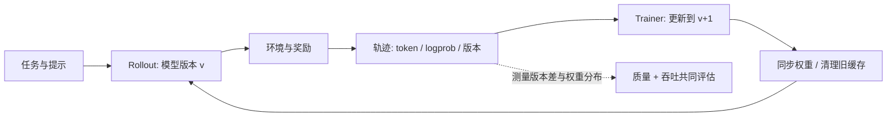
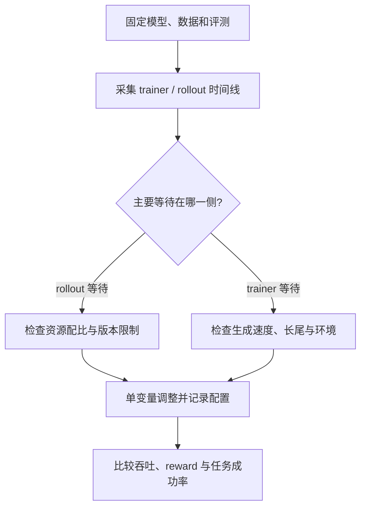

# Dispatch 47 · 910B 异步 RL：吞吐、策略滞后与训推一致性

*2026-11-12 · NPU Frontier Dispatch · Ascend 910B / verl / vLLM-Ascend*

> **30 秒速读**：先用时间线找出训练或采样在哪一侧等待，再单独调整资源配比。评估异步设置时，同时看吞吐、reward 和策略滞后。文中 910B 案例由 verl 团队报告，具体配置请按实际软件版本与硬件核对。

## 1 · 为什么要把系统与训练质量一起看

RL 后训练交替执行采样、打分与参数更新。异步化让训练与 rollout 部分重叠，但 rollout 可能由较旧的策略生成，吞吐增长并不自动意味着更快达到同等质量。应同时记录设备时间线、每秒有效 token、任务成功率、reward、策略版本差和重要性权重统计。延续 [D33 verl](../../reads/dispatch-33-verl.html) 与 [D46 Agentic RL 基础设施](../../reads/dispatch-46-dsec-mimo-rl-infra.html)，这里把两端接起来。

## 2 · 公开 910B 案例：资源平衡优先于单侧峰值

[verl 官方调优指南](https://verl-project.github.io/posts/2026-10-23-async-rl-training-tuning/)报告了 Ascend 910B 上的三组案例。**作者报告**：Qwen3-30B 案例减少 rollout 资源后，端到端吞吐约提升 25%；Qwen3.5-35B 随 staleness 增大，等待时间收益逐渐饱和，reward 波动增大；Qwen3-Omni 在显存允许时提高每卡 PPO token 预算，吞吐约提升 10%。指南说明没有披露完整运行配置，不能据此直接复现或外推到任意任务。

先看时间线：rollout 等训练，可能需要减少 rollout 资源或检查版本限制；训练等样本，检查生成速率、长尾与环境等待。再逐项改变资源比例、token 预算和异步程度，固定其余配置，在同等评测集和相近预算下比较。原指南说明 Q4 路线图计划将 fully async 从主分支移至 verl-recipe，具体以实际版本为准。

## 3 · 训推一致性：先定义数据契约

[vLLM-Ascend 官方 RL 文档](https://docs.vllm.ai/projects/ascend/en/latest/user_guide/feature_guide/rl.html)描述同卡与分卡两条路线。同卡场景可用 sleep mode 释放 rollout 显存，并使用 IPC 传输权重；分卡场景可在更新时暂停生成，通过 HCCL 传输。sleep level 2 丢弃权重与 KV，恢复时先恢复权重分配、装载新权重，再恢复 KV。额外清理可能要求重建 HCCL 组与重捕获图，具体行为以版本为准。

一条可审计轨迹至少保留模型版本、token ID、行为策略 logprob、采样配置、奖励及任务版本；MoE 场景还要在支持时记录专家路由。文档中的 Router Replay 捕获专家选择，Sampling Mask 保存采样后支持集；只有训练端也正确消费这些信息才构成完整对齐。文档同时提示，暂停模式 `keep` 可能使同一请求跨越不同权重版本，需要严格版本边界的任务应使用合适的暂停策略并验证。

## 4 · 值得跟踪的研究

- [GMC-GRPO](https://arxiv.org/abs/2610.01896) 研究异步 GRPO 中过期轨迹的方差与偏差，提出 group-mass capping。作者报告在较大 rollout 延迟下的实验更稳健；这是预印本，非 910B 性能证明。
- [Agentic-OPD](https://arxiv.org/abs/2611.12799) 观察到同一 RL 训练中不同 checkpoint 的能力互补，提出从历史 checkpoint 选择教师并针对学生失败轨迹蒸馏。它可以补充 [D38 蒸馏与 RL](../../reads/dispatch-38-distillation-vs-rl.html)，但仍需独立验证。

## 5 · 910B 最小实验记录：方案，不是结果

以实际可用的小模型和单节点资源为起点，锁定模型与数据版本，先完成同步训练基线，再只改变一项异步设置。至少记录：芯片型号与卡数、固件/CANN/torch_npu/verl/推理引擎版本、模型与数据修订、随机种子、并行策略、输入输出长度、训练步数、设备时间线、显存、有效 token/s、奖励和固定评测集结果。记录失败运行及成本，保存原始日志和配置，标出中断与重试。尚无真实训练数据时，不能用模拟曲线标作实验。

## 来源与边界

主要依据为 [verl 910B 调优指南](https://verl-project.github.io/posts/2026-10-23-async-rl-training-tuning/)、[vLLM-Ascend RL 文档](https://docs.vllm.ai/projects/ascend/en/latest/user_guide/feature_guide/rl.html)、[GMC-GRPO](https://arxiv.org/abs/2610.01896) 与 [Agentic-OPD](https://arxiv.org/abs/2611.12799)。前两者为项目作者文档，后两者为研究预印本；本站没有执行 NPU 实验，也未独立复现论文结果。指南未给完整配置，不能作为开箱即用的复现配方。
