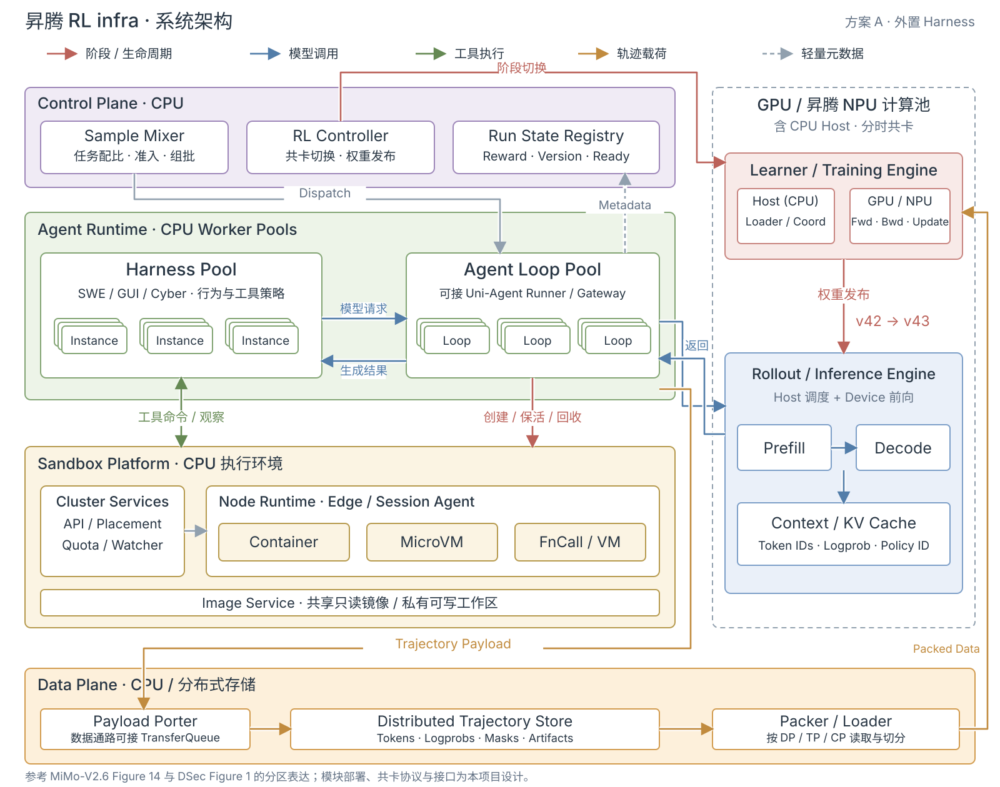
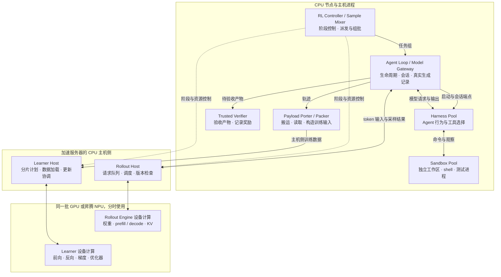
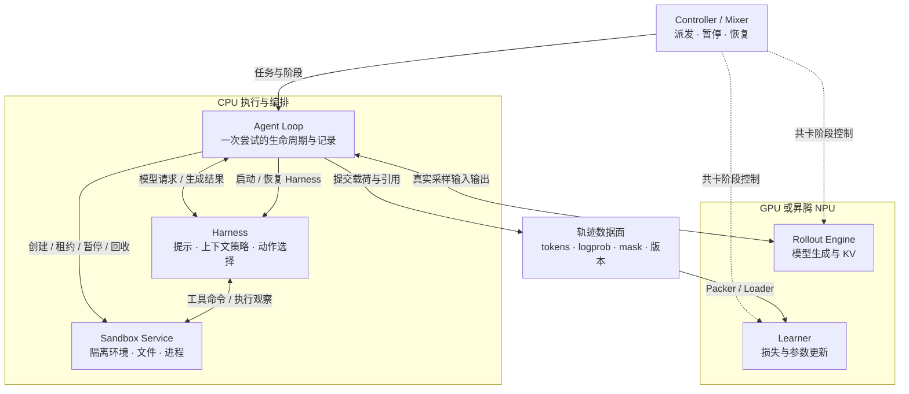
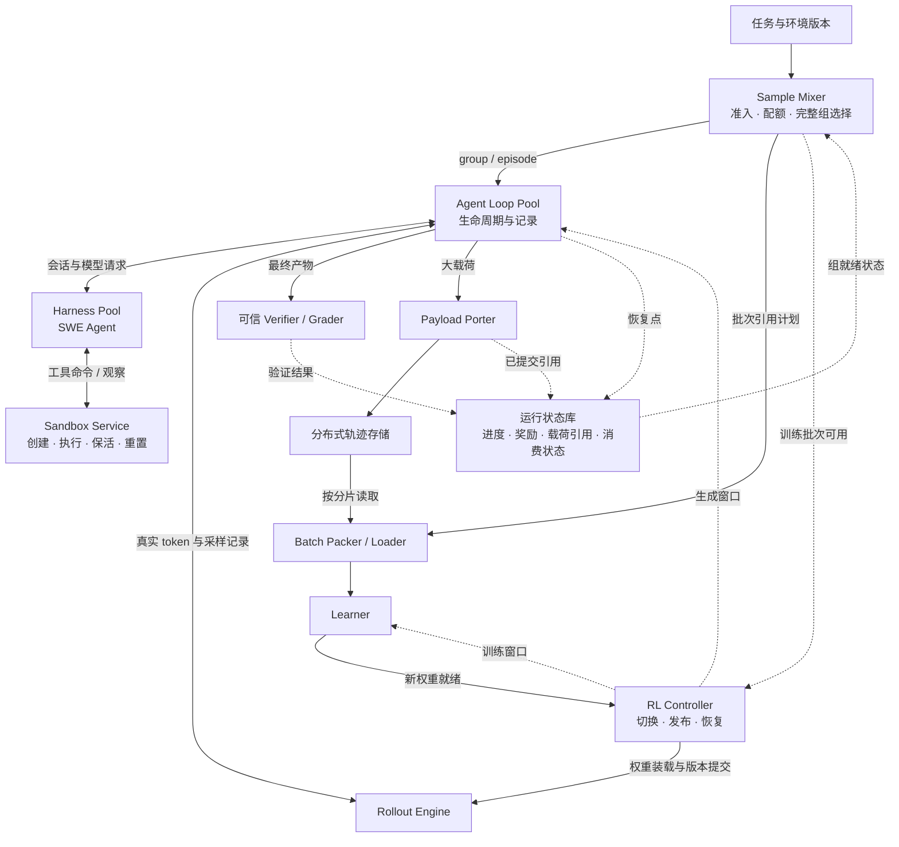
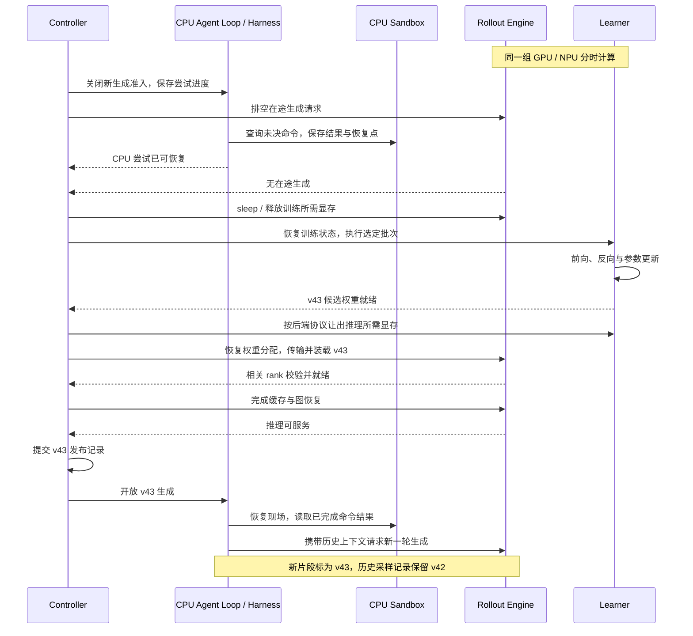

# Dispatch 48 · 昇腾 RL infra

*2026-11-20 · NPU Frontier Dispatch · Sandbox / Harness / Rollout / Learner*

昇腾 RL infra 面向多任务、多 Harness 的 Agentic RL，协调模型计算、Agent 决策与隔离环境执行。本报告以 DeepSWE 编码任务为实例，说明 CPU 与 NPU 分工及共卡跨步方案。建议将长期存活的会话与环境放在 CPU 执行层，将模型生成和梯度更新放在 GPU 或昇腾 NPU 计算层，通过明确的阶段协议分时共卡。已经完成并通过数据验收的题目组进入训练队列，未完成尝试保存现场，在后续生成窗口继续。

本文承接 [D46 DSec 与 MiMo 基础设施](../../reads/dispatch-46-dsec-mimo-rl-infra.html) 和 [D47 910B 异步 RL](../../reads/dispatch-47-910b-async-rl.html)。下文的拓扑、版本字段、切换协议和实验顺序均为面向本项目的实施设计。DeepSWE 实例中已有观察是开启 512 个沙箱时，部分环境的采样 CPU 用量低于 0.01 核；节点总体用量、峰值和采样窗口仍需复核。本文的 v42、v43 与题目组数字均用于解释机制。

## 0 架构总览怎样读

大框划分职责与资源边界，小框表示模块，叠放方框表示一个池承载多个独立实例。实现可以将相邻的可信模块放在同一进程，按接口保持可替换性。先沿左侧 CPU 任务执行链路读图，再看右侧模型计算，最后沿底部数据面回到 Learner。

*架构总览采用嵌套模块、池化实例和分类连线，将 CPU 控制面、Harness Pool、Agent Loop Pool、Sandbox Platform、轨迹数据面，以及共卡的 Learner 与 Rollout Engine 放在一张图中。红线表示阶段与生命周期控制，蓝线表示模型调用，绿线表示工具执行，橙线表示轨迹载荷，灰色虚线表示轻量元数据。沙箱后端按实际任务选择，共卡阶段由 Controller 协调。*

分区表达参考 MiMo-V2.6 Figure 14 的控制面、数据面和执行池，以及 DSec Figure 1 的集群服务、节点运行时和后端展开方式。图中的组件部署、独立接口、资源布局与共卡协议属于本项目的集成设计，图中规模符号表示池化实例，实际容量由实验确定。[MiMo Figure 14](https://arxiv.org/html/2610.11959v1#S6)、[DSec Figure 1](https://arxiv.org/html/2609.22978v1#S3)

### 上方控制面决定发什么任务以及何时切换设备

Sample Mixer 管任务供给，依据目标训练配比、各源耗时、组接受率和资源预算派发尝试。RL Controller 管训练与生成阶段，协调停止新生成、显存装卸、参数更新和权重发布。Run State Registry 保存组成员、尝试进度、奖励、策略版本、载荷引用和批次消费状态。三者配合后，调度器能够依据元数据判断训练条件，执行端能够查询自己的恢复位置。

图中 Dispatch 箭头将一次尝试交给 Agent Loop，向上的 Metadata 箭头汇报其进度和结果。Mixer 选好批次后，还要把组 ID、载荷引用和打包计划交给 Packer。该计划形成底部数据面读取哪些记录的依据。Controller 只有在生成已停止、训练批次已就绪且设备状态可切换时，才能进入训练阶段。

### 中间执行池将 Agent 行为与任务运行分别管理

Harness 根据提示、历史观察和上下文策略组织下一步请求，解析模型动作并选择工具。Agent Loop 为这次尝试提供模型端点，维护环境生命周期，记录实际输入输出 token、行为 logprob、策略版本和结束状态。它们通过双向蓝线完成一次模型调用，再通过绿线与执行环境交互。

| 模块 | 管理的核心状态 | 对外提供的能力 |
|---|---|---|
| Harness | 行为配置、上下文组织、待决动作 | 组织模型请求，选择工具，处理观察 |
| Agent Loop | 尝试身份、模型请求、轨迹记录、恢复位置 | 启动与恢复一次尝试，连接推理并导出训练记录 |
| Sandbox | 工作目录、进程、命令状态、环境租约 | 隔离执行、查询结果、保活、暂停和重置 |

这三个模块可以分别设计和替换。第一版可以让 Harness 与 Agent Loop 共用 CPU Worker，通过 Sandbox Adapter 访问独立执行服务。每条尝试的状态分别保留，常驻 Host 则复用代码、连接和事件循环。重连时，要把待决动作、模型请求和命令结果对齐到同一次尝试。

### 下方沙箱平台保留任务现场并调度真实执行

Cluster Services 管鉴权、配额、放置和节点状态，Node Runtime 管本机环境的生命周期与会话。普通 SWE 任务可先使用容器后端，再按隔离与功能要求引入 MicroVM 或其他后端。底层 Image Service 复用只读镜像，每次独立尝试保留私有可写工作区。

绿线表示命令和观察往返，红线表示创建、保活与回收等生命周期操作。一次模型生成期间，沙箱可以低资源驻留；测试运行期间，它可能短时占用较多 CPU 和 I/O。因此环境存活、普通工具执行和重测试应分别设配额。你观察到部分环境 CPU 低于 0.01 核，可以作为研究高密度驻留的起点，具体并发上限仍需结合节点内存、I/O 和执行峰值测量。

最终验收由可信 Verifier 管理，待测代码在隔离环境内执行。Verifier 的结果与载荷提交状态一起决定组是否就绪。中间测试日志用于指导 Agent，最终奖励按固定的任务与验证版本产生。

### 右侧模型计算池交替执行生成和训练

Rollout Engine 接收 Agent Loop 的模型请求，执行 prefill 与 decode，并返回生成 token 和采样记录。图中的两个计算框表示引擎内的计算阶段，Context / KV Cache 保存可复用的上下文计算状态，生成记录关联实际使用的策略版本。

Learner 通过主机侧 Loader 获取打包数据，在设备侧执行训练前向、反向与参数更新。Packed Data 箭头表示训练引擎接收数据，实际传输与预处理由 CPU 主机侧协调，再将需要的张量送入设备。显存中的参数、梯度和优化器状态由所选训练后端管理。

虚线大框表示这两套引擎分时共用同一批 GPU/NPU。生成窗口内，CPU 上多个 Agent 可以交错调用模型和工具；训练窗口内，具备运行条件的 CPU 工具与验证任务可以继续执行，新模型请求等待下一生成窗口。CPU 执行状态的连续性让切换时能够保留长任务的进度。

权重箭头表示 Controller 协调一次策略发布。v42 是此前可服务的策略快照，Learner 更新后准备 v43，相关推理 rank 装载并确认就绪后再开放生成。续采时保存历史上下文，按新权重重建所需 KV；每段实际生成的行为 logprob 和版本继续保留，以支持训练端处理跨版本轨迹。

### 底部数据面将执行记录变成训练输入

Payload Porter 接收轨迹载荷并返回引用，Distributed Trajectory Store 保存 token、行为概率、mask 和任务产物，Packer / Loader 根据批次计划读取并组织训练分片。这样，控制面可以按引用调度，大体积数据在生产侧与消费侧之间流转。

载荷成功提交后，状态库才能发布可读引用。完整组还需满足成员终态、奖励和数据规则，才能进入可消费队列。训练框架规定的组过滤、优势计算与打包步骤都要保持可追溯。消费记录与 learner checkpoint 协调保存，故障恢复时据此核对哪些更新已经完成。

### 沿一组修 Bug 任务走完闭环

1. Mixer 派发同一道题的多次独立尝试，Agent Loop 分配身份、创建环境并启动 Harness。
2. Harness 反复请求模型生成动作、让 Sandbox 执行命令并读取观察，Agent Loop 持续记录实际生成数据。
3. 尝试结束后验收补丁并提交载荷。组满足训练规则后，Mixer 将其纳入批次，Packer 依计划读取数据。
4. Controller 协调共卡切换，Learner 更新参数并准备新策略。发布完成后开放生成，尚未结束的尝试从保存的现场继续。

图中五类连线可以直接用于定位等待。模型等待时间长时，检查蓝线两端的请求队列、KV 和 prefill/decode；命令返回慢时，检查绿线两端的测试排队、CPU 和 I/O；learner 等数据时，沿 Metadata、组验收和橙色数据路径检查供给；阶段切换耗时高时，分别测量红线涉及的排空、显存装卸、权重传输与引擎恢复。

## 1 四个模块分别运行在哪里

Sandbox 执行命令和保存工作区，Harness 组织 Agent 的提示、工具与行为，Rollout Engine 执行模型前向生成，Learner 执行训练计算。一次完整 rollout 还包含 CPU 上的多轮交互、环境等待和验证。推理引擎只是这段工作流中的模型计算部分。

*图 1 为硬件部署建议。CPU 执行层可以先部署在现有节点，也可以独立扩容。加速服务器本身也有 CPU，Rollout 与 Learner 都有主机侧进程和设备侧计算。共卡表示它们轮流占用同一组设备，具体参数、梯度与优化器状态的驻留和卸载由训练后端管理。*

普通 SWE 的文件编辑和 CPU 测试可以在 CPU 沙箱完成。需要 GPU/NPU 的算子或模型测试，可连接受配额管理的设备验收池，并记录设备、驱动和测试版本。若验收复用训练设备，就必须纳入同一个设备资源调度，测量其对训练的干扰。

### Sandbox、Harness 与 Agent Loop 的独立模块边界

三者可以分别开发、测试和替换。建议先定义独立接口，在第一版把 Harness 与 Agent Loop 放在同一 CPU Worker，通过适配器访问 Sandbox Service。需要不同语言、依赖隔离或独立扩缩容时，再调整进程和节点部署。下图按外置 Harness 绘制。

*图 2 为三个模块独立设计的架构建议。Agent Loop 控制尝试与环境生命周期，Harness 发起模型请求并选择工具，Sandbox 返回执行观察。Harness 与 Agent Loop 可以同进程部署，模型前向和训练计算在 GPU/NPU 上执行。*

| 模块 | 回答的问题 | 建议接口 | 状态归属 |
|---|---|---|---|
| Harness | 下一步怎样完成任务 | start、handle_model_result、handle_tool_result、export_state | 行为配置、上下文组织、待执行动作与可恢复进度 |
| Agent Loop | 这次尝试怎样执行、记录与恢复 | run_episode、generate、checkpoint、resume、finalize | episode 身份、模型请求、实际采样记录、恢复点与结束状态 |
| Sandbox Service | 命令在哪里执行，现场如何保留 | create、exec、get_command、pause、resume、reset、destroy | 文件与进程、命令结果、环境修订与租约 |

操作时，Agent Loop 创建环境并把受限的模型端点和工具适配器交给 Harness。Harness 请求模型生成“运行测试”的动作，再调用 Sandbox 执行。Sandbox 将结果返回 Harness，后者组织下一轮上下文。Agent Loop 记录每次真实生成并管理最终验证和清理。工具适配器将命令及可见输出登记到统一事件记录，使用 episode_id、sandbox_id、generation_id 和 command_id 关联。

这里将 Agent Loop 定义为一次尝试的运行与记录外壳，Harness 封装具体 Agent 行为。若现有框架的 AgentLoop 已经实现 ReAct 决策循环，可以把 Harness 做成其行为插件，复用现有循环。框架中的同名组件应按实际职责映射。

模块间调用可通过函数、进程消息或 RPC 实现。控制器重连时，同时恢复 Harness 的待决动作、Agent Loop 的请求状态和 Sandbox 的命令状态。对仅支持整进程运行的现成 CLI，还需要进程保活或实际 checkpoint 能力；对话记录只能恢复其已记录的信息。环境执行可以继续时，训练窗口内的新模型请求进入等待队列，待已发布策略可服务后再放行。

MiMo 把 Harness 与 Agent Loop 分别池化，Payload Porter 通过分布式存储让调度器只处理轻量引用，Sample Mixer 维护混合任务训练配比。这些机制可分别借鉴到执行、传输与供数层。[MiMo §6.1–6.3](https://arxiv.org/html/2610.11959v1#S6)

## 2 控制链路与数据链路怎样接起来

下面采用外置 Harness。它运行在可信 CPU Worker 内，通过远程执行接口操作沙箱。Agent Loop 为每次尝试管理生命周期与模型端点；Harness 根据模型输出决定下一次工具动作。实现可以把两者放在同一进程，接口上仍需明确所有权。

*图 3 为集成架构建议。实线表示任务、调用与数据，虚线表示状态和阶段控制。镜像与环境工作区存储由 Sandbox Service 管理，轨迹存储由数据面管理，二者按不同访问模式规划。*

| 接口 | 发出什么 | 接收方完成什么 |
|---|---|---|
| Mixer → Agent Loop | 题目、组 ID、尝试 ID、环境和 Harness 修订 | 建立可追溯的一次尝试 |
| Harness → 模型端点 | 当前上下文、采样参数、生成请求 ID | 路由到已发布策略并记录真实采样 |
| Harness → Sandbox | 命令 ID、参数、目录、超时 | 执行并保存可查询结果 |
| Agent Loop → Verifier | 补丁或最终产物引用、任务与验证修订 | 生成可信奖励与报告 |
| Porter → 状态库 | 已提交的载荷引用、大小、摘要 | 让调度器在数据可读后发布就绪状态 |
| Mixer → Packer | 选定组、长度、训练信号与载荷引用 | 构造当前 DP/TP/CP 布局需要的数据 |
| Controller → 引擎 | 阶段、目标策略版本、权重来源 | 完成切换并确认设备侧就绪 |

这些字段是内部接口语义示例。接入 verl 时，应优先映射现有 AgentLoop、rollout、训练后端和权重同步接口，避免建立重复的任务调度或生成服务。

首次启动按依赖顺序准备存储与状态库，启动 Sandbox Service，再启动带固定模型版本的 Rollout Engine 和 Learner 进程，完成设备显存管理与权重同步接线。随后启动 Agent Loop / Harness Host，将模型会话端点和 Sandbox Adapter 注入每次尝试。Controller 确认初始策略可服务后，Mixer 开始派发。Learner 进程可以等待训练窗口，设备侧训练状态按后端策略装卸。

## 3 用一次修 Bug 的任务串起操作

假设题目 task-A 每组采样 K=8 次，组 ID 为 group-A。每次尝试拥有自己的 episode ID 和私有可写工作区，组内使用一致的任务、Harness 和验收配置。以下步骤是建议的运行顺序。

1. Mixer 检查在途组、环境、推理 KV 和数据存储预算，接纳 group-A，逐项登记八次尝试。
2. Agent Loop 申请环境租约并启动 Harness。Sandbox Service 使用指定镜像建立独立工作区，返回可执行的会话。
3. Harness 将题目和工具定义发给模型端点。Rollout Engine 使用当前策略 v42 生成动作，记录输出 token 和实际行为 logprob。
4. Harness 调用 read、edit、test 等工具。沙箱返回命令状态、输出和退出码，Harness 将可见结果纳入下一轮上下文。
5. 尝试结束后提交补丁，可信 Verifier 执行最终验收。Agent 的自述和中间测试日志可辅助排查，最终奖励按指定验证流程产生。
6. Porter 提交载荷，状态库登记引用与验证结果。失败重试通过独立 attempt ID 和原尝试关联，保持去重与审计。
7. 八次尝试满足终态、载荷和奖励条件后，组过滤与训练信号计算决定该组是否可消费。正常解题失败也可能提供有效负样本；基础设施故障按预定规则重试或处理整组。
8. Mixer 收集满足配比和滞后限制的组，生成 batch ID，Controller 协调进入训练窗口。

若使用分支或上下文压缩，一次尝试可能导出多个 Context。组成员按独立尝试计数，训练适配器要处理各 Context 的学习信号和重叠前缀计权。

Verifier 的控制进程与奖励记录保持可信，待测代码在隔离环境内执行。可以把最终补丁应用到干净的验证环境，使用受保护的测试与配置，减少 Agent 对原工作区验收逻辑的修改影响。具体采用哪种验证路径要固定在任务版本里，并计入验证资源预算。

## 4 v43 是什么

v43 是示意性的策略发布编号，代表一份已经装载并允许生成的模型权重快照。在例子里，Learner 从 v42 对应的参数继续更新，准备出下一份权重，Controller 完成发布后将其标为 v43。数字 43 与模型品牌、参数量、GPU 编号和工具轮次分别使用不同字段表示。

一次发布可以包含一个或多个 optimizer step，也可以因为恢复、验证或发布频率而跳过若干训练步。系统需要同时记录训练进度、发布版本和引擎实例。重启后重新加载同一份权重，可以沿用原策略 ID，并分配新的实例 ID。

| 字段 | 示例 | 作用 |
|---|---|---|
| run_id | rl-run-A | 区分独立训练运行 |
| policy_id | rl-run-A/p43 | 标识不可变的已发布策略 |
| parent_policy_id | rl-run-A/p42 | 追踪权重来源 |
| optimizer_step | 1200 | 记录真实训练进度，数值为示例 |
| weights_digest | 权重清单摘要 | 校验目标权重制品或分片清单 |
| inference_config_digest | tokenizer、模板、量化等配置摘要 | 标识影响生成行为的推理配置 |
| publication_state | PREPARING / COMMITTED | 区分准备中和可服务状态 |

这些是本项目建议字段。权重重切分或量化后，各 rank 校验应使用对应分片与转换配置；训练权重文件的摘要无法直接替代转换后推理张量的校验。跨版本统计按同一 run 的发布序号和 lineage 计算，回滚与分支需要另行处理。

## 5 共卡时怎样从 v42 切到 v43

*图 4 为共卡操作协议。第一版选择排空当前生成请求，在工具轮次之间续接。长解码可增加经验证的中断与续接机制。排空生成的等待、设备卸载、训练状态恢复、权重传输和推理恢复应分别计时。*

vLLM-Ascend 官方文档描述同卡的 sleep mode 与 IPC 权重传输，以及分卡的 HCCL 传输。Level 2 sleep 会丢弃权重和 KV，恢复顺序为权重分配、装载新权重、KV 分配。额外清理可能增加 HCCL 和图恢复成本。具体调用顺序需与训练框架的显存与权重生命周期配合。[vLLM-Ascend RL 文档](https://docs.vllm.ai/projects/ascend/en/latest/user_guide/feature_guide/rl.html)

阶段门禁覆盖所有共享设备的参与进程。状态库先登记 PREPARING；相关 rank 和引擎恢复完成后提交 COMMITTED，Gateway 才接纳新请求。若传输中断，则保持生成关闭，通过完整目标权重或已知 checkpoint 恢复。重试发布使用相同目标 ID，避免产生不可追溯的中间版本。

## 6 跨步之后保留哪些状态

假设 group-A 有七次尝试完成，第八次正在执行测试。其他完整组已经足够训练时，可以保留 group-A，在下一生成窗口继续。以下采用整组验收与消费规则，超时、基础设施失败和组淘汰策略在实验前固定。

| 状态 | 所有者 | 跨步处理 |
|---|---|---|
| 对话、上下文谱系、下一步动作 | Agent Loop 与 Harness | 保存恢复点，模型请求在新窗口重发 |
| 代码修改、进程与命令结果 | Sandbox Service | 按资源压力驻留或暂停，恢复后查询未决命令 |
| 原始 token、行为 logprob、采样设置 | 轨迹记录与数据面 | 按生成片段保存，保留原始概率口径 |
| KV cache | Rollout Engine | 使用新权重续采时，根据上下文重建所需 KV |
| 奖励、组状态、消费批次 | 运行状态库 | 只对满足训练规则的完整组提交就绪状态 |
| 参数、优化器、训练进度 | Learner | checkpoint 与批次消费记录协调恢复 |

新窗口可能对历史 v42 上下文使用 v43 继续生成，因此一条尝试可以包含多个行为策略。每次生成记录明确的版本、token 范围和行为 logprob。训练适配器需要支持对应的 off-policy 处理，并监测重要性比率、clip fraction、KL 和任务效果。最大策略滞后限制只能约束数据年龄，训练正确性仍取决于损失实现和数据语义。

旧前缀经过新权重重算时，可以为训练计算新的概率，但原始行为 logprob 另行保留。单个 decode 请求跨权重更新还会引入更细粒度的混合状态。第一版在生成调用边界切换，待片段级记录与训练处理验证后再扩大中断范围。

## 7 沙箱保活、暂停和复用怎样区分

保活表示一次尝试仍然拥有其环境。短等待可以保持低资源驻留，较长等待可以冻结进程、回收内存或保存快照。执行中的测试可继续运行并提交结果，或按后端能力暂停；无论选择哪一种，都要在恢复点中写清未决命令的状态。

DSec 描述将 Worker 与 Agent Sandbox 放在可抢占训练池之外共同保留状态，并提供容器冻结与内存回收、MicroVM 快照恢复等机制。环境状态和 Agent 进度需要一起保留。[DSec §6.2–6.3](https://arxiv.org/html/2609.22978v1#S6)

尝试结束后的复用需要回到指定初始环境，清理私有可写层、后台进程、会话和凭据，并验收重置结果。镜像缓存与只读基础层可以共享，每条独立尝试的修改单独保存。异步命令带 command ID，控制端重连先查询结果，防止重复执行安装、修改文件等有副作用操作。节点故障后的恢复能力取决于已持久化的数据和后端 checkpoint 能力。

## 8 512 路环境怎样配资源

将四项容量分别设置。环境驻留数受内存和存储约束，工具执行数受 CPU 和 I/O 约束，重测试数受峰值资源约束，生成并发受模型、KV 与排队延迟约束。512 个环境里，部分可以等待模型，部分执行命令，部分已完成并等待组内其他成员。

| 容量 | 控制位置 | 观测信号 |
|---|---|---|
| 在途组与独立尝试 | Mixer | 各数据源缺额、策略滞后、长任务完成比例 |
| 存活环境 | Sandbox Service | 节点内存、swap、磁盘、镜像缓存与租约 |
| 普通工具与重测试执行 | 节点执行队列 | CPU 峰值、I/O、排队时间、超时 |
| 推理请求与上下文 | Rollout Host | ready 请求、KV 占用、prefill/decode 延迟 |
| 轨迹载荷 | 数据面 | 未消费字节数、读写带宽、持久化延迟 |

若用 K=8 作容量算例，512 次独立尝试对应 64 组；这是计数换算。实际每题采样数、平均 Context 数和生成次数应来自运行配置。Harness Host 可以承载多个并发会话，阻塞工具调用和 tokenization 放到受控线程或进程，测量宿主 CPU 与事件循环延迟。

混合任务时，建议以最终接受的训练组配比为目标，同时用任务耗时和组接受率估计在途预算。慢任务提前派发可提高供数稳定性，还要追踪较慢任务内部的难题是否持续滞留。调优时同时记录派发、完成、接受、消费四种分布。

## 9 三阶段落地和验收

| 阶段 | 实施范围 | 完成条件 |
|---|---|---|
| A 同步共卡闭环 | 一个 SWE Harness、单一环境后端、真实采样记录、可信验证、完整组、权重发布 | 能追溯一次尝试如何进入批次，下一次生成确实使用已提交权重 |
| B 512 路资源优化 | 常驻执行池、旁路传输、重测试限流、环境租约与恢复记录 | 在固定模型和数据下测得有效组吞吐、训练等待和节点峰值，保留同预算质量结果 |
| C 共卡跨步组流式 | 可恢复的未完成尝试、策略滞后限制、片段版本记录、混合数据源预算 | 恢复与重试不重复工具副作用，训练支持跨版本数据，长任务消费和固定评测达标 |

验收场景覆盖载荷写入后通知丢失、Worker 重连、命令执行后响应丢失、部分 rank 装载失败，以及 learner 更新与消费记录之间的中断。目标是让恢复后的状态可以与日志、checkpoint 和批次记录核对。

每次实验记录模型、任务与环境修订、芯片及卡数、CANN / torch_npu / 训练和推理版本、并行策略、长度分布、随机种子和预算。分别测量排空、卸载、训练、权重装载、缓存恢复、工具排队和验证时间，再比较有效训练组吞吐及同预算任务效果。

## 10 来源与方案边界

| 来源 | 本文采用的机制 | 在本项目中需要验证的部分 |
|---|---|---|
| MiMo §6 | Agent Loop、Harness 池化、载荷引用与混合任务供数 | 与现有框架的接口映射、版本记录、训练数据消费 |
| DSec §6 | 环境与执行状态跨训练作业保留、暂停恢复 | 实际后端的内存回收、命令恢复、环境重置 |
| vLLM-Ascend 官方 RL 文档 | 同卡 sleep、权重传输、暂停恢复的基础能力 | 目标芯片、模型与固定软件版本下的正确性和切换成本 |

部署图、状态契约、v42→v43 协议与分阶段验收均为集成设计。昇腾 RL infra 在具体任务上的跨步收益、可承载密度和训练效果需要通过上述实验获得。

来源链接见 [MiMo-V2.6 技术报告](https://arxiv.org/html/2610.11959v1#S6)、[DSec 技术报告](https://arxiv.org/html/2609.22978v1#S6)、[vLLM-Ascend RL 文档](https://docs.vllm.ai/projects/ascend/en/latest/user_guide/feature_guide/rl.html)。网页能力核对日期为 2026-11-20，复现实验应固定实际安装版本。
